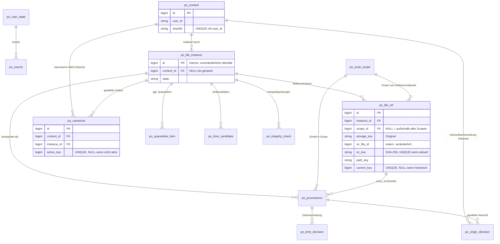
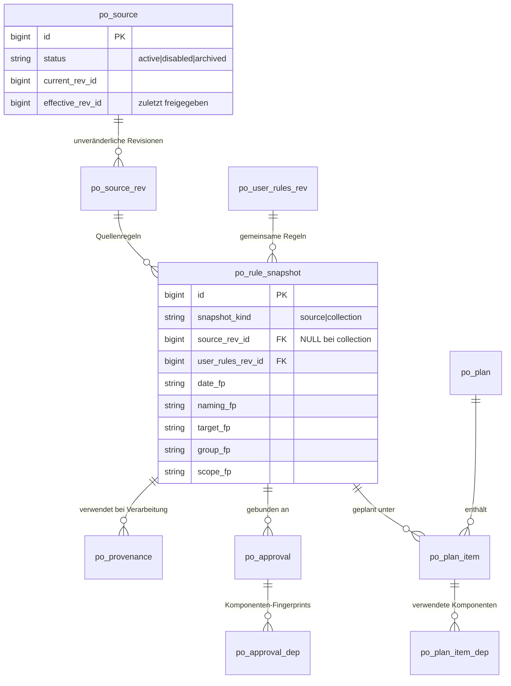
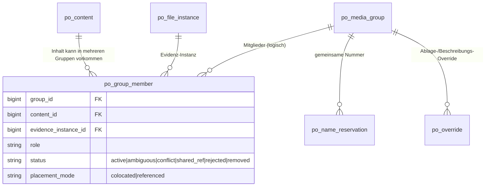
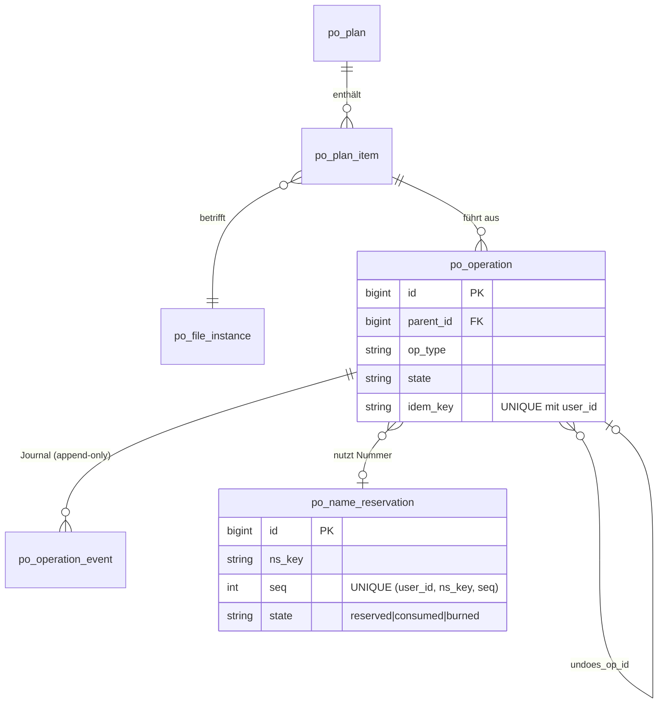
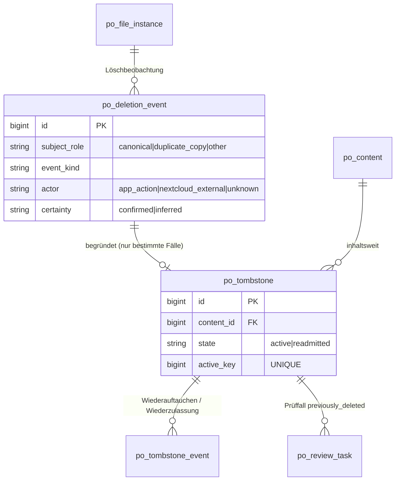
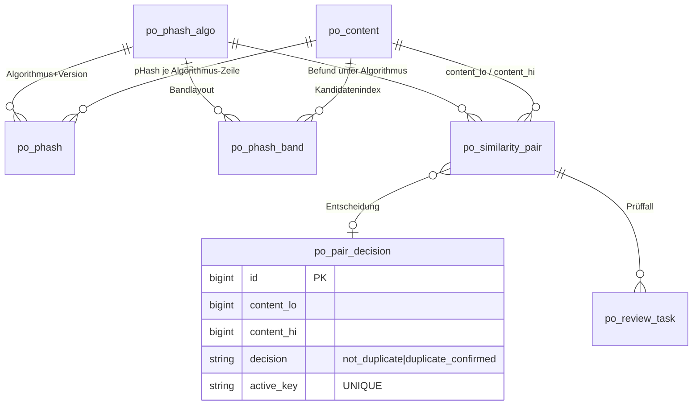
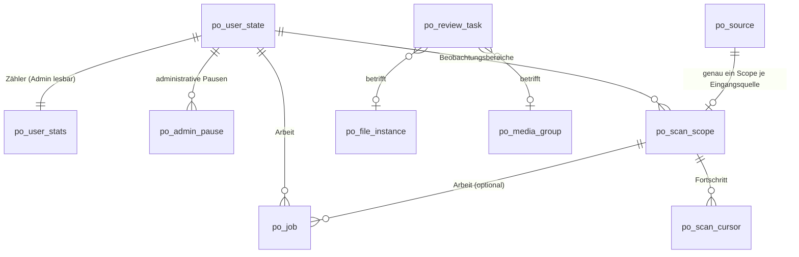

# Datenmodell (konzeptionell-relational)

Stand: 2026-10-09 · Runde 4b (Abschnitt 24: Korrekturen an Operationen, Jobs, Integrität) · Runde 4 (Abschnitt 23) · davor Runde 3b · Status: **Entwurf [T] zur Freigabe**. Kein SQL, keine Migration, kein Code.

> **Runde 3b:** Änderungen gegenüber Runde 3 sind im Text mit **(3b)** markiert; die Begründungen und neuen Abschnitte stehen in den Abschnitten 14–22. Neue technische Lösungen sind Vorschläge **[Z]**, bis sie freigegeben sind.

Verbindliche Entscheidungen (`DEC-…`) haben Vorrang. Wo das Modell über sie hinausgeht, steht **[Z]** = *zu bestätigender Vorschlag* mit Verweis auf `open-questions.md` Abschnitt „Runde 3“. **[T]** = technischer Vorschlag, **[V]** = bereits verbindlich beschlossen.

Dieses Dokument enthält das Schema (Abschnitte 1–8), die Spezialfälle (9: gemeinsamer JPEG, 10: Invarianten), Portabilität/Performance (11–12), Abweichungen (13) und die Überarbeitung nach dem Review (14–22: Scan-Scopes, Herkunftsentscheidung, Fencing, Integrität, pHash, Provenance-Ereignisse, Schlüssel, Konsistenzprüfung). Datenbeispiele: `data-model-examples.md`. Job-Zustandsautomat: Auftrag 4 (hier nur Spalten, keine Übergänge).

---

## 1. Konventionen

### 1.1 Namen, Typen, Portabilität
| Thema | Festlegung [T] |
|---|---|
| Tabellenpräfix | `po_` (Nextcloud ergänzt eigenen Präfix). Tabellennamen ≤ 24 Zeichen, Spaltennamen ≤ 30 (Nextcloud-/Oracle-Grenzen; **genaue Grenzen nicht verifiziert**, bewusst konservativ). |
| Typen | Nur Nextcloud-Schema-Typen: `BIGINT`, `INT`, `SMALLINT`, `STRING(n)`, `TEXT`, `BOOL`. Keine ENUM-, JSON-, ARRAY-, `TIMESTAMP WITH TIME ZONE`-Typen. |
| `TS` | `BIGINT` = Unix-Sekunden **UTC** für alle Systemzeitpunkte (Erstellung, Beobachtung). Kein Datenbank-Zeitstempeltyp (keine Zeitzonen-Konvertierung durch Treiber). |
| `LOCALSEC` | `BIGINT` = Sekunden seit 1970‑01‑01 00:00:00, **als Wanduhrzeit ohne Zeitzone** gelesen (naiv). Dient der Ablage-/Sortierzeit; wird nie zonenkonvertiert. |
| Enumerationen | `STRING(≤32)` mit festem Vokabular (hier gelistet), Prüfung in der Anwendung. Vokabulare sind **vorläufig**; Zustandsübergänge in Auftrag 4. |
| JSON-artiges | `TEXT`. Nie Gegenstand von Abfragen, Indizes oder Constraints. Nur für Konfigurationsmomentaufnahmen und Journal-Details. |
| Hashes | SHA-256 als `STRING(64)`, kleingeschriebenes Hex. |
| Pfade | `TEXT`, **relativ zum Benutzerordner**, `/`‑getrennt (kein absoluter Linux-Pfad, `DEC-ARC-003`). Nie indiziert; Indexierung über `path_key = STRING(64)` (SHA-256 des normalisierten Pfads). |
| Boolesch | `BOOL`; Fallback `SMALLINT 0/1`, falls ein unterstütztes DBMS Probleme macht (unverifiziert). |
| Surrogatschlüssel | `id BIGINT` mit Autoinkrement (Nextcloud-Schema-Mechanismus). Ist die **unveränderliche interne Identität** (siehe 2). |
| Mandant | Jede Tabelle (außer `po_admin_pause`, `po_lease` mit globalem Schlüssel) trägt `user_id STRING(64)`. Siehe 1.3. |
| Partielle/funktionale Indizes | **Nicht** vorausgesetzt. Muster „höchstens ein aktiver Datensatz“ → Spalte `active_key` (NULL wenn inaktiv, sonst Wert) mit `UNIQUE`; setzt voraus, dass mehrere NULL-Werte in einem Unique-Index zulässig sind (MySQL/MariaDB, PostgreSQL, Oracle: ja; **gegen jedes unterstützte DBMS zu testen**). |
| Fremdschlüssel | Im Modell als *logische* FK dokumentiert. Ob physische FK-Constraints in Nextcloud-Migrationen zulässig/üblich sind, ist **nicht verifiziert**; Integrität wird daher in der Anwendung und durch periodische Konsistenzprüfung gesichert (`job-processing.md`, Auftrag 4). |
| Zusammengesetzte Schlüssel (3b) | Jeder zusammengesetzte oder abgeleitete Schlüssel hat eine **berechnete Maximallänge** (Abschnitt 21). Passt die Zusammensetzung nicht sicher in die Spalte, wird ein SHA-256-Hex (64 Zeichen) über eine **längenpräfixierte Kodierung** gebildet; die Ausgangswerte bleiben in eigenen Spalten erhalten. Kein Schlüssel wird je gekürzt. |
| Namen (3b) | Originalnamen und Zielnamen werden in `TEXT` gespeichert (nie indiziert), weil die tatsächliche Längengrenze von Nextcloud und Storage nicht verifiziert ist und `STRING(255)` Zeichen/Bytes je DBMS unterschiedlich zählt (Abschnitt 22.6). |
| Optimistische Sperre | Tabellen mit gleichzeitiger Änderung tragen `version INT`; Update `… WHERE id=? AND version=?`. |

### 1.2 Unveränderlichkeit
*immutable* = nach dem Einfügen **keine** Spalte mehr geändert. *append-only* = nur Einfügen, daneben ausdrücklich genannte Abschlussspalten (z. B. `current_key`). Korrekturen erfolgen durch neue Zeilen. Jede Tabelle ist in der **Mutabilitätsmatrix** (Abschnitt 22.1) mit den zugelassenen Spaltenänderungen eingetragen (3b); Texte der Tabellenbeschreibungen, die davon abweichen, sind Fehler.

### 1.3 Mandantentrennung [T]
- Jede Abfrage der User-API und der Jobs enthält `user_id = ?` als erste Indexspalte.
- Beziehungen zwischen Zeilen verschiedener Benutzer sind unzulässig. Jede Verknüpfung trägt `user_id`; bei Einfügen wird geprüft, dass die referenzierte Zeile denselben `user_id` hat (Anwendungs-Invariante; zusätzlich Konsistenzprüfung).
- **Admin-Zugriff:** Die Admin-API darf ausschließlich `po_user_state`, `po_admin_pause` und `po_user_stats` lesen (strukturell getrennter Zugriffscode, `DEC-USR-009`). Alle übrigen Tabellen enthalten Dateinamen, Pfade oder Hashes und sind für Admin-Code gesperrt.

### 1.4 Löschung und Aufbewahrung (Gesamtprinzip) [T]
| Klasse | Behandlung |
|---|---|
| Historie (Herkunft, Regelrevisionen, Journal, Tombstones, Reservierungen) | Nie physisch gelöscht, solange der Benutzer aktiv ist. Reservierungen **niemals** (`DEC-NAM-009`). |
| Arbeitsdaten (Jobs, Scan-Cursor, Leases) | Nach Abschluss und Karenz gelöscht (Retention in `job-processing.md`). |
| Benutzerlöschung / „Alle App-Daten löschen“ | Vollständiges Löschen aller Zeilen mit `user_id`, in Batches, in Abhängigkeitsreihenfolge (Kinder zuerst); `po_admin_pause` des Benutzers nur entaktiviert. Reservierungen und Tombstones eines gelöschten Benutzers sind ebenfalls zu löschen, da kein Nutzen. |
| Quellen | Nie gelöscht, sondern `archived` (Historie bleibt, `DEC`-Vorgabe Auftrag 3). Physische Löschung nur im Rahmen der Benutzerlöschung. |
| Dateiinhalte | `po_content` wird nur gelöscht, wenn keine Instanz, Herkunft, Tombstone, Gruppenmitgliedschaft, Paarentscheidung darauf zeigt (Garbage Collection mit Karenz). |

---

## 2. Identitätsmodell

Auftrag 3 verlangt die strikte Trennung von **Inhalt**, **physischer Instanz**, **externer Referenz**, **logischer Gruppenzugehörigkeit** und **kanonischer Auswahl**.

| Begriff | Tabelle | Bedeutung | Eigenschaften |
|---|---|---|---|
| **Inhalt (Content)** | `po_content` | Eindeutiger Dateiinhalt je Benutzer, identifiziert durch `(user_id, sha256)` (`DEC-DUP-001`). | Unveränderlich. Gemeinsam für alle byteidentischen Kopien. Träger von Tombstone, Kein‑Duplikat-Entscheidung, pHash. |
| **Dateiinstanz (File Instance)** | `po_file_instance` | Eine tatsächlich vorhandene (oder vorhanden gewesene) physische Datei. **Eigene unveränderliche interne ID.** | Bindet sich nach dem Hashing an genau einen Inhalt; ändert sich der Inhalt, wird die Instanz `superseded` und eine neue Instanz angelegt (`predecessor_instance_id`). |
| **Nextcloud-Referenz (File Ref)** | `po_file_ref` | Externe, **veränderliche** Lokalisierung: `nc_file_id`, Storage, Pfad. | Historie: neue Zeile bei jeder Änderung; höchstens eine aktuelle je Instanz. |
| **Gruppenzugehörigkeit** | `po_group_member` | *Logische* Zuordnung eines **Inhalts** zu einer Mediengruppe (mit Rolle), belegt durch Evidenz aus einer konkreten Instanz. | Mehrere Gruppen je Inhalt technisch möglich → Konfliktfall (Abschnitt 9). |
| **Kanonische Auswahl** | `po_canonical` | Welche **Instanz** realisiert den Inhalt in der Sammlung (`DEC-DUP-002`). | Höchstens eine aktive je `(user_id, content_id)`. |
| **Herkunft** | `po_provenance` | Historisches Ereignis „Instanz X ist in Scan-Scope S eingetreten (Eintritt = Referenzzeile) unter Regelsnapshot R“. | immutable (3b: Idempotenz über Eintritts-Referenz, Abschnitt 20). |
| **Scan-Scope** (3b) | `po_scan_scope` | Beobachtungsbereich: ein Eingangsordner (je Quelle) **oder** die bestehende Sammlung. Träger von Scan-Fortschritt und Herkunft, unabhängig von `po_source`. | Abschnitt 15. |
| **Herkunftsentscheidung** (3b) | `po_origin_decision` | Persistente, nachvollziehbare Entscheidung, welche Herkunft eines Inhalts gilt. Verändert nie `po_provenance`. | Abschnitt 16. |

Konsequenz [Z, `OQ-039`]: Die Anwendung darf `nc_file_id` **nicht** als Identität verwenden. Alle Fremdbeziehungen laufen über `po_file_instance.id`. Verschwindet eine `nc_file_id` (Move über Storage, Wiederherstellung aus Papierkorb mit neuer ID), wird die Instanz **nur dann** per `po_file_ref` mit neuer ID verknüpft, wenn die Wiedererkennung (Abschnitt 4.4) eindeutig ist; sonst Prüfaufgabe.

---

## 3. Entity-Relationship-Diagramme

Mehrere kleine Diagramme je Teilbereich. Attribute nur Schlüssel und wesentliche Felder; Vollständiges in den Abschnitten 4–8.

### 3.1 Kern: Inhalt, Instanz, Referenz, Kanon

### 3.2 Regeln, Quellen, Snapshots, Freigaben

### 3.3 Mediengruppen und Konfliktfall

### 3.4 Pläne, Operationen, Nummern

### 3.5 Löschung, Tombstone, Wiederzulassung

### 3.6 pHash und Prüfentscheidungen

### 3.7 Betrieb: Jobs, Leases, Prüfaufgaben, Statistik

---

## 4. Benutzer, Pausen, Regeln

### 4.1 `po_user_state`
**Zweck:** Persönliche Aktivierung und Pause je Benutzer (`DEC-USR-004/005/007`). Verarbeitungserlaubnis wird **nicht** gespeichert, sondern abgeleitet.

| Spalte | Typ | Null | Bedeutung |
|---|---|---|---|
| user_id | STRING(64) | nein | Nextcloud-Benutzer-ID (PK) |
| enabled | BOOL | nein | persönlich aktiviert (Default false; Installation startet nichts, `DEC-USR-005`) |
| enabled_at | TS | ja | NULL = nie aktiviert |
| user_paused | BOOL | nein | persönliche Pause |
| user_paused_at | TS | ja | |
| user_num | BIGINT | nein | (3b) kleine numerische Benutzerkennung für große Indizes (`po_phash_band`); von der Anwendung vergeben (Insert-und-Retry auf Maximum+1), eindeutig, nie wiederverwendet. Kein Ersatz für `user_id` als Mandantenschlüssel. |
| tz_iana | STRING(64) | ja | konfigurierte Benutzerzeitzone; NULL = nicht konfiguriert → Fallback (5.5) |
| current_rules_rev_id | BIGINT | ja | aktuelle `po_user_rules_rev` |
| effective_rules_rev_id | BIGINT | ja | zuletzt für Verarbeitung freigegebene Revision (OQ-042) |
| created_at / updated_at | TS | nein | |
| version | INT | nein | optimistische Sperre |

- **PK** `user_id`. **FK** `current_rules_rev_id`, `effective_rules_rev_id` → `po_user_rules_rev.id`.
- **Unique** PK; `(user_num)` (3b). **Indizes** `(enabled, user_paused)` für Scheduler-Scan aktiver Benutzer.
- **NULL:** `tz_iana IS NULL` ≠ UTC; es greift die Fallback-Kette (5.5).
- **Lebenszyklus:** angelegt bei erster Nutzung der App-Einstellungen (nicht bei Installation); nie gelöscht außer bei Benutzerlöschung.
- **Mandant:** Zeile gehört genau einem Benutzer. Admin darf lesen (Zustände), aber nicht `tz_iana`/Regelverweise (nur Spalten `enabled`, `user_paused` über Admin-DTO).
- **Invariante:** `processing_allowed(u) = enabled ∧ ¬user_paused ∧ ¬∃ aktive po_admin_pause(scope=user,u) ∧ ¬∃ aktive po_admin_pause(scope=global)`. Admin-Pause setzt nie `enabled`/`user_paused` (`DEC-USR-007`).

### 4.2 `po_admin_pause`
**Zweck:** Administrative Pausen (global oder je Benutzer) als eigene Historie, getrennt von der persönlichen Pause (`DEC-USR-006/007`). Keine Mediendaten.

| Spalte | Typ | Null | Bedeutung |
|---|---|---|---|
| id | BIGINT | nein | PK |
| scope | STRING(8) | nein | `global` \| `user` |
| user_id | STRING(64) | ja | NULL bei `global` |
| reason_code | STRING(32) | nein | kuratierter Code (kein Freitext mit Medienbezug) |
| set_by_uid | STRING(64) | nein | Administrator |
| set_at | TS | nein | |
| cleared_by_uid | STRING(64) | ja | |
| cleared_at | TS | ja | NULL = aktiv |
| active_key | STRING(80) | ja | `g` oder `u:<user_id>` solange aktiv, sonst NULL |

- **Unique** `(active_key)`: höchstens eine aktive globale und eine aktive Pause je Benutzer. **Indizes** `(user_id, cleared_at)`.
- **Lebenszyklus:** Setzen = Insert; Aufheben = Update `cleared_*`, `active_key=NULL`. **Aufbewahrung:** Historie behalten; bei Benutzerlöschung benutzerbezogene Zeilen löschen.
- **Race:** Zwei Admins setzen gleichzeitig → Unique-Verletzung = „bereits pausiert“ (idempotent behandeln).

### 4.3 `po_user_rules_rev` (immutable)
**Zweck:** Unveränderliche Revision der **gemeinsamen** (quellenübergreifenden) Regeln eines Benutzers: Sammlungsordner, Zeitzonenpolitik, Muster für „automatisch erzeugte Namen“, Nummernformat.

| Spalte | Typ | Null | Bedeutung |
|---|---|---|---|
| id | BIGINT | nein | PK |
| user_id | STRING(64) | nein | |
| rev_no | INT | nein | fortlaufend je Benutzer |
| collection_node_id | BIGINT | ja | Nextcloud-Ordner-ID (Hilfe bei Umbenennung) |
| collection_path_rel | TEXT | nein | Pfad relativ zum Benutzerordner |
| tz_iana | STRING(64) | ja | Zeitzone, die diese Revision vorgibt (NULL = Fallbackkette) |
| tz_policy | STRING(24) | nein | z. B. `app_then_profile` |
| name_patterns | TEXT | nein | Muster „automatisch erzeugter Name“ (konfigurierte Liste) |
| number_min_digits | SMALLINT | nein | Default 2 |
| collection_fp / tz_fp / namepat_fp | STRING(64) | nein | Komponenten-Fingerprints. (3b) `namepat_fp` umfasst Namensmuster **und** `number_min_digits` |
| created_at / created_by | TS / STRING(64) | nein | |

- **Unique** `(user_id, rev_no)`. **Indizes** `(user_id, id)`.
- **Lebenszyklus:** jede Änderung = neue Zeile; `po_user_state.current_rules_rev_id` zeigt auf die neueste. Nie geändert.
- **Löschung:** nur mit Benutzerlöschung. **Mandant:** `user_id`.
- **Hinweis (3b, korrigiert):** `number_min_digits` ist Teil von `namepat_fp` und damit der Komponente `naming`. Begründung: Die Stellenzahl verändert die Dateinamen, die in einem Dry-Run gezeigt und freigegeben wurden (`05` → `005`); eine stille Änderung widerspräche `DEC-NAM-013`. Wirkung: nur offene Plan-Items und dauerhafte Freigaben mit Komponente `naming` werden ungültig; bereits vergebene Nummern und bereits angelegte Namen bleiben unverändert (`DEC-DRY-007`, keine Umnummerierung). Rein darstellende Anzeigeoptionen der Oberfläche bleiben außerhalb. Korrigiert Z8 / `OQ-043`.

### 4.4 `po_source`
**Zweck:** Stabile Identität einer **Eingangsquelle** (Eingangsordner mit Regeln) – unabhängig von Konfigurationsrevisionen. (3b) Die bestehende Sammlung ist **keine** Quelle, sondern ein eigener Scan-Scope (Abschnitt 15). Jede Quelle hat genau einen `po_scan_scope`. Quellen werden deaktiviert oder archiviert, nie gelöscht (Auftrag 3, „Historie nicht verlieren“).

| Spalte | Typ | Null | Bedeutung |
|---|---|---|---|
| id | BIGINT | nein | PK |
| user_id | STRING(64) | nein | |
| status | STRING(16) | nein | `active` \| `disabled` \| `archived` |
| source_paused | BOOL | nein | persönliche Quellenpause (Scheduling-Eigenschaft) |
| current_rev_id | BIGINT | nein | zuletzt gespeicherte Revision |
| effective_rev_id | BIGINT | ja | zuletzt **freigegebene** Revision (NULL = noch nie freigegeben). (3b) Einziger Schreibpfad: der Freigabedienst in derselben Transaktion wie `po_approval`; Konsistenzprüfung 22.3 |
| sched_params | TEXT | nein | Mindestalter, Batchgröße, Wartezeiten (mutabel, **nicht** fingerprintet) |
| created_at / archived_at | TS | nein / ja | |
| version | INT | nein | |

- **FK** `current_rev_id`, `effective_rev_id` → `po_source_rev.id`. **Indizes** `(user_id, status)`.
- **Invarianten:** `processing_eligible(S)` = `user.processing_allowed ∧ status=active ∧ ¬source_paused ∧ effective_rev_id IS NOT NULL ∧ (current_rev == effective_rev ∨ Änderung nicht relevant)`. `provenance_eligible` hängt **nicht** von `status`-Pausen, `source_paused`, Admin-/Benutzerpause ab (`DEC-DAT-013`); für `archived` bleibt die Historie wertbar [Z, `OQ-038`].
- **Aufbewahrung:** nie gelöscht. Pausenänderung ändert nur `source_paused` – keine neue Revision, keine Invalidierung (`DEC-DRY-014`).

### 4.5 `po_source_rev` (immutable)
**Zweck:** Unveränderliche Revision der Sortier-/Namens-/Prioritäts-/Gruppierungs-/Zielregeln einer Quelle (`DEC-SRC-003`).

| Spalte | Typ | Null | Bedeutung |
|---|---|---|---|
| id | BIGINT | nein | PK |
| user_id, source_id | STRING(64), BIGINT | nein | |
| rev_no | INT | nein | je Quelle |
| kind | STRING(16) | nein | `historical` \| `incoming` |
| prefix | STRING(64) | nein | Quellenpräfix für Dateinamen (z. B. „Kamera“) |
| root_node_id | BIGINT | ja | Nextcloud-Ordner-ID |
| root_path_rel | TEXT | nein | Eingangsordner relativ zum Benutzerordner |
| recursive | BOOL | nein | |
| excludes | TEXT | nein | Ausschlussmuster |
| priority | INT | nein | absolute Priorität (höher = bevorzugt) |
| date_strategy | STRING(32) | nein | z. B. `exif_then_mtime`, `mtime` |
| date_params / naming_params / target_params / group_params | TEXT | nein | Regelparameter |
| date_fp / naming_fp / target_fp / group_fp / scope_fp | STRING(64) | nein | Komponenten-Fingerprints |
| created_at / created_by | TS / STRING(64) | nein | |

- **Unique** `(source_id, rev_no)`. **Indizes** `(user_id, source_id)`.
- **Fingerprints:** `scope_fp` ⇐ kind, root, recursive, excludes; `date_fp` ⇐ date_strategy, date_params; `naming_fp` ⇐ prefix, naming_params; `target_fp` ⇐ target_params; `group_fp` ⇐ group_params. **Nicht enthalten:** `sched_params`, `source_paused`, `status`, Anzeigenotiz.
- **Priorität** ist absolut gespeichert; ihre *relative* Wirkung (Rangfolge zu anderen Quellen) wird bei Planung berechnet und als Komponente `priority_ctx` in `po_plan_item_dep`/`po_approval_dep` festgehalten (kein eigener Fingerprint pro Quelle, weil er von anderen Quellen abhängt).
- **Lebenszyklus:** neue Zeile je gespeicherter Konfigurationsänderung; unveränderlich; bleibt wegen Provenance-Referenzen erhalten.

### 4.6 `po_rule_snapshot` (immutable)
**Zweck:** „Unveränderliche Regelrevision“, wie sie bei einer Verarbeitung tatsächlich galt: Kombination aus Quellenrevision **und** gemeinsamer Regelrevision, mit **effektiven** Komponenten-Fingerprints (Quellenregel + davon abhängige gemeinsame Regel). Provenance und Plan-Items referenzieren Snapshots.

| Spalte | Typ | Null | Bedeutung |
|---|---|---|---|
| id | BIGINT | nein | PK |
| user_id | STRING(64) | nein | |
| snapshot_kind | STRING(12) | nein | (3b) `source` \| `collection` |
| source_id | BIGINT | ja | NULL bei `collection` |
| source_rev_id | BIGINT | ja | NULL bei `collection` |
| user_rules_rev_id | BIGINT | nein | |
| snap_key | STRING(64) | nein | (3b) SHA-256 über `kind\|source_rev_id oder 0\|user_rules_rev_id` (längenpräfixiert); ersetzt den Unique über Spalten mit NULL |
| date_fp | STRING(64) | ja | H(source.date_fp, tz_fp); NULL bei `collection` |
| naming_fp | STRING(64) | ja | H(source.naming_fp, namepat_fp); NULL bei `collection` |
| target_fp | STRING(64) | ja | H(source.target_fp, collection_fp); NULL bei `collection` |
| group_fp | STRING(64) | ja | = source.group_fp; NULL bei `collection` |
| scope_fp | STRING(64) | nein | `source`: = source.scope_fp; `collection`: = collection_fp |
| created_at | TS | nein | |

- **Unique** `(snap_key)` (idempotentes „get-or-create“; (3b) vorher `(source_rev_id, user_rules_rev_id)`, das mit NULL-Spalten der Sammlung nicht eindeutig wäre). **Indizes** `(user_id, source_id, id)`.
- **Invalidierungslogik:** Vergleich komponentenweise: Eine Änderung nur der Zeitzone verändert `date_fp` aller Quellen (alle nutzen Zeit), **nicht** `naming_fp`/`target_fp`; eine Änderung der Namensmuster verändert nur `naming_fp`. So werden bei Änderung gemeinsamer Regeln nur tatsächlich abhängige Freigaben ungültig (Auftrag 3, Fingerprints).
- **Race:** Zwei Jobs legen denselben Snapshot an → Unique-Verletzung → neu lesen.

---

## 5. Inhalt, Dateiinstanzen, Referenzen, Zeit

### 5.1 `po_content` (immutable bis auf `last_seen_at`)
**Zweck:** Eindeutiger Dateiinhalt je Benutzer (`DEC-DUP-001`).

| Spalte | Typ | Null | Bedeutung |
|---|---|---|---|
| id | BIGINT | nein | PK |
| user_id | STRING(64) | nein | |
| sha256 | STRING(64) | nein | Hex, klein |
| size_bytes | BIGINT | nein | |
| media_class | STRING(16) | nein | `image` \| `video` \| `raw` \| `sidecar` \| `other` |
| mime | STRING(100) | ja | |
| first_seen_at | TS | nein | |

- **Unique** `(user_id, sha256)`. **Indizes** nur Unique (Suche nach SHA-256: B‑Baum, O(log n)).
- **NULL:** `mime` NULL = unbekannt.
- **Lebenszyklus:** angelegt bei der ersten Hash-Erfassung; nie geändert. **Löschung:** Garbage Collection nur ohne alle Referenzen (1.4).
- **Race:** zwei Jobs hashen byteidentische Dateien gleichzeitig → Unique-Verletzung → vorhandene Zeile verwenden (`INSERT`-oder-lesen).
- **Mandant:** gleicher Inhalt bei zwei Benutzern = zwei Zeilen (kein benutzerübergreifender Abgleich – sicher, aber redundant).

### 5.2 `po_file_instance`
**Zweck:** Physische Dateiinstanz mit **eigener unveränderlicher interner ID**. Trägt Beobachtungs- und Stabilitätszustand (`DEC-STB`, `DEC-JOB-005`).

| Spalte | Typ | Null | Bedeutung |
|---|---|---|---|
| id | BIGINT | nein | PK, interne Identität |
| user_id | STRING(64) | nein | |
| content_id | BIGINT | ja | NULL bis gehasht; danach unveränderlich |
| state | STRING(24) | nein | vorläufig: `discovered`, `stabilizing`, `stable`, `hashed`, `managed`, `held`, `missing`, `gone`, `superseded`, `excluded` (Übergänge: Auftrag 4) |
| component_kind | STRING(24) | nein | `image`, `raw`, `video`, `live_video`, `sidecar_xmp`, `other` |
| name_orig_full | TEXT | nein | vollständiger Originalname bei Erstbeobachtung, unnormalisiert wie geliefert (`DEC-NAM-005`). (3b) `TEXT`, weil `STRING(255)` Vollständigkeit nicht garantiert (22.6) |
| integrity_state | STRING(16) | nein | (3b) `unverified` \| `meta_continuous` \| `hash_verified` \| `failed` \| `unconfirmable` (Abschnitt 18) |
| management_mode | STRING(12) | nein | (3b) `none` \| `organized` (von der App verschoben/benannt) \| `adopted` (an Ort und Stelle indiziert, Abschnitt 15) |
| size_bytes | BIGINT | nein | zuletzt beobachtet |
| mtime | TS | nein | zuletzt beobachtet (Nextcloud-MTime) |
| etag | STRING(64) | ja | |
| hashed_size / hashed_mtime / hashed_etag | BIGINT/TS/STRING(64) | ja | Signatur zum Hash-Zeitpunkt (Hash-Cache-Schlüssel) |
| hashed_at | TS | ja | |
| first_seen_at | TS | nein | Beobachtungszeit der App (nicht MTime, `REQ-STB-06`) |
| stable_since | TS | ja | |
| obs_streak | SMALLINT | nein | aufeinanderfolgende Beobachtungen mit gleicher Signatur |
| last_seen_at | TS | nein | |
| gone_at / gone_reason | TS / STRING(24) | ja | |
| predecessor_instance_id | BIGINT | ja | bei Inhaltswechsel |
| scope_id | BIGINT | ja | (3b) aktueller Scan-Scope (Zwischenspeicher der aktuellen Referenz, **einziger Schreibpfad**: Referenzdienst, gleiche Transaktion wie die neue `po_file_ref`); NULL = außerhalb aller Scopes. Ersetzt `current_ref_id`, `source_id` und `location_class` (Redundanz, 22.2) |
| version | INT | nein | |

- **FK** `content_id`→`po_content`, `predecessor_instance_id`→selbst, `scope_id`→`po_scan_scope`.
- **Indizes** `(user_id, content_id)`; `(user_id, state)`; `(user_id, scope_id, state)`; `(user_id, integrity_state)` (3b). Die aktuelle Referenz folgt aus `po_file_ref.current_key` (Unique).
- **NULL:** `content_id IS NULL` ⇒ nie entscheidungsreif (kein Dedup, keine Planung). `stable_since IS NULL` ⇒ nicht stabil.
- **Lebenszyklus:** `discovered → … → managed`; Ende `gone`/`superseded`. Zeilen bleiben (Historie, Referenz von Journal/Tombstone). **Löschung:** nur mit Benutzerlöschung oder nach Retention für `gone`-Instanzen ohne Referenzen (Konfiguration offen, `OQ-018`).
- **Invarianten:** (I1) eine Instanz bindet höchstens einen Inhalt, nie gewechselt; (I2) ändert sich Signatur nach `hashed_*`, wird sie **nicht** neu gebunden, sondern `superseded` und eine Nachfolgerinstanz erzeugt; (I3) `state=managed` ⇒ `content_id NOT NULL` ∧ Stabilität erfüllt; (I4, 3b) `management_mode=adopted` ⇒ die App hat die Datei nie verschoben oder umbenannt; ein Wechsel zu `organized` nur durch eine freigegebene Operation (INV-12).
- **Race:** Event und Scan erzeugen dieselbe Instanz gleichzeitig → Dedup über `po_file_ref.nc_key`‑Unique (5.3, 3b: SHA-256-Schlüssel): zweiter Insert scheitert, Instanz wird gelesen.

### 5.3 `po_file_ref`
**Zweck:** Externe Lokalisierung (Nextcloud-Datei-ID, Storage, Pfad) mit Historie. Nextcloud-ID, Storage und Pfad sind **externe Referenzen**, die sich ändern dürfen (Auftrag 3).

| Spalte | Typ | Null | Bedeutung |
|---|---|---|---|
| id | BIGINT | nein | PK |
| user_id | STRING(64) | nein | |
| instance_id | BIGINT | nein | |
| scope_id | BIGINT | ja | (3b) Scan-Scope, dem der Pfad **zum Zeitpunkt dieser Referenz** angehörte (historische Tatsache; wird bei späterer Änderung der Scope-Wurzel nicht nachgeführt). NULL = außerhalb |
| nc_file_id | BIGINT | ja | Original, NULL = nicht (mehr) auflösbar |
| storage_key | STRING(64) | ja | Original der Nextcloud-Storage-Kennung (bis 64 Zeichen), unverändert gespeichert, nie gekürzt |
| path_rel | TEXT | nein | |
| path_key | STRING(64) | nein | SHA-256 des normalisierten Pfads |
| parent_node_id | BIGINT | ja | |
| valid_from | TS | nein | |
| valid_to | TS | ja | NULL = aktuell |
| change_reason | STRING(24) | nein | `observed`, `app_move`, `manual_move`, `rename`, `id_changed`, `recognized`, `trash`, `restore` |
| recognition | STRING(16) | nein | `exact_id` \| `operation` \| `content_match` \| `manual` |
| op_id | BIGINT | ja | auslösende Operation |
| current_key | BIGINT | ja | = `instance_id` solange aktuell, sonst NULL |
| nc_key | STRING(64) | ja | (3b) SHA-256-Hex über `len(storage_key):storage_key\|nc_file_id` (längenpräfixiert) solange aktuell **und** beide Originalwerte vorhanden, sonst NULL. Ersetzt die zu kurze Verkettung `STRING(80)` (Abschnitt 21) |

- **Unique** `(current_key)` (höchstens eine aktuelle Referenz je Instanz); `(nc_key)` (eine Nextcloud-Datei gehört aktuell höchstens einer Instanz). **Indizes** `(user_id, nc_file_id)`; `(user_id, path_key)`; `(instance_id, valid_from)`. (3b) Wechselt eine Referenz den `scope_id`, ist das ein **Eintritt** (Abschnitt 20).
- **Wiedererkennung nach ID-Verlust** (`recognition=content_match`) nur bei Sicherheit [Z, `OQ-039`]: Auto‑Zuordnung ausschließlich wenn (a) eine Instanz `missing` mit Inhalt C existiert, (b) **genau eine** neue unverknüpfte Datei mit gleichem SHA‑256 und gleicher Größe auftaucht, (c) kein `po_deletion_event` mit Bestätigung für die Instanz vorliegt und (d) die Instanz nicht von einem Tombstone betroffen ist. In jedem anderen Fall Prüfaufgabe `ref_recognition`. SHA‑256 allein unterscheidet byteidentische Kopien nicht → nie bei mehreren Kandidaten.
- **Lebenszyklus:** Änderung des Ortes = alte Zeile schließen (`valid_to`, `current_key=NULL`, `nc_key=NULL`), neue einfügen. **Aufbewahrung:** Historie behalten; Kürzung alter Zeilen (nur wenn weder Journal noch Tombstone darauf verweisen) möglich.
- **Race:** Event und Operation melden denselben Move → zweiter Versuch scheitert an `current_key`‑Unique oder findet bereits aktuelle Zeile (idempotent).

### 5.4 `po_time_candidate`
**Zweck:** Rohe Zeitkandidaten je Instanz (`DEC-DAT-007`): nichts wird verworfen oder umgerechnet überschrieben.

| Spalte | Typ | Null | Bedeutung |
|---|---|---|---|
| id | BIGINT | nein | PK |
| user_id, instance_id | | nein | |
| kind | STRING(24) | nein | `exif_datetime_original`, `exif_create_date`, `qt_creation_date`, `qt_mvhd_create`, `mtime` |
| raw_text | TEXT | ja | Originalwert exakt, z. B. `2026:10:09 13:12:12`; bei MTime NULL. (3b) `TEXT`: Rohwerte beschädigter Metadaten können beliebig lang sein und dürfen nicht gekürzt werden (`DEC-DAT-007`) |
| raw_offset_text | STRING(16) | ja | z. B. `+02:00` |
| utc_offset_min | SMALLINT | ja | geparster Offset |
| local_naive | LOCALSEC | ja | Wanduhrzeit, falls Rohwert eine solche liefert |
| utc_instant | TS | ja | UTC, falls Quelle UTC liefert (MTime, QuickTime UTC) oder Offset vorhanden |
| plausibility | STRING(12) | nein | `ok` \| `suspect` \| `invalid` (`DEC-DAT-014`: nur kennzeichnen, nie pauschal verwerfen) |
| extractor / extractor_ver | STRING(32)/(16) | nein | |
| extracted_at | TS | nein | |

- **Unique** `(instance_id, kind)`. **Indizes** `(user_id, instance_id)`.
- **NULL:** Kombination (`local_naive`, `utc_instant`) beschreibt die Zeitnatur: nur `local_naive` = *floating*; beide + Offset = *Offset‑lokal*; nur `utc_instant` = UTC/MTime.
- **Lebenszyklus (3b, korrigiert):** *nicht* immutable, sondern **neu-extrahierbar**: Eine erneute Extraktion (neuer Extraktor/neue Version) darf die Spalten `raw_*`, `utc_*`, `local_naive`, `plausibility`, `extractor*`, `extracted_at` einer bestehenden Zeile ersetzen. Bereits getroffene `po_time_decision`-Zeilen bleiben davon unberührt, weil sie ihre Werte selbst tragen (keine Rückwirkung auf Ablageorte, `DEC-DRY-007`).
- **Redundanz:** EXIF-Kandidaten sind inhaltsabhängig, werden hier je Instanz gespeichert (einfach); Optimierung auf `content_id` später.

### 5.5 `po_time_decision` (append-only, mit „aktuell“-Kennung)
**Zweck:** Tatsächlich verwendete Ablagezeit je **Herkunftsereignis** (die Datumsstrategie gehört zur Quelle der Herkunft, `DEC-DAT-011`).

| Spalte | Typ | Null | Bedeutung |
|---|---|---|---|
| id | BIGINT | nein | PK |
| user_id | STRING(64) | nein | |
| provenance_id | BIGINT | nein | |
| instance_id | BIGINT | nein | |
| candidate_id | BIGINT | ja | gewählter Kandidat; NULL bei manueller Korrektur ohne Kandidat |
| strategy | STRING(32) | nein | |
| time_source | STRING(32) | nein | Zeitquelle (Kandidatenart oder `manual`) |
| local_sort_ts | LOCALSEC | nein | **tatsächlich verwendete lokale Sortierzeit** |
| utc_instant | TS | ja | UTC-Darstellung falls bekannt |
| utc_offset_min | SMALLINT | ja | |
| tz_iana_used | STRING(64) | ja | verwendete IANA-Zone (nur wenn Umrechnung stattfand) |
| tz_basis | STRING(24) | nein | `floating_local` \| `offset_local` \| `converted_from_utc` \| `mtime_user_tz` \| `mtime_fallback_tz` \| `manual` |
| tz_source | STRING(16) | nein | `app_setting` \| `nc_profile` \| `nc_default` \| `fallback_utc` \| `n/a` |
| reliability | STRING(12) | nein | `high` \| `medium` \| `low` \| `suspect` \| `manual` |
| manual_corrected | BOOL | nein | |
| corrected_by / corrected_at | STRING(64) / TS | ja | |
| snapshot_id | BIGINT | nein | zum Entscheidungszeitpunkt gültiger Snapshot |
| created_at | TS | nein | |
| current_key | BIGINT | ja | = `provenance_id` solange aktuell |

- **Unique** `(current_key)`. **Indizes** `(user_id, instance_id)`, `(user_id, local_sort_ts)` (für Ordnerableitung/Reports).
- **Regeln [Z, `OQ-012`]:** (1) EXIF mit Offset: `local_sort_ts` = Wanduhrzeit der Aufnahme (Rohzeit), nicht Umrechnung (`tz_basis=offset_local`; `utc_instant` zusätzlich). (2) EXIF ohne Offset: `floating_local`. (3) QuickTime/Video nur UTC: Umrechnung in `tz_iana_used`. (4) MTime: Umrechnung `utc_instant`→lokal mit Benutzerzeitzone.
- **Deterministischer Fallback der Benutzerzeitzone [Z, `OQ-044`]:** (a) `po_user_state.tz_iana`, (b) Nextcloud-Benutzerzeitzone (Profil), (c) Nextcloud-Standardzeitzone, falls abfragbar, (d) `UTC`. Die erste verfügbare, gültige IANA-Kennung gewinnt; `tz_source` hält die Stufe fest, bei (d) zusätzlich `reliability ≤ medium` und Hinweis in der UI. Wechselt die Zone später, werden **bestehende** Entscheidungen nicht neu berechnet (`DEC-DRY-007`); `date_fp` ändert sich, neue Verarbeitung/Reorganisation braucht neue Freigabe.
- **Lebenszyklus:** Manuelle Korrektur = neue Zeile (`manual`), alte `current_key=NULL`; Kandidaten bleiben unberührt.
- **Hinweis:** `local_sort_ts` ist Quelle von Jahr/Monat/Sekunde für Ordner, Dateiname und Nummernnamensraum.

---

## 6. Gruppen, Herkunft, Kanon, Overrides, Quarantäne, Löschung

### 6.1 `po_media_group`
**Zweck:** Mediengruppe als logische Einheit (`DEC-GRP-001`).

| Spalte | Typ | Null | Bedeutung |
|---|---|---|---|
| id | BIGINT | nein | PK |
| user_id | STRING(64) | nein | |
| group_type | STRING(16) | nein | `live_photo` \| `raw_jpeg` \| `sidecar` \| `mixed` |
| state | STRING(20) | nein | `open`, `waiting_complete`, `complete`, `needs_review`, `dissolved`, `merged` |
| confidence | STRING(12) | nein | `metadata` \| `heuristic` \| `manual` |
| wait_until | TS | ja | konfigurierte Wartezeit (`DEC-GRP-006`) |
| merged_into_id / split_from_id | BIGINT | ja | Verlauf bei Zusammenführen/Trennen |
| created_at / updated_at | TS | nein | |
| version | INT | nein | |

- **Indizes** `(user_id, state)`; `(user_id, wait_until)`.
- (3b) Die aktuelle Gruppennummer folgt aus `po_name_reservation` (`owner_active_key`); die frühere Spalte `name_reservation_id` entfiel (zweiter Schreibpfad, 22.2).
- **Konfliktregel (3b):** Eine Gruppe im Zustand `needs_review` oder mit einem Mitglied im Status `conflict`/`ambiguous` wird **als Ganzes** gehalten; es gibt keine Teiloperation an einzelnen Bestandteilen (Invariante G5, Abschnitt 9).
- **Lebenszyklus:** Gruppen können erweitert (neue Mitglieder), getrennt (neue Gruppe, `split_from_id`), zusammengeführt (`merged_into_id`) und manuell korrigiert werden (Auftrag 3); aufgelöste Gruppen bleiben als Historie.
- **Race:** Zwei Jobs erweitern dieselbe Gruppe → `version`‑Check; verlierender Job wiederholt.

### 6.2 `po_group_member`
**Zweck:** Logische Zugehörigkeit eines **Inhalts** zu einer Gruppe, belegt durch eine Instanz. Mitgliedschaft gilt pro Inhalt, nicht pro Datei (Abschnitt 9).

| Spalte | Typ | Null | Bedeutung |
|---|---|---|---|
| id | BIGINT | nein | PK |
| user_id, group_id, content_id | | nein | |
| role | STRING(20) | nein | `still`, `live_video`, `raw`, `jpeg`, `xmp_sidecar`, `other` |
| evidence_instance_id | BIGINT | nein | Instanz, aus der die Evidenz stammt |
| evidence_kind | STRING(32) | nein | `content_identifier`, `basename_time_folder`, `manual` |
| evidence_level | SMALLINT | nein | 1 = eindeutige Metadatenreferenz, 2 = Dateiart/Ordner/Basisname/Zeit kompatibel, 3 = manuell |
| status | STRING(16) | nein | `active`, `ambiguous`, `conflict`, `shared_ref`, `rejected`, `removed` (3b: die realisierende Instanz folgt aus `po_canonical`/`po_quarantine_item`, keine Spalte mehr) |
| placement_mode | STRING(12) | nein | `colocated` (gleicher Basisname und Ordner, Normalfall) \| `referenced` (bestätigter geteilter Bestandteil, Abschnitt 9) |
| assignment | STRING(8) | nein | `auto` \| `manual` |
| added_at / status_changed_at | TS | nein | |
| status_changed_by | STRING(64) | ja | |

- **Unique** `(group_id, content_id)`. **Indizes** `(user_id, content_id)` (Mehrfachgruppen‑Erkennung), `(user_id, evidence_instance_id)`.
- **Zuordnungsregeln (Auftrag 3) [Z, `OQ-045`]:** `evidence_level=1` ⇒ `active` automatisch; Level 2 nur, wenn *alle* Kriterien erfüllt (kompatible Dateiarten, gleicher Quellordner, gleicher Basisname, plausible Zeitstempel) und **keine** widersprüchliche weitere Gruppenhypothese existiert; sonst `ambiguous` + Prüfaufgabe (`DEC-GRP-003`).
- **Invariante:** Existieren zwei Zeilen (verschiedene Gruppen) mit gleichem `content_id` und Status ∈ {`active`,`ambiguous`}, entsteht automatisch Status `conflict` für beide **und** eine Prüfaufgabe `group_shared_component`; bis zur Entscheidung werden die betroffenen Bestandteile nicht verschoben (Abschnitt 9). Keine Datenverdopplung, keine Löschung.
- **Race:** Gleichzeitige Gruppenerkennung zweier Dateien derselben Aufnahme → Unique `(group_id, content_id)`; Konflikterkennung läuft nach jedem Einfügen (idempotent).

### 6.3 `po_provenance` (immutable) (3b überarbeitet)
**Zweck:** Historische Herkunftsereignisse (`DEC-DUP-004`, Auftrag 3). Ein Ereignis ist der **Eintritt einer Instanz in einen Scan-Scope** („Episode“): Es entsteht, wenn die aktuelle Referenz einer Instanz erstmals im Scope liegt, und nicht erneut, solange sie dort bleibt. Jedes Ereignis referenziert den bei der Verarbeitung gültigen Regel-Snapshot. Idempotenz und Unterscheidung der Fälle: Abschnitt 20.

| Spalte | Typ | Null | Bedeutung |
|---|---|---|---|
| id | BIGINT | nein | PK |
| user_id | STRING(64) | nein | |
| instance_id | BIGINT | nein | |
| content_id | BIGINT | nein | unveränderlich je Instanz |
| scope_id | BIGINT | nein | (3b) Scan-Scope des Eintritts |
| source_id | BIGINT | ja | (3b) NULL bei `collection_adopted` (Sammlung ist keine Quelle) |
| entry_ref_id | BIGINT | nein | (3b) die `po_file_ref`-Zeile, mit der die Instanz in den Scope eintrat (Episodenschlüssel) |
| entry_kind | STRING(16) | nein | (3b) `arrival` (neu im Scope), `reentry` (nach Verlassen des Scopes zurückgekehrt, z. B. verwaltete Datei zurück im Eingang), `adoption` (Sammlungsindexierung) |
| snapshot_id | BIGINT | nein | unveränderliche Regelrevision zum Zeitpunkt des Eintrags |
| origin_kind | STRING(20) | nein | `historical`, `incoming`, `collection_adopted` (`DEC-DRY-010`) |
| priority_at_event | INT | ja | (3b) **eingefrorene Tatsache**: Priorität der Quellenrevision des Snapshots; NULL bei `collection_adopted` (keine Priorität) |
| path_rel_at_event | TEXT | nein | |
| name_orig_full | TEXT | nein | (3b) |
| observed_at | TS | nein | |
| op_id | BIGINT | ja | auslösende Operation (nur bei App-verursachtem Eintritt, normalerweise NULL) |

- **Unique (3b)** `(instance_id, scope_id, entry_ref_id)` — ersetzt `(instance_id, snapshot_id)`. **(Runde 4: Korrektur K1, Abschnitt 23.1 — `entry_ref_id` identifiziert nicht jeden Eintritt; Unique wird `(instance_id, entry_seq)`.)** **Indizes** `(user_id, content_id)`, `(user_id, scope_id, observed_at)`.
- **Herkunftspriorität (3b, ersetzt Z5):** Die Provenance-Zeile bleibt unverändert; sie wird weder bei Quellenrevisionen noch bei Prioritätsänderungen neu bewertet. Welche Herkunft *gilt*, steht in `po_origin_decision` (Abschnitt 16). Pausen verändern nichts (`DEC-DAT-013`).
- **Lebenszyklus:** nie geändert, nie gelöscht (außer Benutzerlöschung).

### 6.4 `po_canonical`
**Zweck:** Kanonische Auswahl je Inhalt und Historie der Auswahl (`DEC-DUP-002`).

| Spalte | Typ | Null | Bedeutung |
|---|---|---|---|
| id | BIGINT | nein | PK |
| user_id, content_id, instance_id | | nein | |
| state | STRING(12) | nein | `active` \| `retracted` \| `lost` |
| selected_at | TS | nein | |
| selected_by | STRING(12) | nein | `auto` \| `manual` \| `reassign` \| `adopt` (3b) |
| ended_at | TS | ja | |
| active_key | BIGINT | ja | = `content_id` solange `active` |

- **Unique** `(active_key)` ⇒ **höchstens ein aktives kanonisches Exemplar je `(user_id, content_id)`**. **Indizes** `(user_id, instance_id)`.
- (3b) `winning_provenance_id` entfiel: Die gültige Herkunft steht ausschließlich in `po_origin_decision` (zweiter Schreibpfad, 22.2).
- **Invariante:** aktiver Eintrag ⇒ `instance.content_id = content_id` ∧ Instanz liegt im Sammlungs-Scope (`scope_id` → `po_scan_scope.scope_kind = collection`). Ist die Instanz gelöscht (`DEC-GRP-014`): Zeile → `lost`, **keine** automatische Ersetzung durch Quarantänekopie; Tombstone/Prüffall.

### 6.5 `po_override`
**Zweck:** Manuelle Ablageort-Overrides (`DEC-GRP-012`, `DEC-DAT-012`) und persönliche Beschreibungen (`DEC-NAM-006`).

| Spalte | Typ | Null | Bedeutung |
|---|---|---|---|
| id | BIGINT | nein | PK |
| user_id | STRING(64) | nein | |
| target_type | STRING(10) | nein | `group` \| `instance` (3b umbenannt von `scope_type`, um Verwechslung mit `po_scan_scope` zu vermeiden) |
| target_id | BIGINT | nein | (3b, vorher `scope_id`) |
| kind | STRING(16) | nein | `location` \| `description` \| `name_lock` |
| value_text | TEXT | ja | Zielordner relativ bzw. Beschreibungstext |
| set_via | STRING(16) | nein | `move_detected`, `rename_detected`, `ui` |
| set_at / set_by | TS / STRING(64) | nein | |
| op_ref | BIGINT | ja | erkennende Operation/Beobachtung |
| cleared_at | TS | ja | |
| active_key | STRING(64) | ja | `<target_type>:<target_id>:<kind>` solange aktiv (3b: Maximallänge 8+1+19+1+16 = 45, daher 64; vorher 40 knapp) |

- **Unique** `(active_key)`. **Indizes** `(user_id, target_type, target_id)`.
- `name_lock` = manuelle Änderung von Präfix/Nummer (`DEC-NAM-012`): verhindert automatische Namenskorrektur, löst Prüfaufgabe `name_modified`.
- Overrides werden nur manuell oder durch die Aufhebungsfunktion beendet; Reorganisationspläne respektieren aktive Overrides standardmäßig (`DEC-DRY-009`).

### 6.6 `po_quarantine_item`
**Zweck:** Logische Quarantäne (`DEC-JNL-001`) für exakte Duplikate und gehaltene Konfliktfälle. Quarantäne ist Zustand einer **Instanz**, nicht eines Inhalts.

| Spalte | Typ | Null | Bedeutung |
|---|---|---|---|
| id | BIGINT | nein | PK |
| user_id, instance_id, content_id | | nein | |
| kind | STRING(20) | nein | `exact_duplicate` \| `held_conflict` \| `pending_group` \| `collection_duplicate` (3b: weitere Kopie **innerhalb** der Sammlung, nie in eine Sammelaktion einbezogen) |
| state | STRING(20) | nein | `quarantined`, `trashed_by_app`, `removed_external`, `released`, `superseded` |
| canonical_instance_id | BIGINT | ja | kanonische Instanz zum Entstehungszeitpunkt (kann später `lost` sein) |
| created_at / resolved_at | TS | nein / ja | |
| resolution | STRING(24) | ja | |
| active_key | BIGINT | ja | = `instance_id` solange `quarantined` |

- **Unique** `(active_key)`. **Indizes** `(user_id, state, id)` (Keyset-Pagination im Prüfbereich), `(user_id, content_id)`.
- **Invariante:** Quarantäne ändert die Datei nicht; sie verhindert nur den Import in die Sammlung. Entfernen einer Quarantänekopie (Papierkorb/extern) → `po_deletion_event` mit `subject_role=duplicate_copy`; **kein** Tombstone (6.8).
- **Schutz bei Sammelaktion:** Eine Instanz darf nur in den Papierkorb, wenn (a) `kind=exact_duplicate`, (b) eine **aktive** kanonische Instanz mit gleichem Inhalt existiert und **unmittelbar vor der Aktion beide Exemplare vollständig neu gehasht** wurden (Runde 4b, `DEC-DUP-010`; ein gespeicherter Status `hash_verified` oder eine unveränderte Signatur genügt nicht; Abschnitt 24.4), (c) die Instanz nicht Mitglied einer Gruppe ist, deren anderer Bestandteil nicht ebenfalls redundant ist (`DEC-DUP-007`).

### 6.7 Löschung: `po_deletion_event` (append-only)
**Zweck:** Jede beobachtete Löschung/Entfernung/Verlust einer Instanz als Ereignis, **bevor** Folgerungen gezogen werden. Trennt: kanonische Löschung, Entfernung einer Kopie, externe Löschung, Verlust, Verschiebung aus dem Scope.

| Spalte | Typ | Null | Bedeutung |
|---|---|---|---|
| id | BIGINT | nein | PK |
| user_id, instance_id | | nein | |
| content_id | BIGINT | ja | |
| subject_role | STRING(16) | nein | `canonical` \| `duplicate_copy` \| `group_component` \| `other` |
| event_kind | STRING(24) | nein | `deleted_to_trash`, `deleted_permanent`, `trashed_by_app`, `moved_out_of_scope`, `lost` |
| actor | STRING(20) | nein | `nextcloud_external` (Löschung über Nextcloud, nicht durch die App) \| `app_action` \| `unknown` |
| detected_via | STRING(12) | nein | `event` \| `scan` \| `operation` |
| certainty | STRING(12) | nein | `confirmed` \| `inferred` |
| trash_state | STRING(16) | nein | `in_trash`, `permanent`, `unknown`, `n/a` |
| last_ref_id | BIGINT | ja | letzte Referenz |
| canonical_id | BIGINT | ja | falls kanonisch |
| group_id | BIGINT | ja | |
| winning_provenance_id | BIGINT | ja | (3b) Momentaufnahme der gültigen Herkunft zum Löschzeitpunkt (aus `po_origin_decision`), wird nie nachgeführt |
| op_id | BIGINT | ja | bei App-Aktion |
| detected_at | TS | nein | |

- **Indizes** `(user_id, instance_id)`, `(user_id, content_id, detected_at)`.
- **Abbildung der sechs Fälle des Auftrags:**

| Auftragsfall | `subject_role` | `event_kind` / `actor` / `certainty` | Folge |
|---|---|---|---|
| Bewusste Löschung eines kanonischen Sammlungsoriginals | `canonical` | `deleted_to_trash` oder `deleted_permanent` / `nextcloud_external` / `confirmed` | **Tombstone** (6.8), `po_canonical → lost`, Prüffälle für Quarantänekopien (nicht automatisch ersetzen) |
| Manuelle Entfernung einer zusätzlichen Duplikatkopie | `duplicate_copy` | `deleted_*` / `nextcloud_external` / `confirmed` | Quarantäneeintrag `removed_external`; **kein** inhaltsweiter Tombstone |
| Entfernung einer Kopie durch die App-Sammelaktion | `duplicate_copy` | `trashed_by_app` / `app_action` | Quarantäne `trashed_by_app`; kein Tombstone |
| Externe Löschung über Nextcloud (anderer Client/Pfad) | je Rolle | `actor=nextcloud_external` | wie oben nach Rolle; Unterscheidung zur App-Aktion über Journalabgleich |
| Verlust/Nichterreichbarkeit | `any` | `lost` / `unknown` / `inferred` | Instanz `missing`; **kein** Tombstone; erst nach Bestätigung (Mehrfachscan oder manuell) Umdeutung zu Löschung |
| Verschiebung aus dem Scope | `any` | `moved_out_of_scope` | Prüffall (`DEC-GRP-011`); kein Tombstone |

### 6.8 `po_tombstone` und `po_tombstone_event`
**Zweck:** Dauerhafte Löschentscheidung zu einem **Inhalt** (`DEC-DUP-008/009`): Wiederimport und automatischer Ersatz werden verhindert. Das Modell ist ein Ereignisgeflecht, kein einzelnes Flag.

`po_tombstone`:

| Spalte | Typ | Null | Bedeutung |
|---|---|---|---|
| id | BIGINT | nein | PK |
| user_id, content_id | | nein | |
| created_by_event_id | BIGINT | nein | `po_deletion_event` (immer `subject_role=canonical`, `certainty=confirmed`) |
| former_canonical_id | BIGINT | ja | frühere `po_canonical` |
| former_instance_id | BIGINT | nein | gelöschte Instanz |
| group_id | BIGINT | ja | Gruppe zum Löschzeitpunkt |
| winning_provenance_id | BIGINT | ja | Herkunft zum Löschzeitpunkt |
| state | STRING(12) | nein | `active` \| `readmitted` |
| created_at | TS | nein | |
| readmitted_at | TS | ja | |
| active_key | BIGINT | ja | = `content_id` solange `active` |

- **Unique** `(active_key)`. **Indizes** `(user_id, content_id)`.
`po_tombstone_event` (append-only): `id, user_id, tombstone_id, event` (`created`, `reappearance_seen`, `readmitted`, `readmission_revoked`, `quarantine_copy_present`), `instance_id` (ja), `actor` (`user`/`system`), `at`, `note` (ja). **Unique** `(tombstone_id, id)`; Index `(user_id, tombstone_id, at)`.

**Regeln:**
1. **Erzeugung:** nur aus bestätigter Löschung der **kanonischen** Instanz (nicht von Duplikatkopien, nicht bei Verlust, nicht bei Verschiebung). Die App selbst löscht nie kanonische Instanzen.
2. **Wirkung:** Solange `active`: (a) kein automatischer Import von Instanzen mit diesem Inhalt (sie werden `held` / Quarantäne `held_conflict`), (b) keine automatische Kanon-Wahl aus vorhandenen Quarantänekopien (`DEC-GRP-014`), (c) keine automatische Löschung der Kopien (`DEC-DUP-009`). Jeder neue oder vorhandene Fund erzeugt **einen** Prüffall `previously_deleted` (idempotent über `po_review_task.dedup_key`).
3. **Wiederzulassung:** nur durch ausdrückliche manuelle Aktion (`readmitted`, Ereignis); danach darf wieder importiert oder eine Kopie als kanonisch bestimmt werden (über normalen Plan). Eine spätere erneute bewusste Löschung erzeugt **eine neue** Tombstone-Zeile (alte bleibt `readmitted`).
4. **Gruppen:** Der Tombstone betrifft nur diesen Inhalt (`DEC-GRP-013`). Andere Komponenten derselben Gruppe bleiben unberührt; die Mitgliedschaft wird `removed`, nicht gelöscht.
5. **Wiederherstellung aus dem Papierkorb durch den Benutzer** (gleicher Inhalt kehrt zurück): behandelt wie „Wiederauftauchen“ (Prüffall); ob dies automatisch als Wiederzulassung gelten darf, ist offen [Z, `OQ-046`].

---

## 7. pHash, Pläne, Freigaben, Nummern, Operationen

### 7.1 `po_phash_algo`, `po_phash`, `po_phash_band` (3b überarbeitet)
Begründung, Versionierung, Skalierung und Benchmarkplan: Abschnitt 19.

`po_phash_algo` (globale Konfigurationstabelle, keine Mediendaten) – **Zweck:** Registrierung jeder Kombination aus Algorithmus, Version und Bandlayout. Jeder Hash, jede Bandzeile und jeder Ähnlichkeitsbefund gehört zu genau einer Zeile.

| Spalte | Typ | Null | Bedeutung |
|---|---|---|---|
| id | INT | nein | PK, kurz, in großen Indizes verwendet |
| algo_id | STRING(24) | nein | Familie, z. B. `dct64` |
| algo_ver | STRING(12) | nein | Version; **jede** inhaltliche Änderung (Skalierung, Farbraum, Vorverarbeitung) ist eine neue Version |
| band_count | SMALLINT | nein | Anzahl Bänder *b* |
| band_widths | STRING(40) | nein | Bit-Breiten je Band, z. B. `21,21,22` |
| probe_radius | SMALLINT | nein | Bit-Fehler je Band, die bei der Suche eingeplant werden (*r*) |
| guarantee_radius | SMALLINT | nein | = *b*·(*r*+1)−1; bis zu dieser Hamming-Distanz sind Treffer **garantiert** (keine Falsch-Negative) |
| state | STRING(12) | nein | `building` \| `active` \| `retired` |
| created_at / activated_at / retired_at | TS | nein / ja / ja | |
| active_key | STRING(24) | ja | `algo_id` solange `active` (höchstens eine aktive Version je Familie) |

**Unique** `(algo_id, algo_ver)`; `(active_key)`.

`po_phash` – **Zweck:** Wahrnehmungshash je Inhalt und Algorithmus-Zeile (nur Bilder, `DEC-PHA-001`).

| Spalte | Typ | Null | Bedeutung |
|---|---|---|---|
| id | BIGINT | nein | PK |
| user_id, content_id | | nein | |
| algo_row_id | INT | nein | → `po_phash_algo.id` (trägt `algo_id`+`algo_ver`) |
| hash_hex | STRING(16) | ja | 64 Bit als 16 Hex-Zeichen (klein); NULL bei `status≠ok`. (3b) Statt vorzeichenbehaftetem `BIGINT` (Begründung 19.5) |
| status | STRING(12) | nein | `ok`, `unsupported`, `failed` |
| computed_at | TS | nein | |

**Unique (3b)** `(user_id, content_id, algo_row_id)` — vorher ohne Version. Zeilen sind unveränderlich; ein neuer Algorithmus/eine neue Version erzeugt **neue** Zeilen neben den alten.

`po_phash_band` – **Zweck:** Kandidatenindex ohne quadratischen Vergleich, je Algorithmus-Zeile.

| Spalte | Typ | Bedeutung |
|---|---|---|
| user_num | BIGINT | (3b) kurze Benutzerkennung statt `user_id` (Indexgröße) |
| algo_row_id | INT | (3b) statt `algo_id`; bindet Bandlayout und Version |
| band_no | SMALLINT | |
| band_val | BIGINT | Teilwert, höchstens 30 Bit breit (Layoutregel) |
| content_id | BIGINT | |

**PK** `(user_num, algo_row_id, band_no, band_val, content_id)` (zugleich Suchindex). **Zeilen je Hash:** *b* des Layouts. Die Hamming-Garantie, die Suchkosten und der schlechteste Fall stehen in 19.2–19.4; die frühere Aussage „mehr Bänder machen Buckets kleiner“ galt unvollständig (Abschnitt 19.2).

### 7.2 `po_similarity_pair` und `po_pair_decision`
`po_similarity_pair` – **Zweck:** Ähnlichkeitsbefund zweier Inhalte; Quelle der Prüfaufgaben „mögliche Duplikate“ (`DEC-PHA-003`). pHash blockiert nie (`DEC-PHA-004`).

| Spalte | Typ | Null | Bedeutung |
|---|---|---|---|
| id | BIGINT | nein | PK |
| user_id | STRING(64) | nein | |
| content_lo, content_hi | BIGINT | nein | `content_lo < content_hi` (kanonische Reihenfolge) |
| algo_row_id | INT | nein | (3b) statt `algo_id`; Befund gehört zu genau einer Algorithmus-Zeile |
| distance | SMALLINT | nein | Hamming‑Distanz unter dieser Algorithmus-Zeile |
| state | STRING(12) | nein | `open`, `dismissed`, `confirmed`, `stale` |
| decision_id | BIGINT | ja | |
| found_at | TS | nein | |

**Unique** `(user_id, content_lo, content_hi, algo_row_id)`. **Indizes** `(user_id, state, id)`. (3b) Beim Algorithmuswechsel werden alte offene Befunde `stale`; die Prüfliste zeigt je `(lo,hi)` höchstens einen Befund (aktiver Algorithmus bevorzugt).

`po_pair_decision` – **Zweck:** Manuelle Entscheidung „Kein Duplikat“ (oder „Duplikat bestätigt“), gebunden an **Inhaltsidentitäten** (`DEC-PHA-005`).

| Spalte | Typ | Null | Bedeutung |
|---|---|---|---|
| id | BIGINT | nein | PK |
| user_id | STRING(64) | nein | |
| content_lo, content_hi | BIGINT | nein | |
| decision | STRING(20) | nein | `not_duplicate` \| `duplicate_confirmed` |
| decided_by / decided_at | STRING(64) / TS | nein | |
| note | TEXT | ja | |
| revoked_at | TS | ja | |
| seen_algo_row_id | INT | ja | (3b) Algorithmus-Zeile, unter der der Benutzer die Distanz sah (nur Nachvollziehbarkeit) |
| active_key | STRING(48) | ja | `<lo>:<hi>` solange nicht widerrufen (Maximallänge 19+1+19 = 39) |

**Unique** `(active_key)`.
- **Algorithmusunabhängig (3b):** Die Entscheidung hängt nur an `(content_lo, content_hi)`, nicht an Algorithmus oder Version; ein Algorithmuswechsel verliert keine manuelle Entscheidung (19.3).
- **Übernahme durch identische Kopien (`DEC-PHA-006`):** automatisch, weil die Entscheidung am **Inhalt** hängt; jede byteidentische Instanz teilt `content_id`.
- **Keine Übertragung durch pHash (`DEC-PHA-007`):** Ein neuer Inhalt D, der C ähnlich ist, erzeugt ein *neues* Paar `(C,D)`; die alte Entscheidung für `(C,A)` wirkt nicht.
- Paare, deren Inhalt eine Entscheidung hat, werden nicht erneut als `open` angelegt.

### 7.3 `po_plan`, `po_plan_item`, `po_plan_item_dep`
`po_plan` – **Zweck:** Importplan (Dry-Run‑Ergebnis) für historische Bestände, Reorganisation oder Neuzuordnung (`DEC-DRY-001..003, 008`).

| Spalte | Typ | Null | Bedeutung |
|---|---|---|---|
| id | BIGINT | nein | PK |
| user_id | STRING(64) | nein | |
| source_id | BIGINT | ja | NULL bei quellenübergreifendem Plan |
| kind | STRING(20) | nein | `historical_once` \| `reorganize` \| `reassign_batch` |
| state | STRING(16) | nein | `draft`, `computed`, `approved`, `executing`, `completed`, `cancelled`, `stale` |
| scope_filter | TEXT | ja | Filter |
| created_at / computed_at / approved_at / completed_at | TS | ja (außer created) | |
| approved_by | STRING(64) | ja | |
| n_total / n_approved / n_done / n_stale / n_invalid / n_failed | INT | nein | Zähler (Cache) |
| version | INT | nein | |

**Indizes** `(user_id, state)`.

`po_plan_item` – **Zweck:** Einzelne geplante Dateioperation/Entscheidung, **dateibezogen freigebbar** (`DEC-DRY-003`).

| Spalte | Typ | Null | Bedeutung |
|---|---|---|---|
| id | BIGINT | nein | PK |
| user_id, plan_id | | nein | |
| seq | INT | nein | Reihenfolge im Plan |
| instance_id | BIGINT | nein | |
| group_id | BIGINT | ja | |
| action | STRING(20) | nein | `move_rename`, `adopt` (3b: nur als *Anzeige* einer Indexierungsvorschau; die Sammlungsindexierung selbst erzeugt keine Plan-Items, Abschnitt 15), `quarantine`, `hold`, `skip`, `reassign` |
| state | STRING(24) | nein | `planned`, `approved`, `executing`, `done`, `stale`, `invalidated_by_rule_change`, `failed`, `skipped` |
| snapshot_id | BIGINT | nein | Snapshot, unter dem geplant wurde |
| **Plan-gebundene Eingaben (`DEC-NAM-013`):** | | | |
| pb_origin_decision_id | BIGINT | ja | (3b) die zum Planzeitpunkt gültige Herkunftsentscheidung (statt einer rohen Provenance-Referenz) |
| pb_time_decision_id | BIGINT | ja | Zeitentscheidung |
| pb_target_dir | TEXT | ja | Zielordner |
| pb_description | TEXT | ja | Beschreibungsanteil |
| pb_prefix | STRING(64) | ja | Quellenpräfix |
| pb_group_rev | INT | ja | `po_media_group.version` |
| pb_override_state | STRING(16) | ja | Override-Stand (z. B. `none`) |
| prov_number | INT | ja | **vorläufige** Nummer (keine Reservierung) |
| in_size / in_mtime / in_content_id | BIGINT/TS/BIGINT | ja | Eingabesignatur |
| approved_at | TS | ja | |
| invalidated_at / invalid_reason | TS / STRING(32) | ja | |
| op_id | BIGINT | ja | ausführende Operation |

**Indizes** `(plan_id, state, seq)`, `(user_id, instance_id)`.

`po_plan_item_dep` – **Zweck:** Welche Regelkomponenten ein Item **tatsächlich** verwendet hat (Basis der selektiven Invalidierung, `DEC-DRY-013`).

| Spalte | Typ | Bedeutung |
|---|---|---|
| item_id | BIGINT | |
| user_id | STRING(64) | |
| component | STRING(16) | `date`, `naming`, `target`, `group`, `scope`, `priority_ctx` |
| fp | STRING(64) | Fingerprint zum Planzeitpunkt |

**PK** `(item_id, component)`.

**Selektive Invalidierung [T]:** Nach jeder Konfigurationsänderung (neue `po_source_rev`/`po_user_rules_rev` → neuer Snapshot) vergleicht ein Job für jedes `planned`/`approved` Item jede Zeile aus `po_plan_item_dep` mit dem **aktuellen** Fingerprint derselben Komponente der betroffenen Quelle(n); bei Abweichung `state=invalidated_by_rule_change` (nur für diese Items). Für `priority_ctx` wird der Fingerprint aus der aktuellen relativen Rangfolge der am Item beteiligten Herkünfte neu berechnet. Abgeschlossene Operationen (`done`) bleiben unberührt (`DEC-DRY-007`). **Nicht** invalidierend: `sched_params`, `source_paused`, Admin-/Benutzerpausen (`DEC-DRY-014`).

### 7.4 `po_approval` und `po_approval_dep`
`po_approval` – **Zweck:** Freigaben als Ereignis: einmalige Plan-/Item-Freigaben und **dauerhafte Quellenfreigaben** für laufende Quellen (`DEC-DRY-004/005`).

| Spalte | Typ | Null | Bedeutung |
|---|---|---|---|
| id | BIGINT | nein | PK |
| user_id | STRING(64) | nein | |
| kind | STRING(20) | nein | `plan`, `plan_item`, `standing_source`, `reorg_plan` |
| plan_id / source_id / plan_item_id | BIGINT | ja | je nach Art |
| snapshot_id | BIGINT | ja | freigegebener Snapshot (bei `standing_source`) |
| state | STRING(16) | nein | `active`, `revoked`, `invalidated`, `superseded` |
| approved_by / approved_at | STRING(64) / TS | nein | |
| invalidated_at / invalid_reason | TS / STRING(32) | ja | |
| active_key | STRING(40) | ja | z. B. `src:<id>` solange `standing_source` aktiv |

**Unique** `(active_key)` (höchstens eine aktive dauerhafte Freigabe je Quelle). **Indizes** `(user_id, kind, state)`.
`po_approval_dep` – **PK** `(approval_id, component)`; Spalten `user_id`, `fp`. Bei `standing_source`: Komponenten `date`, `naming`, `target`, `group`, `scope`, `priority_ctx`.
- **Gültigkeit einer Standing-Freigabe** = alle Dep‑Fingerprints stimmen mit den aktuellen Snapshot-Fingerprints der Quelle überein. Abweichung ⇒ `invalidated`; die Quelle verliert `processing_eligible` für **neue** Verarbeitung (Quelle wartet auf neuen Dry‑Run/Freigabe); bisherige Herkünfte bleiben `provenance_eligible` (`DEC-DAT-013`).
- **Race:** Konfigurationsänderung und laufender Executor → Executor prüft die Gültigkeit unmittelbar vor jedem Item neu (Item‑Level), nicht nur beim Start.

### 7.5 `po_name_reservation`
**Zweck:** Atomare, dauerhafte Nummernreservierung (`DEC-NAM-008/009/013`). **Vorläufige** Dry‑Run‑Nummern liegen nur in `po_plan_item.prov_number`; **verbindliche** Reservierungen entstehen erst bei Ausführung.

| Spalte | Typ | Null | Bedeutung |
|---|---|---|---|
| id | BIGINT | nein | PK |
| user_id | STRING(64) | nein | |
| ns_key | STRING(64) | nein | SHA‑256 des normalisierten Namensraums (siehe unten) |
| target_dir_norm | TEXT | nein | Klartext des normalisierten Zielverzeichnisses (Diagnose) |
| prefix_norm | STRING(128) | nein | normalisiertes Quellenpräfix (3b: die Konfiguration verlangt, dass die *normalisierte* Form höchstens 64 Zeichen lang ist; sonst wird das Präfix abgelehnt, nicht gekürzt) |
| local_sec | LOCALSEC | nein | lokale Sekunde |
| seq | INT | nein | Nummer (≥ 1) |
| state | STRING(12) | nein | `reserved` \| `consumed` \| `burned` |
| burn_reason | STRING(24) | ja | `aborted`, `foreign_collision`, `deleted`, `superseded_name`, `recovery` |
| owner_type / owner_id | STRING(10)/BIGINT | nein | `group` oder `instance` (ein Eintrag je Gruppe, **gemeinsame Nummer** für alle Komponenten) |
| owner_active_key | STRING(32) | ja | (3b) `<owner_type>:<owner_id>` solange die Reservierung die **gültige** Nummer des Eigentümers ist (`reserved` oder `consumed`, nicht `burned`); Unique. Ersetzt die Rückspalte `po_media_group.name_reservation_id` |
| plan_item_id / op_id | BIGINT | ja | |
| created_at / state_changed_at | TS | nein | |

- **Unique** `(user_id, ns_key, seq)`; `(owner_active_key)` (3b). **Indizes** `(user_id, owner_type, owner_id)`.
- **Namensraum** `ns_key = SHA‑256( N(zielverzeichnis) ␟ N(präfix) ␟ local_sec )`, mit `N` = Unicode‑NFC → Case‑Folding → pro Pfadelement abschließende Punkte/Leerzeichen entfernen → Windows‑unzulässige Zeichen und reservierte Gerätenamen vereinheitlicht. **Absichtlich restriktivste Semantik** (case‑insensitiv, normalisierungs‑insensitiv), damit Kollisionen auf Dateisystemen mit anderer Semantik (Windows‑Clients, macOS, Object Storage) vermieden werden [Z, `OQ-047`].
- **Vergabe (portabel):** `seq = COALESCE(MAX(seq),0)+1` für `(user_id, ns_key)`, `INSERT`; bei Unique‑Verletzung Wiederholung (kein DBMS‑spezifisches `RETURNING`/`ON DUPLICATE`). **Nie** `DELETE`/`UPDATE seq`. Zustandswechsel nur `reserved → consumed|burned`.
- **Nie wiederverwendet:** Fehler, Abbruch, Löschung der Datei, Undo, Recovery lassen die Zeile stehen (`burned`/`consumed`). Lücken sind erlaubt.
- **Darstellung:** `seq` wird mit mindestens `number_min_digits` (Default 2) Stellen formatiert, wächst darüber hinaus beliebig (`01 … 99 100 …`). Sortierung im Dateisystem bei gemischter Länge ist ein bekannter Nebeneffekt (akzeptiert, `OQ-043`).
- **Gruppen:** Ein Eintrag je Gruppe; nachträglich ergänzte Komponenten übernehmen `seq` und Basisname der Gruppe (`DEC-NAM-010`). Würde der abgeleitete Name abweichende Datums-/Ordner-/Herkunftsergebnisse bedeuten → kein stilles Umbenennen, sondern Prüfaufgabe (`DEC-NAM-013`).
- **Race:** (1) gleichzeitige Importe gleicher Sekunde → Unique-Verlierer holt nächste Nummer; (2) Absturz nach `reserved` → Zeile bleibt, Recovery macht `consumed` oder `burned`; (3) Namensraum-Kollision mit fremder Datei → `burned(foreign_collision)`, nächste Nummer.

### 7.6 `po_operation` und `po_operation_event`
**Zweck:** Operationsjournal (Intent‑Journal, `PROP-JNL-001`, `DEC-JNL-004..006`, `DEC-IMM-006`). Eltern‑/Kindoperationen für Gruppen.

`po_operation`:

| Spalte | Typ | Null | Bedeutung |
|---|---|---|---|
| id | BIGINT | nein | PK |
| user_id | STRING(64) | nein | |
| parent_id | BIGINT | ja | Elternoperation (Gruppenoperation) |
| op_type | STRING(20) | nein | `group_move`, `move`, `rename`, `trash`, `reassign`, `undo`, `adopt` |
| actor_kind | STRING(12) | nein | `auto`, `plan`, `user`, `undo`, `recovery` |
| state | STRING(20) | nein | `intended`, `executing`, `done`, `aborted_precondition`, `failed`, `needs_review`, `recovered` |
| instance_id | BIGINT | ja | betroffene Instanz (Kind) |
| group_id | BIGINT | ja | |
| plan_item_id | BIGINT | ja | |
| undoes_op_id | BIGINT | ja | bei Undo |
| idem_key | STRING(80) | nein | Idempotenzschlüssel, unabhängig vom Versuch (z. B. `item:<id>`); (3b) wird von **einem** Aufbau-Code erzeugt, der bei Überschreitung der Länge auf SHA-256-Hex (64) wechselt |
| pre_state | TEXT | nein | erwarteter Vorzustand (Pfad, Größe, MTime, content_id, nc_file_id) |
| target_dir / target_name | TEXT / TEXT | ja | Sollzustand (3b: `target_name` als `TEXT`, ungekürzt) |
| reservation_id | BIGINT | ja | |
| post_state | TEXT | ja | beobachteter Nachzustand |
| attempt | SMALLINT | nein | |
| intent_at / started_at / finished_at | TS | ja (außer intent) | |
| review_task_id | BIGINT | ja | |
| active_key | BIGINT | ja | (3b) = `instance_id` solange die Operation nicht terminal ist (`intended`, `executing`, `needs_review`); sonst NULL |
| executor_id | STRING(64) | ja | (3b) Worker, der die Operation beansprucht hat (`executing`) |
| exec_fence | BIGINT | ja | (3b) `po_lease.fence` zum Zeitpunkt der Beanspruchung |
| claimed_at / claim_deadline | TS | ja | (3b) Beginn und spätester Beginn des Storage-Aufrufs (Abschnitt 17) |
| storage_class | STRING(12) | ja | (3b) `rename_same` \| `copy_possible` \| `unknown` (Abschnitt 18) |
| version | INT | nein | |

- **Unique** `(user_id, idem_key)` ⇒ Wiederholung desselben Schritts erzeugt keine zweite Operation. (3b) **Unique** `(active_key)` ⇒ höchstens eine nicht-terminale Operation je Instanz (zwei Worker können dieselbe Datei nicht gleichzeitig mit je eigener Absicht bearbeiten; Abschnitt 17). **Indizes** `(user_id, state)`, `(parent_id)`, `(user_id, instance_id)`, `(user_id, intent_at)`.
- **Lebenszyklus (Kurzfassung, Details Auftrag 4):** Intent wird in eigener Transaktion **vor** der Dateioperation committet; danach Ausführen, Nachzustand prüfen, `done`. Recovery nach Abbruch gemäß `architecture-overview.md` §6.3 (Roll‑forward). Undo = neue Operation mit `undoes_op_id`.
- **Eltern-/Kindoperationen:** Elternoperation `group_move` mit Kindern je Komponente; Elternstatus `done` erst wenn alle Kinder `done`; Teilzustand ist gültig und erkennbar (kein Rollback, kein Missverständnis als manuelle Verschiebung).
- **Aufbewahrung:** Journal wird nicht gekürzt (Datenvolumen klein), außer per ausdrücklicher Benutzeraktion (`OQ-018`).

`po_operation_event` (append-only): `id, user_id, op_id, ev_seq INT, event_type, detail TEXT, at TS`; **Unique** `(op_id, ev_seq)`; Index `(user_id, at)`. Dient als lückenloses Protokoll (`intent_recorded`, `precondition_checked`, `executed`, `post_verified`, `aborted`, `recovered`, …).

---

## 8. Betrieb: Jobs, Leases, Fortschritt, Prüfaufgaben, Statistik

> Zustandsübergänge und Wiederholungslogik detailliert in Auftrag 4; hier nur Strukturen.

### 8.1 `po_job`
**Zweck:** Persistente Arbeitswarteschlange (Event‑Einträge, Scan‑ und Verarbeitungsschritte), leicht (`DEC-JOB-001/002`): enthält nur IDs, keine Pfade.

| Spalte | Typ | Null | Bedeutung |
|---|---|---|---|
| id | BIGINT | nein | PK |
| user_id | STRING(64) | nein | |
| scope_id | BIGINT | ja | (3b) Scan-Scope (statt `source_id`; Sammlungsjobs haben keine Quelle) |
| kind | STRING(24) | nein | `change_event`, `observe`, `hash`, `extract`, `phash`, `group_eval`, `plan_exec`, `rescan` |
| subject_type / subject_id | STRING(12) / BIGINT | ja | z. B. `instance` |
| state | STRING(16) | nein | `queued`, `leased`, `done`, `retry_wait`, `failed_permanent`, `cancelled` |
| priority | SMALLINT | nein | |
| not_before | TS | nein | Backoff/Entprellung |
| attempts / max_attempts | SMALLINT | nein | |
| last_error_class | STRING(12) | ja | `temporary` \| `permanent` \| `critical` |
| lease_owner | STRING(64) | ja | |
| lease_expires | TS | ja | |
| dedup_key | STRING(80) | ja | (3b) gehalten in `queued`, `leased`, `retry_wait` **und** `failed_permanent` (blockiert endloses Neueinreihen); **jeder** Übergang nach `done` oder `cancelled` sowie die Auflösung der zugehörigen Prüfaufgabe setzt ihn in **demselben** Update auf NULL |
| lease_token | BIGINT | nein | (3b) wird bei jedem Leasing erhöht; Abschluss-Updates tragen `WHERE lease_token=?` (Fencing für Job-Zeilen) |
| created_at / finished_at | TS | nein / ja | |

- **Unique** `(user_id, dedup_key)` ⇒ identische aktive Jobs verschmelzen (idempotentes Einreihen). **Indizes** `(state, not_before, priority)`; `(user_id, state)`; `(user_id, scope_id, state)`.
- **Fairness:** Scheduler wählt je Durchlauf nach Benutzer reihum (Round‑Robin) mit Budget; Abfrage über `(state, not_before)` plus Auswahl der Benutzer‑IDs mit Arbeit (`SELECT DISTINCT user_id` über Index).
- **Leasing:** `UPDATE … SET state='leased', lease_owner=?, lease_expires=?, lease_token=lease_token+1 WHERE id=? AND (state='queued' OR (state='leased' AND lease_expires<now))`, Erfolg = betroffene Zeilen = 1 (portabel, ohne `SKIP LOCKED`).
- **Aufbewahrung:** `done`/`cancelled` nach Karenz löschen; `failed_permanent` bleibt bis Prüfaufgabe erledigt.

### 8.2 `po_lease`
**Zweck:** Exklusivität je Benutzer/Quelle/global (`PROP-LEASE-001`, `DEC-JOB-013`).

| Spalte | Typ | Null | Bedeutung |
|---|---|---|---|
| lease_key | STRING(80) | nein | PK, z. B. `user:<id>`, `src:<id>`, `scheduler` |
| owner | STRING(64) | nein | Prozess-/Job-Kennung |
| fence | BIGINT | nein | monoton steigendes Token (verhindert Schreiben durch abgelaufenen Halter) |
| acquired_at / heartbeat_at / expires_at | TS | nein | |

Erwerb: Insert (PK‑Konflikt = belegt) oder Update `WHERE lease_key=? AND expires_at<now` mit Erhöhung von `fence`. Alle schreibenden **Datenbank**-Schritte prüfen `fence`. (3b) **Das Token schützt nur Datenbankschreibvorgänge.** Es verhindert nicht, dass ein alter Worker nach Lease-Verlust noch `Node::move()` aufruft; dieses Fenster und die Gegenmaßnahmen stehen in Abschnitt 17.

### 8.3 `po_scan_cursor` (3b überarbeitet)
**Zweck:** Wiederaufnehmbarer Fortschritt von Scans und Neuabgleichen **je Scan-Scope** (`DEC-JOB-003/004/006`). Gilt für Eingangsordner **und** die bestehende Sammlung (Abschnitt 15).

| Spalte | Typ | Null | Bedeutung |
|---|---|---|---|
| id | BIGINT | nein | PK |
| user_id, scope_id | | nein | (3b) statt `source_id` |
| scan_kind | STRING(12) | nein | `incremental` (Ereignislücken/Rückstand), `reconcile` (täglicher Abgleich: Listing und Vergleich der Signaturen), `full` (manueller Vollscan: Abgleich plus optionale Stichproben-Neuhash) |
| trigger | STRING(12) | nein | `schedule`, `manual`, `event_gap`, `first_index` |
| state | STRING(12) | nein | `running`, `paused`, `completed`, `aborted` |
| cursor_token | TEXT | ja | opak, z. B. letzte verarbeitete Knoten-ID/Seite |
| items_done | BIGINT | nein | |
| started_at / updated_at / completed_at | TS | | |
| active_key | STRING(40) | ja | `<scope_id>:<scan_kind>` solange `running` oder `paused`; bei `completed`/`aborted` im selben Update NULL |

**Unique** `(active_key)`; Index `(user_id, scope_id, state)`. Je Scope laufen verschiedene `scan_kind` unabhängig; ein manueller `full` verdrängt einen laufenden `reconcile` nicht, sondern wird bei Bedarf danach angestoßen.

### 8.4 `po_review_task`
**Zweck:** Prüfaufgaben und Fehler für den Prüfbereich (`DEC-JNL-002`, `DEC-JOB-010`).

| Spalte | Typ | Null | Bedeutung |
|---|---|---|---|
| id | BIGINT | nein | PK |
| user_id | STRING(64) | nein | |
| category | STRING(16) | nein | `exact_duplicate`, `possible_duplicate`, `conflict`, `error`, `waiting` |
| subtype | STRING(32) | nein | `previously_deleted`, `group_shared_component`, `group_ambiguous`, `name_modified`, `ref_recognition`, `outside_collection_move`, `integrity`, `unsupported_media`, … |
| state | STRING(12) | nein | `open`, `snoozed`, `resolved`, `dismissed` |
| severity | STRING(10) | nein | `info`, `warning`, `critical` |
| error_class | STRING(12) | ja | |
| instance_id / group_id / content_id / pair_id / tombstone_id / op_id | BIGINT | ja | Betreffobjekte |
| detail | TEXT | ja | menschenlesbar, benutzerprivat |
| dedup_key | STRING(80) | ja | solange offen |
| created_at / resolved_at | TS | nein / ja | |
| resolution / resolved_by | STRING(24) / STRING(64) | ja | |

**Unique** `(user_id, dedup_key)` (solange offen; sonst NULL). **Indizes** `(user_id, category, state, id)` (Keyset‑Pagination), `(user_id, instance_id)`.
- Admin‑Sicht: nur Zählung nach `category`/`severity` über `po_user_stats`, nie diese Tabelle.

### 8.5 `po_user_stats`
**Zweck:** Vorberechnete Zähler für die Admin‑Oberfläche (`DEC-USR-008`), vermeidet Aggregation über große Tabellen.

| Spalte | Typ | Bedeutung |
|---|---|---|
| user_id | STRING(64) | PK |
| n_instances / n_indexed / n_managed / n_quarantined / n_review_open / n_review_errors / n_jobs_queued / n_jobs_failed | BIGINT | Zähler |
| last_scan_at / last_activity_at | TS (ja) | |
| processing_state | STRING(16) | zwischengespeicherte Anzeige (`active`, `paused_user`, `paused_admin`, `disabled`, `error`) |
| updated_at | TS | |

Pflege durch Jobs (Delta nach Batch) + periodische Neuberechnung aus den Basistabellen (Abgleich, Selbstheilung). Enthält **keine** Namen/Pfade/Hashes.

---

## 9. Datenmodell-Konflikt: Gemeinsamer JPEG in zwei RAW‑Gruppen (CONFLICT-008)

### 9.1 Der Fall (Prüfbeispiel)
Benutzer *alice*, Quelle „Kamera“.

- Gruppe **A**: `RAW-A` (`IMG_0001.CR3`) + `JPEG-X` (`IMG_0001.JPG`), Ordner `/Eingang/Kamera/Tag1/`.
- Gruppe **B**: `RAW-B` (`IMG_0002.CR3`) + **dasselbe byteidentische JPEG** (`IMG_0002.JPG`), Ordner `/Eingang/Kamera/Tag2/`. Die Kopie `IMG_0002.JPG` ist byteidentisch mit `IMG_0001.JPG` (gleiches SHA‑256 `x9f…`).

Anforderungen, die kollidieren:
1. `DEC-DUP-002`: höchstens **ein** kanonisches physisches Exemplar je `(Benutzer, SHA‑256)` in der Sammlung.
2. `DEC-NAM-010` / `DEC-GRP-009`: alle Komponenten einer Gruppe teilen Nummer, Basisnamen und Zielort.
3. `DEC-GRP-008` / `DEC-GRP-015`: Dedup komponentenweise; Komponenten haben eigene Inhaltsidentität.

Die Kopie `JPEG-X` kann nicht gleichzeitig an Basisname und Ort von A **und** von B liegen, ohne verdoppelt zu werden. Doppelte Ablage verletzt (1); Ablage nur bei A verletzt (2) für B.

### 9.2 Modellierung (was unterscheidbar sein muss)
| Aspekt | Modell |
|---|---|
| **Eindeutiger Dateiinhalt** | genau eine Zeile `po_content` (`x9f…`) |
| **Tatsächliche physische Dateiinstanz** | zwei Zeilen `po_file_instance` (`IMG_0001.JPG` im Ordner Tag1, `IMG_0002.JPG` im Ordner Tag2), beide mit `content_id` von JPEG‑X |
| **Logische Gruppenzugehörigkeit** | zwei Zeilen `po_group_member`: `(A, content_X, evidence_instance=Inst1)`, `(B, content_X, evidence_instance=Inst2)` — Evidenz stammt jeweils aus der eigenen physischen Kopie |
| **Kanonische Auswahl** | höchstens eine aktive `po_canonical` für `content_X` (wählt Inst1 **oder** Inst2, oder bleibt bis zur Entscheidung leer) |
| **Mehrdeutige/unvereinbare Zuordnung** | beide Mitgliedszeilen erhalten Status `conflict`; Prüfaufgabe `conflict / group_shared_component`; (3b) **alle** Instanzen beider Gruppen (RAW-A, JPEG-Tag1, RAW-B, JPEG-Tag2) werden `po_quarantine_item(kind=held_conflict)` und bleiben im Eingang |

### 9.3 Verhalten bis zur Entscheidung [Z, `OQ-048`] (3b überarbeitet)
**Korrektur an Runde 3:** Der Entwurf importierte RAW-A und RAW-B regulär und hielt nur die JPEG-Kopien. Das riss unsichere Gruppen durch eine automatische Teiloperation auseinander und widersprach der Leitlinie `DEC-GRP-003` („Unsichere Gruppierungen bleiben zur Prüfung im Eingang“). `DEC-GRP-005` (fehlende *optionale* Begleitdatei blockiert nicht) greift hier nicht, weil die Begleitdatei vorhanden, ihre **Zuordnung** aber mehrdeutig ist.

**Konservative Standardbehandlung:**
- Die **gesamte Konfliktmenge** (beide Gruppen mit allen Bestandteilen) wird gehalten: Gruppen `needs_review`, alle Bestandteile `po_quarantine_item(kind=held_conflict)`, alle Dateien **unverändert im Eingang** (kein Verschieben, Umbenennen, Kopieren, Löschen; keine Nummernreservierung; keine automatische Wahl).
- **Eine** Prüfaufgabe je betroffenem Inhalt (idempotent über `dedup_key = shared:<content_id>`), die beide Gruppen und alle Bestandteile zeigt.
- Erst nach der manuellen Entscheidung (9.4) laufen die beteiligten Gruppen durch den normalen Ablauf.
- **Abweichende Variante P2 „RAW sofort importieren“** (nur RAW-A/RAW-B regulär, JPEG-Kopien gehalten) bleibt als *nicht empfohlene* Option dokumentiert; sie wäre eine neue fachliche Entscheidung und braucht ausdrückliche Freigabe (`OQ-048`).

### 9.4 Mögliche manuelle Entscheidungen (zu bestätigen)
| Option | Wirkung auf das Modell |
|---|---|
| **O1 – nur Gruppe A** | `(A,X)` wird `active`, `(B,X)` wird `rejected`; Gruppe A wird vollständig importiert (Inst1 kanonisch, A‑Basisname); Gruppe B wird danach als Gruppe ohne JPEG normal importiert; Inst2 wird `exact_duplicate`‑Quarantäne. |
| **O2 – nur Gruppe B** | spiegelbildlich. |
| **O3 – Gruppen zusammenführen** | falls beide RAWs tatsächlich zur selben Aufnahme gehören (z. B. Doppeleintrag): A und B → `merged`, eine Gruppe, eine Nummer. |
| **O4 – geteilter Bestandteil (`shared_ref`)** | Beide Mitgliedszeilen `shared_ref`, `placement_mode=referenced`: JPEG‑X liegt **einmal** (kanonisch) beim Ort von A; Gruppe B verweist logisch darauf. Ausnahme von `DEC-NAM-010` (B‑Komponenten haben nicht denselben Basisnamen wie der JPEG) – nur mit ausdrücklicher Freigabe. Folge: Verschiebt der Benutzer A, folgt der JPEG A; B wird informiert (Prüfaufgabe), nicht mitbewegt. |
| **O5 – ablehnen beider** | beide `rejected`; JPEG bleibt eigenständiges Medium (`DEC-GRP-004`), nicht gruppiert. |

Keine Option verdoppelt oder löscht Daten. Defaultvorschlag: **O1/O2 nur auf ausdrücklichen Benutzerentscheid**, niemals automatisch.

### 9.5 Invarianten
- (G1) Pro `(user_id, content_id)` höchstens eine aktive `po_canonical`.
- (G2) Hat ein Inhalt ≥ 2 Mitgliedszeilen in ≥ 2 Gruppen mit Status `active|ambiguous`, wird dies **spätestens am Ende des Gruppen‑Evaluationsjobs** zu `conflict` + Prüfaufgabe.
- (G3) Solange `conflict`: keine Operation verschiebt/benennt irgendeinen Bestandteil der betroffenen Gruppen (3b: nicht nur die geteilte Datei).
- (G4) Die Auflösung ist eine protokollierte manuelle Aktion (`DEC-JNL-009`).
- (G5, 3b) Eine Gruppe mit Status `needs_review` oder einem Mitglied in `conflict`/`ambiguous` erzeugt **keine** Plan-Items und Operationen für einzelne Bestandteile; der Ausführer verweigert Teiloperationen an solchen Gruppen.

---

## 10. Zentrale Invarianten (Übersicht)

| ID | Invariante | Durchgesetzt durch |
|---|---|---|
| INV-01 | Höchstens ein aktives kanonisches Exemplar je `(user, content)` | `UNIQUE(po_canonical.active_key)` |
| INV-02 | Höchstens eine aktuelle Referenz je Instanz; eine Nextcloud-Datei gehört aktuell höchstens einer Instanz | `UNIQUE(po_file_ref.current_key)`, `UNIQUE(po_file_ref.nc_key)` |
| INV-03 | Nummern nie wiederverwendet; `(user, ns_key, seq)` eindeutig | `UNIQUE`, keine `DELETE`/`UPDATE seq` |
| INV-04 | Höchstens ein aktiver Tombstone, ein aktives Override, eine aktive Standing‑Freigabe, eine aktive Quarantäne je Instanz | `UNIQUE(active_key)` |
| INV-05 | Herkunft, Regelrevisionen, Snapshots, Journal, Löschereignisse, Integritätsprüfungen unveränderlich/append‑only (3b: Spaltenliste je Tabelle in der Mutabilitätsmatrix 22.1) | Repositories ohne Update-Methoden für `immutable`-Tabellen + Test; **nachträgliche Manipulation außerhalb der App wird dadurch nicht erkannt** |
| INV-06 | Pausen verändern weder Herkunftsdaten noch Fingerprints | Pausen nur in `po_user_state`, `po_source.source_paused`, `po_admin_pause` |
| INV-07 | Mutationen nur mit gültigem Intent in `po_operation` und `fence` des Leases | Anwendung |
| INV-08 | Keine Zeile referenziert Zeilen eines anderen `user_id` | Anwendung + periodische Konsistenzprüfung |
| INV-09 | Tombstone entsteht nur aus bestätigter Löschung einer kanonischen Instanz | Anwendungslogik anhand `po_deletion_event` |
| INV-10 | Plan-Items werden bei geänderten plan‑gebundenen Eingaben nicht ausgeführt | Neuberechnung vor Ausführung (7.3, 7.5) |
| INV-11 (3b) | Höchstens eine nicht-terminale Operation je Instanz; eine Operation, die `executing` beansprucht wurde, wird nur durch ihren Ausführer oder die Recovery abgeschlossen, nie von anderen abgebrochen | `UNIQUE(po_operation.active_key)`, bedingte Updates (Abschnitt 17) |
| INV-12 (3b) | Eine `adopted`-Instanz wird nie ohne ausdrücklich freigegebenen Reorganisations- oder Neuzuordnungsplan bewegt | Ausführer-Prüfung `management_mode`; Abschnitt 15 |
| INV-13 (3b) | Eine Herkunftsentscheidung ändert sich nur durch ein neues Herkunftsereignis nach freigegebener Regel, durch einen freigegebenen Plan oder manuell — nie durch Konfigurationsänderung allein | `po_origin_decision`, Abschnitt 16 |
| INV-14 (3b) | Keine Operation gilt als vollständig verifiziert ohne nachgewiesenen Integritätsgrad; Vernichtung von Redundanz (Papierkorb für Duplikate) verlangt (4b) den Neuhash **beider** Exemplare unmittelbar davor; `hash_verified` ist nur Verlaufsvermerk | `po_integrity_check`, Abschnitt 18 |
| INV-15 (3b) | Terminale Übergänge geben alle `active_key`/`dedup_key` im selben Update frei | Anwendung; Konsistenzprüfung 22.3 |
| INV-16 (3b) | Je `(instance_id, scope_id, entry_ref_id)` höchstens ein Herkunftsereignis; jeder tatsächliche Eintritt erzeugt eines | `UNIQUE`, Abschnitt 20 |

---

## 11. Datenbankportabilität

Bewertung für die von Nextcloud unterstützten relationalen Datenbanken (MySQL/MariaDB, PostgreSQL, SQLite zu Testzwecken; Oracle wird in neueren Nextcloud-Versionen **nicht notwendigerweise** unterstützt — **die jeweils aktuell unterstützten Datenbanken sind gegen die Nextcloud-Systemanforderungen der Zielversionen zu prüfen**, nicht hier behauptet).

| Thema | Risiko | Gegenmaßnahme / Annahme |
|---|---|---|
| Unique‑Index mit mehreren NULL (`active_key`‑Muster) | DBMS‑abhängiges NULL‑Verhalten | Muster nur dort, wo bestätigt (MySQL/MariaDB, PostgreSQL, SQLite: ja; Oracle: ja). Pro unterstütztem DBMS im Integrationstest prüfen (`testing.md`). Fallback: konstanter Sentinelwert statt NULL plus Zusatzspalte `ended_at`‑Teil im Schlüssel. |
| Maximale Indexlänge (MySQL‑Schlüsselgrenzen, Oracle) | Index über lange Strings scheitert | Indizierte Strings ≤ 80 Zeichen; Pfade nie indiziert (`path_key`); `ns_key`/`sha256` 64 Zeichen. Zusammengesetzte Indizes: Gesamtlänge beachten (z. B. `(user_id 64, dedup_key 80)` ist knapp; ggf. `user_id` auf 64 begrenzen, Schlüssel 64–80 halten). |
| `TEXT` in Oracle (CLOB), nicht vergleichbar/indizierbar | Abfragen auf TEXT | TEXT nie in `WHERE`/`JOIN`/Index. |
| `BOOL` | Oracle: kein echter Boolean | Nextcloud‑Schema‑Typ verwenden; Fallback `SMALLINT`. |
| Großschreibung/Collation | MySQL-Standard case‑insensitiv, PostgreSQL case‑sensitiv | `sha256`, `ns_key`, `path_key`, `active_key` sind generierte, normalisierte Zeichenketten (Kleinbuchstaben). Benutzer‑IDs: so übernehmen wie Nextcloud sie liefert und mit demselben Vergleich wie Nextcloud verwenden. |
| Autoinkrement | verschiedene Implementierungen | über Nextcloud-Schema; IDs nur als opake Ganzzahlen. |
| Zeit | Zeitzonenkonvertierung durch Treiber | ausschließlich `BIGINT`‑Epoch und `LOCALSEC`. |
| `INSERT … ON DUPLICATE` / `RETURNING` / `SKIP LOCKED` / `FOR UPDATE` | nicht überall gleich | **Nicht verwendet.** Muster: Insert und bei Unique‑Verletzung neu lesen; Leases per bedingtem `UPDATE` mit Prüfung der betroffenen Zeilen. |
| Transaktionsisolation | unterschiedliche Standard-Isolationsstufen | Alle Muster müssen unter `READ COMMITTED` korrekt sein (Unique‑Constraints + bedingte Updates statt Lesen‑dann‑Schreiben). |
| Deadlocks bei konkurrierenden Inserts | InnoDB Gap Locks | Wiederholbare kurze Transaktionen, einheitliche Zugriffsreihenfolge, Retry. |
| Fremdschlüssel | Nextcloud-Migrationspraxis unverifiziert | logisch; periodische Konsistenzprüfung. |
| 64-Bit-pHash (3b) | Vorzeichenbehaftetes `BIGINT` (Zweierkomplement) ist portierbar, aber fehleranfällig: PDO liefert `BIGINT` je Treiber als String oder Integer; `>>` in PHP ist arithmetisch; 32-Bit-PHP wäre unmöglich | Speicherung als `STRING(16)`-Hex; Bandwerte (≤ 30 Bit) separat als `BIGINT` (Abschnitt 19.5). |
| Zeichen vs. Bytes bei `STRING(n)` (3b) | MySQL/PostgreSQL zählen Zeichen, andere DBMS/Konfigurationen Bytes | Indizierte Strings sind ASCII (Hex, Codes); Namen und Pfade in `TEXT`; Längenberechnungen in 21 gehen vom ungünstigen Fall (Bytes) aus. |
| Unique mit teilweisen NULL (3b) | Mehrspaltige Unique-Indizes behandeln teilweise NULL je DBMS unterschiedlich | Mehrspaltige Eindeutigkeit nur über Spalten, die gemeinsam gefüllt oder gemeinsam NULL sind, oder über einen abgeleiteten Hash (`snap_key`, `nc_key`). |
| Unterabfrage in `UPDATE … WHERE` (3b) | Für atomare Lease-Prüfung gedacht (Abschnitt 17); Verhalten je DBMS (z. B. gleiche Tabelle in MySQL) | Nur Unterabfragen auf **andere** Tabellen; je unterstütztem DBMS zu testen. |
| Große Tabellen | `ALTER` auf Millionenzeilen blockiert | Migrationen additiv planen; neue Spalten nullable; Index-Aufbau separat (Auftrag 5). |
| SQLite | geringe Schreibparallelität | nur Entwicklungs-/Testziel; Lease‑ und Reservierungsmuster funktionieren, Durchsatz nicht vergleichbar. |

---

## 12. Skalierung und Komplexität

Keine Benchmarkzahlen; nur Komplexitätsklassen. *n* = Zeilen der Tabelle; Annahme: B‑Baum‑Indizes.

| Operation | Zugriff | Klasse |
|---|---|---|
| Suche nach SHA‑256 | `UNIQUE(po_content: user_id, sha256)` | O(log n) |
| Instanz → Referenz / Referenz → Instanz | `current_key`, `nc_key`, `(user_id, path_key)` | O(log n) |
| Hash‑Cache‑Prüfung („unverändert?“) | Instanz‑Zeile (Signaturspalten) | O(1) pro Datei nach Fund der Instanz |
| Event → Queue | Insert in `po_job` mit `dedup_key` | O(log n) |
| Kollisionsnummer | Index‑Maximum über `(user_id, ns_key, seq)` + Insert | O(log n), bei Wettlauf Wiederholung |
| pHash‑Kandidaten | (3b) Σ über Bänder von (Anzahl Probe-Werte) Index‑Lookups + Buckets; Probe-Werte je Band = Σₖ₌₀..r C(Breite,k) | O(P·(log n) + Kandidatenzahl) mit P = Probe-Werte gesamt; Kandidatenzahl datenabhängig, **beschränkt durch Kappung**; rechnerische Erwartung nur unter Gleichverteilung (19.2), Messung vorgesehen (19.6) |
| Vollständiger Paarvergleich | **nicht vorgesehen** (O(n²) vermieden) | – |
| Prüfbereich‑Pagination | Keyset auf `(user_id, category, state, id)` | O(log n + Seitengröße); kein `OFFSET` |
| Admin‑Aggregation | `po_user_stats` + `po_user_state` | O(Anzahl Benutzer) |
| Neuaufbau der Zähler | `GROUP BY` über Indizes `(user_id, state)` | O(n) pro Benutzer, nur im Hintergrund |
| Selektive Invalidierung | Items eines Plans × deren `dep`‑Zeilen | O(Items · Komponenten) je Konfigurationsänderung |
| Benutzerlöschung | Batches je Tabelle über `user_id` | O(n) je Tabelle, in kleinen Transaktionen |
| Tabellenwachstum | `po_file_ref` (Historie), `po_provenance`, `po_operation_event`, `po_time_candidate` dominieren (viele Zeilen je Instanz) | lineares Wachstum mit Änderungen; Aufbewahrungsstrategie beachten |

Zeilenmengen-Abschätzung (qualitativ): Pro Dateiinstanz entstehen je mindestens 1 Instanz‑, 1+ Referenz‑, 1 Herkunfts‑, 1–3 Zeitkandidaten‑, 1 Zeitentscheidungs‑Zeile; bei Bildern zusätzlich *b* Bandzeilen. Für „Hunderttausende bis Millionen Instanzen“ liegt die größte Tabelle damit im Bereich einer niedrigen einstelligen Vielfachen der Instanzzahl; das ist für die genannten Datenbanken mit den genannten Indizes üblich, **muss aber auf der Referenz gemessen werden** (`performance.md`, später).

---

## 13. Abweichungen, neue Vorschläge und Konflikte

### 13.1 Vorschläge über die verbindlichen Entscheidungen hinaus [Z]
Alle Punkte unten stammen aus den Vorgaben des Auftrags 3 oder aus meinem Entwurf und sind **nicht** verbindlich, bis sie bestätigt sind (Details: `open-questions.md`, Abschnitt „Runde 3“).

| Nr. | Vorschlag | Verweis |
|---|---|---|
| Z1 | Eigene unveränderliche interne Dateiidentität; Nextcloud‑ID/Storage/Pfad nur als externe Referenz mit Historie | OQ-039 |
| Z2 | Wiedererkennung nach ID‑Verlust nur bei eindeutiger, bestätigungsfreier Übereinstimmung (Bedingungen 5.3) | OQ-039 |
| Z3 | Tombstone nur aus bestätigter Löschung der kanonischen Instanz; Entfernung zusätzlicher Kopien erzeugt keinen Tombstone; Verlust ≠ Löschung | OQ-040 / OQ-003 |
| Z4 | Wiederherstellung aus dem Papierkorb durch den Benutzer: Verhalten offen | OQ-046 |
| Z5 | **(3b ersetzt)** Persistente Herkunftsentscheidung `po_origin_decision`; Provenance bleibt unverändert; neue Entscheidung nur bei neuem Herkunftsereignis nach freigegebener Regel, bei freigegebenem Plan oder manuell; Gleichstand ändert nichts (Abschnitt 16) | OQ-041 |
| Z6 | Zwei Revisionsebenen: gemeinsame Regeln (`po_user_rules_rev`) und Quellenregeln (`po_source_rev`), kombiniert in Snapshots; Fingerprints je Komponente | OQ-042 |
| Z7 | Scheduling‑Parameter (Mindestalter, Batch) mutabel in `po_source.sched_params`, ohne Fingerprint | OQ-023 |
| Z8 | Nummernformat: mindestens zweistellig, unbegrenzt erweiterbar; **(3b korrigiert)** Stellenzahl ist Teil der Komponente `naming` (Abschnitt 4.3) | OQ-043 |
| Z9 | Zeitzonen‑Fallbackkette (App → Profil → Nextcloud‑Standard → UTC) mit Protokollierung | OQ-044 |
| Z10 | Zeitablage: EXIF mit Offset behält lokale Uhrzeit (`offset_local`) | OQ-012 |
| Z11 | Gruppen‑Evidenzstufen 1–3 und Kriterien für Stufe 2 | OQ-045 |
| Z12 | Namensraum‑Normalisierung mit restriktivster Semantik | OQ-047 |
| Z13 | Gemeinsamer Bestandteil zweier Gruppen: Konfliktstatus und Optionen O1–O5; **(3b)** Default: gesamte Konfliktmenge im Eingang halten, keine Teiloperation (9.3) | OQ-048 / CONFLICT-008 |
| Z14 | Plattformfokus Nextcloud 34 und 35; 33 nach Tests möglich | OQ-037 (ersetzt Vorschlag aus `environment.md` §3) |
| Z15 (3b) | Scan-Scope als eigene Entität; Sammlung ist kein Quelle; `collection_adopted` ohne `source_id`; Indexierung ohne Importvorgang und ohne Plan-Items (Abschnitt 15) | OQ-051 |
| Z16 (3b) | Adoptierte Dateien werden nie automatisch umsortiert; weitere Kopien in der Sammlung sind `collection_duplicate` (Abschnitt 15.5) | OQ-051 / CONFLICT-011 |
| Z17 (3b) | Fencing-Modell: Operations-Beanspruchung mit `exec_fence`, Frist, Existenz- und Vorzustandsprüfung unmittelbar vor und nach dem Storage-Aufruf; Restfenster ausdrücklich dokumentiert (Abschnitt 17) | OQ-055 |
| Z18 (3b) | Integritätsklassen und Tiefe der Verifikation, Hashbestätigung vor Redundanzvernichtung (Abschnitt 18) | OQ-052 |
| Z19 (3b) | pHash-Algorithmusregister, `hash_hex`, Bandlayout mit Sondierungsradius, Kandidatenkappung, Benchmarkplan (Abschnitt 19) | OQ-054 |
| Z20 (3b) | Provenance als Eintrittsepisode `(instance, scope, entry_ref)`; Rückkehr einer verwalteten Datei in den Eingang als Prüffall (Abschnitt 20) | OQ-053 |
| Z21 (3b) | `nc_key` als SHA-256 über längenpräfixierte Originalwerte; Originale in eigenen Spalten (Abschnitt 21) | OQ-056 |
| Z22 (3b) | Entfernte Redundanzen (Abschnitt 22.2), Namen als `TEXT`, Mutabilitätsmatrix | – |

### 13.2 Korrektur an früheren Vorschlägen
- `environment.md` §3 (**PROP-VER-001**) schlug Boden 29 und „zum Release gepflegte Hauptversionen“ vor. Auftrag 3 setzt den Test‑Fokus auf **34 und 35**, Erweiterung auf 33 nach Tests, Matrix später verbindlich. Der ältere Vorschlag gilt als **überholt**; `environment.md` und `open-questions.md` werden entsprechend ergänzt. Die API-Untergrenze aus `@since` (29) bleibt als technische Information bestehen, ist aber kein Support‑Versprechen.
- `architecture-overview.md` §8.1 (Kollisionsnummer): bleibt gültig; hier um Namensraum‑Normalisierung, Gruppen‑Eigentümer und Darstellung (≥ 2 Stellen, unbegrenzt) ergänzt.
- `architecture-overview.md` §10 (Tombstone‑Anforderungen) ist hier konkretisiert (6.7, 6.8); Granularität „je Inhalt“ ist **Vorschlag**.

### 13.3 Neue Konflikte
| ID | Beschreibung | Verweis |
|---|---|---|
| CONFLICT-008 | Gemeinsamer JPEG in zwei Mediengruppen vs. ein kanonisches Exemplar je Inhalt vs. Gruppenkonsistenz (Abschnitt 9). | OQ-048 |
| CONFLICT-009 | „Tombstone verhindert Wiederimport“ vs. Wiederherstellung durch den Benutzer aus dem Nextcloud‑Papierkorb: zurückgekehrte Datei ist Wiederauftauchen *und* ursprüngliche Instanz. Automatische Wiederzulassung wäre ein Automatismus gegen `DEC-DUP-009` („ausdrückliche manuelle Wiederzulassung“). | OQ-046 |
| CONFLICT-010 | Wirksame Herkunftspriorität: eingefrorener Wert am Ereignis vs. zuletzt freigegebene Quellenrevision — beide sind mit `DEC-DAT-011` vereinbar, führen aber zu verschiedenen Sortierentscheidungen nach Prioritätsänderung. | OQ-041 |

### 13.3b Neue und geänderte Konflikte (3b)
| ID | Beschreibung | Verweis |
|---|---|---|
| CONFLICT-008 (3b) | Konservative Standardbehandlung statt Teilimport (9.3); Optionen O1–O5 und P2 zur Freigabe | OQ-048 |
| CONFLICT-010 (3b) | Neu gefasst: persistente Herkunftsentscheidung; offen bleibt nur die Vergleichsbasis (eingefrorener vs. aktueller Rang des bisherigen Siegers) | Abschnitt 16, OQ-041 |
| CONFLICT-011 (neu) | Adoptierte Sammlungsdatei vs. neue höher priorisierte Herkunft: `DEC-DAT-011`/`DEC-DRY-012` erlauben Neuzuordnung nach freigegebener Priorität, `DEC-DRY-007`/`DEC-DRY-010` schützen bestehende Sammlungsdateien | OQ-051 |
| CONFLICT-012 (neu) | `DEC-GRP-005` (fehlende optionale Begleitdatei blockiert nicht) vs. `DEC-GRP-003` (Unsicheres bleibt im Eingang) beim Teilimport einer mehrdeutigen Gruppe | OQ-048 |

### 13.4 Nicht Teil dieses Dokuments
Zustandsübergänge der Jobs (Auftrag 4), konkrete Migrationen und Indexdefinitionen in SQL/PHP (Auftrag 5/Implementierung), API‑Verträge, Frontend‑Datenflüsse.

---

# Runde 3b: Überarbeitung nach dem Review

Alle Lösungen in den Abschnitten 14–22 sind **Vorschläge [Z]**, bis Product Owner und Jana sie freigeben. Die Produktsemantik der verbindlichen Entscheidungen wird nicht geändert; wo Spannungen bestehen, steht ein Konflikt (13.3b).

## 14. Übersicht: Befund → Maßnahme

| Nr. | Befund (Review) | Maßnahme | Abschnitt |
|---|---|---|---|
| 1 (P0) | Sammlungsscans quellengebunden | Neue Entität `po_scan_scope`; `po_scan_cursor`, `po_job`, `po_file_ref`, `po_provenance` hängen am Scope, `source_id` wird dort nullable | 15 |
| 2 (P0) | Prioritätsauswertung aus `effective_rev` ordnet Historisches um | Neue Tabelle `po_origin_decision`; Provenance bleibt unverändert; Konfigurationsänderung allein löst nichts aus | 16 |
| 3 (P0) | Fencing-Token schützt keine Storage-Mutation | Beanspruchung der Operation mit Frist, Aktivschlüssel je Instanz, Prüfungen vor und nach dem Aufruf; Restfenster benannt | 17 |
| 4 (P0) | Gleiche Größe/MTime/ETag ≠ gleicher Inhalt | Integritätsklassen, `po_integrity_check`, `integrity_state` | 18 |
| 5 (P1) | pHash-Version nicht Teil der Eindeutigkeit | `po_phash_algo`, versionierte Hash-, Band- und Befundzeilen | 19 |
| 6 (P1) | Bandverfahren nicht belastbar bewertet | Garantie, Sondierungsradius, rechnerische Erwartung, schlechtester Fall, Alternativen, Benchmarkplan | 19 |
| 7 (P1) | `(instance_id, snapshot_id)` verhindert Wiederholungen | Eintrittsepisode `(instance_id, scope_id, entry_ref_id)` | 20 |
| 8 (P1) | `nc_key STRING(80)` zu kurz | `nc_key` = SHA-256 über längenpräfixierte Originalwerte; Prüfung aller zusammengesetzten Schlüssel | 21 |
| 9 (P1) | Szenario 10 reißt unsichere Gruppen auseinander | Gesamte Konfliktmenge im Eingang halten | 9.3 |
| 10 | Weitere Konsistenzprüfung | Mutabilitätsmatrix, Redundanzabbau, Tabellenzahl, ER-Abgleich, Jobschlüssel, Namenslänge, Nummerndarstellung | 22 |

## 15. Scan-Scopes und Indexierung der bestehenden Sammlung

### 15.1 Befund
Ein Benutzer muss seine bestehende Sammlung indexieren können, ohne sie als Eingangsquelle zu konfigurieren. In Runde 3 hingen `po_provenance.source_id` (NOT NULL) und `po_scan_cursor.source_id` an `po_source`; `collection_adopted` hatte damit keine saubere Heimat.

### 15.2 Vergleich der Lösungen
| Kriterium | **A: Scan-Scope-Entität** | **B: interne Sammlungsquelle in `po_source`** |
|---|---|---|
| Fachliche Passung | Eingang und Sammlung sind beide „Beobachtungsbereiche“; nur der Eingang hat Regeln, Priorität und Präfix | Sammlung bekäme Priorität, Präfix, Datumsstrategie, Revisionen, Freigaben, die für sie keinen Sinn haben |
| Gefahr unbeabsichtigter Neuorganisation | Gering: Es gibt keine Quelle, die als „Importquelle“ Verarbeitung auslösen könnte | Hoch: Jede Abfrage „alle aktiven Quellen“ müsste die interne Quelle ausfiltern; ein vergessener Filter würde die Sammlung als Eingang verarbeiten |
| Eingriff in das Modell | Neue kleine Tabelle; `source_id` wird in Provenance/Cursor/Job durch `scope_id` ersetzt bzw. nullable | Keine neue Tabelle, aber Sonderfälle (NULL-Felder, `kind=internal`, Ausnahmen in Freigabe, Priorität, UI, Admin-Statistik) |
| Historische Referenzierung | `po_file_ref.scope_id` hält fest, in welchem Bereich ein Pfad lag | Über Quelle möglich, aber Sammlungswurzel stammt aus `po_user_rules_rev`, nicht aus der Quelle (zwei Wahrheiten) |
| Priorität/Tie-Break | Adoptierte Herkunft hat keine Priorität (`priority_at_event` NULL) | Künstliche Priorität nötig (welche?) und beeinflusst `priority_ctx` |
| Wartbarkeit | Zwei klar getrennte Konzepte | Ein Konzept mit Ausnahmen |

**Empfehlung [Z]:** Lösung **A**. Eingangsquelle und Sammlung sind verschiedene Dinge; eine Sammlung ohne Regeln, Priorität und Freigabe gehört nicht in `po_source`.

### 15.3 `po_scan_scope`
**Zweck:** Stabile Identität eines Beobachtungsbereichs. Genau ein Scope je Eingangsquelle und genau ein Scope „Sammlung“ je Benutzer.

| Spalte | Typ | Null | Bedeutung |
|---|---|---|---|
| id | BIGINT | nein | PK |
| user_id | STRING(64) | nein | |
| scope_kind | STRING(12) | nein | `incoming` \| `collection` |
| source_id | BIGINT | ja | bei `incoming` gesetzt (Unique), bei `collection` NULL |
| collection_key | STRING(64) | ja | bei `collection` = `user_id`, sonst NULL; Unique ⇒ höchstens ein Sammlungs-Scope je Benutzer |
| status | STRING(12) | nein | `active` \| `disabled` \| `archived` (folgt bei `incoming` der Quelle) |
| index_state | STRING(16) | nein | nur Sammlung: `not_indexed` \| `indexing` \| `indexed` \| `needs_reindex` |
| created_at / archived_at | TS | nein / ja | |
| version | INT | nein | |

- **Unique** `(source_id)`; `(collection_key)`. **Indizes** `(user_id, scope_kind, status)`.
- Die **Wurzel** des Bereichs wird *nicht* gespeichert, sondern aus `po_source_rev.root_path_rel` bzw. `po_user_rules_rev.collection_path_rel` gelesen (keine zweite Wahrheit). Der Scope behält seine Identität, wenn die Wurzel in einer neuen Revision wechselt; ein Wechsel der Sammlungswurzel setzt `index_state=needs_reindex` und löst **keine** Verschiebungen aus.
- **Lebenszyklus:** Eingangs-Scope wird zusammen mit der Quelle angelegt und archiviert; Sammlungs-Scope entsteht bei der ersten Aktivierung der Sammlungsindexierung. Nie gelöscht (Historie in `po_file_ref`/`po_provenance`), außer bei Benutzerlöschung.
- **Mandant:** `user_id`. **Admin:** kein Zugriff.

### 15.4 Ablauf der Indexierung (ohne künstlichen Import)
| Aspekt | Vorschlag [Z, OQ-051] |
|---|---|
| Herkunft | `po_provenance` mit `origin_kind=collection_adopted`, `entry_kind=adoption`, `scope_id` = Sammlung, `source_id` NULL, `priority_at_event` NULL, Snapshot `snapshot_kind=collection` |
| Instanz | `management_mode=adopted`, Scope = Sammlung; **keine** Operation, **kein** `po_operation`, **keine** Plan-Items, **keine** Nummernreservierung, kein Schreibzugriff auf Medien |
| Hash/Inhalt | wie bei Eingang (SHA-256, `po_content`); Zeitkandidaten nur auf Anforderung (die Sammlung wird nicht neu geordnet) |
| Kanon | Hat der Inhalt noch keine aktive Kanon-Wahl: `po_canonical(selected_by=adopt)` für die Instanz. Gibt es mehrere adoptierte Kopien desselben Inhalts: kanonisch wird die Instanz mit der kleinsten `id` (deterministisch); die übrigen sind `collection_duplicate` (15.5) |
| Herkunftsentscheidung | `po_origin_decision` mit `basis=adopted` (Abschnitt 16) |
| Freigabe | Die reine Indexierung ändert nichts an Dateien und braucht keinen Dry-Run (`DEC-DRY-001` gilt für automatische Organisation); eine **Vorschau** (Anzahl Dateien, erkannte Duplikate, erkannte Gruppen, ungelesene Dateien) ist vor dem ersten Lauf anzubieten |
| Fortschritt | `po_scan_cursor(scope_id, scan_kind=full, trigger=first_index)`, wiederaufnehmbar |
| Täglicher Abgleich | `scan_kind=reconcile`, `trigger=schedule`: Listing, Vergleich der Signaturen; neue Dateien → Adoption oder Eingang (je nach Scope), fehlende → `missing`, verschobene → Referenzhistorie |
| Manueller Vollscan | `scan_kind=full`, `trigger=manual`; optional Stichproben-Neuhash (Integrität, Abschnitt 18) |
| Neue Dateien in der Sammlung | Datei taucht im Sammlungs-Scope auf, ohne dass eine App-Operation sie dorthin gebracht hat (`op_id` unbekannt): Adoption mit `entry_kind=adoption`; die App benennt sie nicht um |

### 15.5 Verhinderung unbeabsichtigter Neuorganisation
1. `management_mode=adopted` ist ein Sperrmerkmal: Kein Ausführer bewegt oder benennt adoptierte Instanzen, außer ein ausdrücklich freigegebener `reorganize`-Plan (`DEC-DRY-008`) enthält sie (INV-12).
2. Ein neues Herkunftsereignis höherer Priorität ändert die Herkunftsentscheidung adoptierter Inhalte **nicht automatisch** (`basis=suppressed_adopted`, Abschnitt 16.4), bis `OQ-051` anders entscheidet (CONFLICT-011).
3. Weitere Kopien innerhalb der Sammlung: `po_quarantine_item(kind=collection_duplicate)`; sie fließen **nicht** in die Duplikat-Sammelaktion; ihre Behandlung ist eine eigene, ausdrückliche Aktion (`DEC-DUP-006/007`).
4. Gruppen: Adoption erzeugt Gruppen (nur Evidenzstufe 1 und 3 automatisch; Stufe 2 nur als Vorschlag), und **benennt nichts um**, auch wenn die vorhandenen Namen vom Schema abweichen.
5. Änderung von Sammlungswurzel oder Layoutregeln ordnet nichts um (`DEC-DRY-007`).

## 16. Wirksame Herkunftsentscheidung

### 16.1 Befund
Die Runde-3-Regel „wirksame Priorität = Priorität der `effective_rev`“ liest Prioritäten jedes Mal neu aus der zuletzt freigegebenen Revision. Eine neue freigegebene Quellenrevision mit geänderter Priorität würde damit rückwirkend die bevorzugte Herkunft **bestehender** Medien ändern und eine Neuorganisation auslösen — im Widerspruch zu `DEC-DRY-007`.

### 16.2 Fachliche Regel (Vorgabe des Reviews)
1. Neue Importregeln gelten für **zukünftige** Importe.
2. Neue, höher priorisierte Herkünfte können nach **bereits freigegebenen** Regeln eine Neuzuordnung auslösen.
3. Eine bloße Konfigurationsänderung reorganisiert nichts.
4. Allgemeine Neuorganisation: eigener Dry-Run und ausdrückliche Freigabe.
5. Manuelle Standort-Overrides haben Vorrang.

### 16.3 `po_origin_decision`
**Zweck:** Die **persistente** Entscheidung, welche Herkunft eines Inhalts gilt. Sie ist die einzige Quelle für „bevorzugte Herkunft“ (Datumsstrategie, Quellenpräfix, Zielregeln des Plans). `po_provenance` bleibt unverändert.

| Spalte | Typ | Null | Bedeutung |
|---|---|---|---|
| id | BIGINT | nein | PK |
| user_id, content_id | | nein | |
| provenance_id | BIGINT | nein | gewählte Herkunft |
| basis | STRING(20) | nein | `initial`, `challenger_won`, `adopted`, `batch_plan`, `manual` |
| state | STRING(12) | nein | `current`, `superseded`, `suppressed` |
| prev_decision_id | BIGINT | ja | Vorgänger (`superseded`) |
| priority_used | INT | ja | Priorität der gewählten Herkunft zum Entscheidungszeitpunkt (eingefroren; NULL bei `adopted`) |
| prev_priority_used | INT | ja | Priorität des Vorgängers, mit der verglichen wurde |
| ranking_basis | TEXT | ja | Maschinenlesbare Vergleichsgrundlage (Provenance-IDs, Quellenrevisionen, Prioritäten) für die Nachvollziehbarkeit |
| snapshot_id | BIGINT | nein | Snapshot der gewählten Herkunft |
| approval_id | BIGINT | ja | `po_approval`, die die Neuzuordnung erlaubte (dauerhafte Quellenfreigabe oder Plan) |
| plan_item_id | BIGINT | ja | bei `batch_plan` |
| decided_at | TS | nein | |
| current_key | BIGINT | ja | = `content_id` solange `current`; Unique ⇒ eine gültige Entscheidung je Inhalt |

- **Unique** `(current_key)`. **Indizes** `(user_id, content_id, id)`; `(user_id, provenance_id)`.
- **Mutabilität:** append-only; erlaubte Änderungen: `state`/`current_key` beim Ablösen.
- **Lebenszyklus:** Erste Herkunft eines Inhalts → `initial` (oder `adopted`). Danach nur die Fälle in 16.4.

### 16.4 Entscheidungstabelle
| Anlass | Wirkung auf `po_origin_decision` | Wirkung auf Dateien |
|---|---|---|
| Erste Herkunft eines Inhalts | `initial` (oder `adopted` bei Adoption) | normaler Import bzw. keine Operation |
| Neues Herkunftsereignis mit **strikt höherer** eingefrorener Priorität als `priority_used` des aktuellen Siegers, Herausforderer `provenance_eligible`, dauerhafte Freigabe seiner Quelle gültig, kein aktives Standort-Override | neue Zeile `challenger_won`, alte `superseded` | Neuzuordnung per Plan-Item `reassign` (`DEC-DAT-011`, `DEC-DRY-012`); Ausführung wartet, solange die Quelle nicht `processing_eligible` ist (`DEC-DAT-013`) |
| Neues Herkunftsereignis, **nicht** strikt höher (auch Gleichstand) | keine Änderung | keine; Gleichstand verändert nie den Sieger (Stabilität, ersetzt den früheren Tie-Break) |
| Aktives Standort-Override | Zeile mit `state=suppressed` (dokumentiert, dass ein Herausforderer gewonnen hätte); aktuelle Entscheidung bleibt | keine (`DEC-DAT-012`) |
| Herausforderer trifft auf `adopted` | Zeile `suppressed` (`basis=adopted` bleibt aktuell) | keine bis `OQ-051` anders entscheidet |
| Konfigurationsänderung (neue Revision, Prioritätsänderung, Pause) | **keine Änderung** | keine; wirkt nur auf künftige Ereignisse und auf `priority_ctx` offener Plan-Items |
| Allgemeine Neuorganisation oder „Herkünfte neu bewerten“ (`plan.kind` `reorganize`/`reassign_batch`) | nach Freigabe und Ausführung `batch_plan`-Zeilen | nach Plan |
| Manuelle Wahl der Herkunft | `manual` | per Plan-Item |

### 16.5 Offene Vergleichsbasis (CONFLICT-010 neu gefasst, OQ-041)
Verglichen wird die eingefrorene Priorität des Herausforderers (`priority_at_event`, im Snapshot der freigegebenen Revision entstanden) mit der Basis des bisherigen Siegers:
- **Variante F (empfohlen [Z]):** mit dem **eingefrorenen** `priority_used` des bisherigen Siegers. Historische Entscheidungen bleiben stabil; eine nachträgliche Rangänderung wirkt nicht rückwirkend.
- **Variante C:** mit dem **aktuellen** freigegebenen Rang der Quelle des bisherigen Siegers. Eine Prioritätssenkung der Quelle könnte dann bei der *nächsten* Herausforderer-Ankunft eine Umsortierung auslösen — das ist näher an „höher priorisierte Herkunft nach freigegebenen Regeln“, aber schwerer vorherzusagen.
Nach Freigabe wird nur die gewählte Variante implementiert; das Schema trägt beide (die Vergleichswerte stehen in der Entscheidungszeile).

### 16.6 Folgen für andere Tabellen
`po_canonical.winning_provenance_id` entfällt; `po_plan_item.pb_origin_decision_id` (statt `pb_provenance_id`); `po_tombstone`/`po_deletion_event` behalten ihre Momentaufnahme. Offene Plan-Items verlieren die Gültigkeit über `priority_ctx`, wenn sich die Herkunftsentscheidung des Inhalts ändert.

## 17. Fencing, Lease und Storage-Mutation

### 17.1 Grundaussage
Das Fencing-Token (`po_lease.fence`) wird in Datenbankschreibvorgängen geprüft. **Nichts** in Datenbank oder Nextcloud-API macht „Token prüfen“ und `Node::move()` zu einer einzigen atomaren Handlung. Dieses Dokument behauptet keine solche Atomizität. Ob und wie Nextcloud-Dateisperren Move gegenüber anderen Prozessen schützen, ist **nicht verifiziert** (`nextcloud-integration.md`).

### 17.2 Mechanismen (alle Vorschläge [Z, OQ-055])
1. **Beanspruchung der Operation** (Claim): Übergang `intended → executing` durch ein einzelnes bedingtes `UPDATE`, das Zeilenzustand und Lease-Prüfung zusammenfasst: `… WHERE id=? AND state='intended' AND (SELECT fence FROM po_lease WHERE lease_key=?)=? AND (SELECT expires_at …) > now + Sicherheitsabstand`. Erfolg = eine betroffene Zeile; gespeichert werden `executor_id`, `exec_fence`, `claimed_at`, `claim_deadline`. Die Unterabfrage betrifft eine **andere** Tabelle (Portabilität 11, zu testen).
2. **Aktivschlüssel je Instanz:** Unique auf `po_operation.active_key` ⇒ zwei Worker können nicht gleichzeitig verschiedene Absichten auf derselben Instanz haben.
3. **Zielbestimmung in der Operation:** Ziel (`target_dir`, `target_name`) und Nummer sind im Intent festgelegt, nicht Sache des Workers. Ein später ausgeführter alter Aufruf will daher dasselbe Ziel wie die Recovery.
4. **Frist:** Der Storage-Aufruf beginnt nur, wenn `now ≤ claim_deadline` und die Lease noch einen Sicherheitsabstand hat. Der Abstand wird größer gewählt als die erwartete Dauer einer Einzeloperation (kein Zahlenwert behauptet; Konfiguration, gemessen auf der Referenz).
5. **Prüfung unmittelbar vor dem Aufruf:** Knoten per `file_id`/Referenz laden; Eigentümer, Mount, Pfad, Größe, MTime gegen `pre_state`; Ziel existiert nicht; Operation noch `executing` mit eigener `exec_fence`.
6. **Nextcloud-Sperre als zusätzliche Schicht:** exklusive Sperre auf Quell- und Zielknoten für die Dauer des Aufrufs, **falls** Dateisperren aktiv und nutzbar sind (Fähigkeitsprüfung). Die Korrektheit darf nicht davon abhängen.
7. **Prüfung nach dem Aufruf:** Knoten erneut laden; Pfad = Soll; `file_id` unverändert (bzw. dokumentierte Abweichung); Größe/MTime; Integritätsklasse (Abschnitt 18).
8. **Ergebnisschreibung mit Fence:** Schreibvorgänge nach dem Aufruf tragen `WHERE id=? AND exec_fence=? AND state='executing'`.
9. **Abbruch nur vor Beanspruchung:** `intended → cancelled/aborted` per bedingtem Update (`WHERE state='intended'`). Der Wettlauf „Claim gegen Abbruch“ wird von der Datenbank entschieden. Eine bereits beanspruchte Operation wird von **keinem anderen** abgebrochen, sondern nur vom Ausführer oder von der Recovery abgeschlossen bzw. zur Prüfung gestellt (INV-11).

### 17.3 Modellierte Fälle
| # | Fall | Verhalten | Restrisiko |
|---|---|---|---|
| F1 | Lease geht **vor dem Claim** verloren | Claim-Update scheitert (Lease-Bedingung); keine Mutation | keines |
| F2 | Lease geht **zwischen Claim und Storage-Aufruf** verloren (z. B. Prozess steht still) | Frist und Prüfung nach Mechanismus 4/5 verringern das Fenster; ist der Aufruf trotzdem fällig, führt er genau das im Intent festgelegte Ziel aus | **Nicht schließbar:** Zwischen letzter Prüfung und `Node::move()` kann Zeit vergehen. Folge begrenzt: Ergebnis ist die im Intent geplante Verschiebung; Nachprüfung (Mechanismus 7) markiert eine Verschiebung unter nicht mehr gültiger Regelrevision als `needs_review` (Undo möglich) |
| F3 | Lease geht **während** des Aufrufs verloren | Aufruf läuft zu Ende; DB-Schreibvorgänge mit alter `exec_fence` werden abgelehnt; Operation bleibt `executing`; Recovery beobachtet und vervollständigt (`recovered`) | Zeitfenster bis zur Recovery; Datei ist bereits am Ziel |
| F4 | Zwei Worker, dieselbe Datei | Unique `active_key` verhindert zweite Absicht; derselbe Intent kann nur einmal beansprucht werden | Alter Worker mit veralteter Beanspruchung (F2) und neuer Worker nach Recovery: beide wollen dasselbe Ziel; zweiter Aufruf scheitert am vorhandenen Ziel oder ist wirkungslos (**Verhalten von `Node::move()` bei vorhandenem Ziel ist zu verifizieren**, Spike) |
| F5 | Zwei Worker, verschiedene Dateien, dasselbe Zielnamenspaar | Namensraum-Reservierung (`seq` eindeutig) verhindert gleiche Namen; fremde Dateien: Zielprüfung | Fremder Client legt Datei zwischen Prüfung und Aufruf an: nicht schließbar; nie überschreiben (falls API es verhindert, sonst Spike-Ergebnis abwarten) |
| F6 | Absturz zwischen Storage-Aufruf und DB-Ergebnis | Recovery-Tabelle `architecture-overview.md` §6.3, ergänzt um Integritätsprüfung nach Recovery (18.4) | Aussage „Aufruf hat vollständig stattgefunden“ ist nur über Beobachtung und Hash zu stützen |
| F7 | Externer Eingriff (Benutzer verschiebt Datei während der Operation) | Vorzustandsprüfung und Nachprüfung erkennen Abweichung → `needs_review` | Nicht schließbar zwischen Prüfung und Aufruf |
| F8 | Job-Zeile (nicht Operation) | `lease_token`-bedingte Abschlussupdates | nur DB-Wirkung |

### 17.4 Ehrliche Grenzen
- Es gibt **kein** Verfahren in diesem Modell, das den Storage-Aufruf eines gestoppten, später fortgesetzten Prozesses sicher verhindert. Die Konstruktion begrenzt den Schaden (Ziel steht im Intent, Nachprüfung, Undo) und macht ihn sichtbar.
- Ob Move/Rename zwischen DB-Cache und Dateisystem atomar ist, ist für 34/35 unverifiziert (`DEC-IMM-006`).
- Die Sicherheitsabstände sind Konfigurationswerte, die auf der Referenzumgebung gemessen werden müssen.
- Die Zustandsübergänge im Detail (Retry, Backoff, Heartbeat) gehören zu Auftrag 4.

## 18. Ende-zu-Ende-Integritätsstrategie

### 18.1 Grundsatz
Gleiche Größe, MTime oder ETag beweisen keinen gleichen Inhalt. Sie sind **Hinweise** („Metadatenkontinuität“). Als „vollständig verifiziert“ gilt ein Inhalt nur, wenn der SHA-256 des Zielinhalts nach der Operation neu berechnet wurde und mit dem gespeicherten übereinstimmt. Keine Operation gilt allein wegen eines erfolgreichen API-Rückgabewerts als verifiziert.

### 18.2 Stufen (`po_file_instance.integrity_state`)
| Wert | Bedeutung |
|---|---|
| `unverified` | Nach einer Mutation noch keine Prüfung |
| `meta_continuous` | `file_id` (falls erwartet), Größe, MTime stimmen; **kein** Inhaltsnachweis |
| `hash_verified` | SHA-256 nach der letzten Mutation neu berechnet und gleich |
| `failed` | Neuhash weicht ab oder Inhalt unlesbar |
| `unconfirmable` | Prüfung nicht durchführbar (Datei fehlt, Storage nicht lesbar, Zeitüberschreitung) |

### 18.3 Operationsklassen (`po_operation.storage_class`)
| Klasse | Kriterium | Pflichtprüfung | Folge |
|---|---|---|---|
| `rename_same` | Move/Rename im selben Storage; für diese Nextcloud-Version und diesen Storage-Typ **per Spike nachgewiesen** (Umbenennung ohne Kopie, `file_id` bleibt) | sofort: `meta_continuous` (Mechanismus 7); danach **nachgelagerter Hash-Job** bis `hash_verified` | Bis dahin gilt die Datei als „nicht vollständig verifiziert“; Operation darf `done` sein |
| `copy_possible` | Objektspeicher, Mount-/Storage-Wechsel, Wiederherstellung aus dem Papierkorb, nicht belegte Rename-Semantik, `file_id`-Wechsel | **Neuhash des Ziels vor** `done`; Vorab-Hash, wenn die gespeicherte Signatur ältere Inhalte nicht ausschließen kann | `done` erst nach Übereinstimmung; sonst `needs_review` |
| `unknown` | Storage-Typ nicht erkennbar, Spike nicht erfolgt | wie `copy_possible` | wie `copy_possible` |
| (Recovery) | Operation wurde per Recovery abgeschlossen (`recovered`), Zustand während des Absturzes unbekannt | Neuhash des Ziels | wie `copy_possible` |

Storage-Profile (Ergebnis der Spikes je Nextcloud-Version und Storage-Typ) sind **globale Konfiguration**, keine Benutzerdaten. Fehlt das Profil, gilt `unknown`. Die Referenzumgebung hat keinen belegten Storage-Typ (`environment.md`).

### 18.4 Fälle ohne ausreichenden Nachweis
Neuhash weicht ab, Ziel unlesbar, `file_id`/Größe unerwartet oder Prüfung nicht möglich: Instanz `failed` bzw. `unconfirmable`, Prüfaufgabe `integrity` (kritisch), Quelle pausiert (`DEC-JOB-011`), **keine** weiteren Operationen auf diesem Inhalt, **keine** Papierkorb-Aktion auf Duplikaten, **keine** automatische Reparatur. Mögliche Ursache bleibt offen: Der Neuhash unterscheidet nicht, ob der Inhalt vor der Operation schon verändert war oder währenddessen; der Vorab-Hash (bei `copy_possible`) trennt das.

### 18.5 Redundanzvernichtung
**(4b ersetzt)** Vor jeder vom Benutzer bestätigten Papierkorb-Aktion auf einer Duplikatkopie werden das zusätzliche Exemplar **und** die kanonische Instanz jeweils unmittelbar davor vollständig neu gehasht (nicht aus dem Hash-Cache, nicht aus `integrity_state`). Ein älterer Status `hash_verified` genügt nie (`job-processing.md` §6.4). Dieses Verfahren ist teurer als die Signaturprüfung und bewusst so gewählt: Die Sammelaktion ist die einzige App-Handlung, die Redundanz beseitigt. [Z, OQ-052]

### 18.6 `po_integrity_check` (append-only)
**Zweck:** Nachvollziehbare, abfragbare Prüfungen (Journal-Details sind nicht abfragbar).

| Spalte | Typ | Null | Bedeutung |
|---|---|---|---|
| id | BIGINT | nein | PK |
| user_id, instance_id | | nein | |
| content_id | BIGINT | nein | erwarteter Inhalt |
| op_id | BIGINT | ja | auslösende Operation |
| phase | STRING(12) | nein | `pre`, `post`, `deferred`, `sample`, `pre_delete` |
| method | STRING(8) | nein | `meta` \| `sha256` |
| result | STRING(12) | nein | `match`, `mismatch`, `unreadable`, `skipped` |
| exp_size / obs_size | BIGINT | ja | |
| exp_mtime / obs_mtime | TS | ja | |
| exp_etag / obs_etag | STRING(64) | ja | |
| obs_sha256 | STRING(64) | ja | bei `method=sha256` |
| checked_at | TS | nein | |

**Indizes** `(user_id, instance_id, checked_at)`; `(user_id, result, checked_at)` für offene Fehler. **Mutabilität:** append-only. **Aufbewahrung:** `match`-Zeilen sind kürzbar nach Frist (Datenvolumen); `mismatch` nie.

### 18.7 Grenzen
Der Hash belegt Bytes zum Lesezeitpunkt. Spätere Speicherverfälschung im Storage wird nur durch einen späteren Stichproben-/Vollscan erkannt, nicht verhindert. Die Anzahl der nachgelagerten Hash-Prüfungen (alle, Stichprobe, auf Anforderung) ist eine Entscheidung (OQ-052) mit Kosten (Lesezugriffe je Datei).

## 19. pHash: Versionierung, Skalierung, Benchmarkplan

### 19.1 Versionierung
- `po_phash_algo` führt Algorithmus, Version und Bandlayout. Hashes (`po_phash`), Bandzeilen (`po_phash_band`) und Befunde (`po_similarity_pair`) tragen `algo_row_id`.
- Ein neuer Algorithmus oder eine neue Version: neue Zeile (`state=building`), Hintergrundjob berechnet Hashes und Bänder für vorhandene Inhalte (fortsetzbar, gedrosselt), alte Version bleibt `active`. Nach ausreichender Abdeckung wird die neue `active` (Transaktion: alte → `retired`, neue → `active`; Unique auf `active_key` verhindert zwei aktive).
- Alte offene Befunde werden `stale`, sofern der aktive Algorithmus sie nicht ebenfalls findet. Bandzeilen retirierter Algorithmen können nach Karenz gelöscht werden; Hashes bleiben (klein).
- **Manuelle Entscheidungen** (`po_pair_decision`) hängen an Inhaltspaaren und sind algorithmusunabhängig; sie bleiben bei jedem Wechsel wirksam. Ein vom neuen Algorithmus gefundenes Paar mit aktiver Entscheidung erzeugt keinen offenen Befund. Löscht ein Benutzer die Entscheidung, entsteht wieder ein offener Befund.

### 19.2 Hamming-Garantie und Bandlayout
Teilt man den 64-Bit-Hash in *b* disjunkte Bänder und sucht in jedem Band alle Werte mit höchstens *r* abweichenden Bits, dann findet man **jedes** Paar mit Hamming-Distanz ≤ *b*·(*r*+1)−1 (Schubfachprinzip; keine Falsch-Negativen für diesen Bereich). Für Distanz ≤ 8 ist *b*·(*r*+1) ≥ 9 nötig.

| Layout | *b* (Breiten) | *r* | Garantie bis | Proben je Hash | Rechnerische Erwartung falscher Kandidaten je Suchhash (n = 10⁵ / 10⁶) |
|---|---|---|---|---|---|
| L9 | 9 (7×8, 8) | 0 | 8 | 9 | ≈ 6,6·10³ / 6,6·10⁴ |
| L5 | 5 (13×4, 12) | 1 | 9 | 69 | ≈ 1,0·10³ / 1,0·10⁴ |
| L4 | 4 (16×4) | 2 | 11 | 548 | ≈ 8,4·10² / 8,4·10³ |
| L3 | 3 (21, 21, 22) | 2 | 8 | 718 | ≈ 28 / 282 |

Die Erwartungswerte sind **Rechnung unter der Annahme unabhängiger, gleichverteilter 64-Bit-Hashes**, keine Messung: Σ über Bänder (Proben je Band) · *n* / 2^Breite, Überschneidungen vernachlässigt. Mit weniger, dafür breiteren Bändern sinken die zufälligen Treffer stark, die Zahl der Probe-Abfragen steigt. Die Aussage von Runde 3 („mehr Bänder, kleinere Buckets“) war unvollständig: Bei *r* = 0 und *b* = 9 sind die Bänder nur 7–8 Bit breit, und jedes Band hat bei 10⁶ Hashes im Mittel ≈ 7·10³ Einträge je Wert.

### 19.3 Reale Verteilungen und schlechtester Fall
- **Echte Wahrnehmungshashes sind nicht gleichverteilt.** Einfarbige Flächen, Screenshots, Dokumentenscans, Serienbilder und Vorlagen erzeugen identische oder fast identische Hashes. Dann wächst die Bucketgröße mit der Zahl dieser Bilder, nicht mit *n*/2^Breite. Die Rechnung oben ist für solche Bestände eine **Untergrenze**.
- **Schlechtester Fall:** Ein Wert, den ein großer Teil der Inhalte teilt, liefert O(n) Kandidaten je Suche und O(n²) Vergleiche insgesamt. Ein Cluster von *m* wirklich ähnlichen Bildern hat zudem inhärent O(m²) Paare.
- **Gegenmaßnahme [Z]:** Kandidatenkappung (`max_candidates_per_query`, Konfiguration). Bei Überschreitung: Suche abgebrochen, Hash als `capped` markiert (Vermerk in der Statistik; Prüfaufgabe „Ähnlichkeitssuche unvollständig“), Recall für diesen Hash nicht garantiert. Die Kappung begrenzt die Arbeit, nicht die Qualität; Cluster-Darstellung (ein Vertreter je Cluster) ist ein späterer Schritt.
- **Algorithmusversionierung und Neuindizierung:** Die Neuindizierung kostet pro Inhalt einmal Hash- und Bandberechnung (Dateizugriff nötig, Bildvorschau-Decodierung); sie läuft im Hintergrund unter dem Kappungs- und Drosselungskonzept.
- **Indexgröße:** Eine Bandzeile je Band und Inhalt. Mit *n* = 10⁶ und *b* = 4 sind das 4·10⁶ Zeilen; eine 64-stellige `user_id` in jeder Zeile wäre verschwenderisch, daher `user_num`.

### 19.4 Alternative Kandidatenindizes (konzeptionell)
| Alternative | Eigenschaft | Bewertung |
|---|---|---|
| Bandindex mit Sondierung (hier) | exakt bis Garantieradius, DB-portabel, Insert/Lookup O(log n) | **Empfehlung**; Layout per Benchmark wählen |
| Brute-Force in Blöcken (alle Hashes als gepackte Binärdaten im Speicher, XOR/Popcount) | exakt, kein Index, O(n) je Suche; Speicher 8 Byte je Hash (rechnerisch) | Für kleine Bestände oder als Prüfinstanz für Recall-Messungen geeignet; PHP-Popcount ist langsam (kein nativer 64-Bit-Befehl) |
| Datenbank-Bit-Funktionen (`BIT_COUNT`, XOR) | schnell in einzelnen DBMS | **Abgelehnt** (DB-spezifisch, `DEC-ARC-002`) |
| BK-/VP-Baum | exakt, metrische Struktur, Ersatz für Bänder | Im Speicher oder serialisiert; Pflege bei Einfügen, Neuaufbau bei Versionswechsel; DB-Persistenz aufwendig |
| LSH / zufällige Projektionen | probabilistisch, Recall nicht garantiert | Unvereinbar mit „garantiert bis 8“ |
| Externer Vektorindex | schnell | Zusätzlicher Dienst (`DEC-ARC-008`) |
Empfehlung: Bandindex als Standard, Brute-Force für kleine Bestände (unterhalb einer zu messenden Schwelle) und als Wahrheitsquelle im Benchmark.

### 19.5 Speicherung von 64-Bit-Hashes als signed `BIGINT`
| Aspekt | Bewertung |
|---|---|
| Wertebereich | 64 Bit passen als Zweierkomplement; Umrechnung nötig |
| PHP | `int` ist auf 64-Bit-Plattformen vorzeichenbehaftet; `>>` verschiebt arithmetisch (Vorzeichen wird nachgezogen) ⇒ Bandextraktion braucht Maskierung; unsigned-Hashes über 2⁶³ werden in PHP zu Gleitkommazahlen, wenn falsch behandelt |
| Treiber | `BIGINT` wird je Treiber/Einstellung als String oder Integer geliefert; Vergleiche und Bit-Operationen müssen darauf vorbereitet sein |
| DBMS | `BIGINT` ist in den genannten DBMS vorhanden; Vergleich/Sortierung des Hashwerts ist ohnehin bedeutungslos (nur Gleichheit relevant) |
| Fehlerbild | Stille Rundung/Überlauf bei Konvertierungen, unsichtbar bis ein Vergleich scheitert |
**Empfehlung [Z]:** Kanonisch `hash_hex STRING(16)`; Bandwerte (≤ 30 Bit) daraus berechnen. Kosten: 16 statt 8 Byte je Hash, keine Indexspalte nötig. Signed `BIGINT` bleibt zulässig, wenn eine durchgängige Hilfsklasse alle Konvertierungen kapselt; sie ist aber die fehleranfälligere Variante.

### 19.6 Reproduzierbarer Benchmarkplan (für die Implementierung)
Es werden **keine** Messwerte behauptet. Der Plan legt fest, was später gemessen wird.

| Element | Festlegung |
|---|---|
| Ziel | Wahl des Bandlayouts, Kappungsgrenze, Schwelle für Brute-Force; Prüfung der Hamming-Garantie |
| Datensätze | (D1) synthetisch gleichverteilte 64-Bit-Hashes; (D2) synthetisch mit gezielt eingestreuten Nahduplikaten (bekannte Distanzen 0–12) und Clustern; (D3) reale Fotosammlung mit freigegebener, dokumentierter Herkunft (Referenzbestand des Product Owners und ein lizenzierter öffentlicher Datensatz, Auswahl offen); (D4) pathologisch: Einfarbflächen, Screenshots, Scans, Serienbilder |
| Größen | 10⁴, 10⁵, 10⁶ und (falls Ressourcen) 5·10⁶ Hashes |
| Layouts | L9, L5, L4, L3 und mindestens ein weiteres aus der Auswertung |
| Messgrößen | Kandidaten je Suche (Mittel, p95, p99, Maximum); Proben je Suche; Latenz Einfügen/Suchen (kalt/warm); Zeilenzahl und Indexgröße; Anteil gekappter Suchen; **Recall und Präzision gegen Brute-Force-Ground-Truth** (Stichprobe und vollständig bei D1/D2) |
| Umgebung | Nextcloud-Version, PHP, DBMS und Version, Hardware, Konfiguration, Cache-Zustand; jeder Lauf mit Startwert und Seed; Skripte und Rohdaten werden mit abgelegt |
| DBMS | mindestens MySQL/MariaDB und PostgreSQL; SQLite nur als Funktionsprobe |
| Wiederholung | je Konfiguration mehrere Läufe; Streuung berichten |
| Akzeptanzkriterien | **vom Product Owner festzulegen** (Obergrenzen für Latenz, Indexgröße, Anteil gekappter Suchen; Mindest-Recall bis zur Garantiedistanz = 100 %) |
| Ergebnisablage | `performance.md` (später) mit Rohdaten, Auswertung und gewähltem Layout |

## 20. Provenance-Ereignisse und Idempotenz

### 20.1 Ereignisbegriff
Ein Herkunftsereignis ist der **Eintritt einer Instanz in einen Scan-Scope** („Episode“). Die Episode beginnt mit der `po_file_ref`-Zeile, deren `scope_id` von „anderer Scope/außerhalb“ zu diesem Scope wechselt (`entry_ref_id`), und dauert, solange aufeinanderfolgende Referenzen im selben Scope bleiben (Umbenennung und Verschieben innerhalb des Scopes sind kein neuer Eintritt).

### 20.2 Fallunterscheidung
| Fall | Verhalten | Schlüssel |
|---|---|---|
| Doppelte Zustellung desselben Events | Zweiter Verarbeitungsversuch trifft dieselbe Referenz ⇒ derselbe Episodenschlüssel ⇒ Unique-Verletzung = bereits erfasst | `(instance_id, scope_id, entry_ref_id)` |
| Erneuter Scan derselben unveränderten Datei | Keine neue Referenz, kein neuer Eintritt ⇒ **keine** neue Provenance | – |
| Neue Regelrevision, Datei unverändert | Kein neuer Eintritt ⇒ keine neue Provenance (die Neubewertung läuft über Plan-Items, nicht über Herkunft) | – |
| Tatsächlicher erneuter Import derselben Instanz (Datei verlässt den Scope und kehrt zurück) | Neue Referenz mit Scope-Wechsel ⇒ neues `entry_ref_id` ⇒ neue Provenance (`entry_kind=reentry`) | neu |
| Rückverschiebung einer bereits verwalteten Datei in den Eingangsordner | Eintritt in den Eingangs-Scope ⇒ neue Provenance (`reentry`); die Datei war kanonisch in der Sammlung: Kanon → `retracted` (Grund `returned_to_incoming`), **Prüfaufgabe**; automatische Weiterverarbeitung nur nach ausdrücklicher Bestätigung (konservativer Standard [Z, OQ-053]) | neu |
| Neues physisches Exemplar mit identischem Inhalt | Neue Instanz ⇒ neue Provenance (`arrival`) auf demselben `content_id` | neu |
| Inhaltsänderung derselben Datei | `superseded` + Nachfolgerinstanz (Regel I2) ⇒ Provenance der neuen Instanz | neu |
| App-eigener Move aus dem Eingang in die Sammlung | Austritt aus dem Eingangs-Scope, Eintritt in den Sammlungs-Scope **durch eigene Operation** (`op_id` gesetzt) ⇒ **keine** Adoptions-Provenance (kein externer Eintritt) | – |

### 20.3 Folgen
Die vollständige Herkunftshistorie bleibt erhalten, weil jeder tatsächliche Eintritt eine Zeile erzeugt und keine Zeile nachträglich verändert wird. Die Regelrevision gehört zum Ereignis (`snapshot_id`), steht aber nicht mehr in der Eindeutigkeit.
Rechengrundlage für Scope-Wechsel: Der Referenzdienst bestimmt `scope_id` des neuen Pfads aus den aktuellen Scope-Wurzeln beim Schreiben der Referenz.

## 21. Schlüsselmodell: Längen und Kollisionen

### 21.1 `po_file_ref.nc_key`
Ursache: `storage_key` bis 64 Zeichen + Trennzeichen + `BIGINT` (bis 19 Dezimalstellen) = bis 84 Zeichen > `STRING(80)`. Lösung: Originale in `storage_key` (STRING(64)) und `nc_file_id` (BIGINT) getrennt aufbewahren; Eindeutigkeit über `nc_key = SHA-256-Hex(len(storage_key) ":" storage_key "|" nc_file_id)` (64 Zeichen). Die Längenpräfixierung schließt Mehrdeutigkeiten aus (`ab`+`1|2` ≠ `a`+`b1|2`). Kollisionswahrscheinlichkeit von SHA-256 wird als vernachlässigbar angenommen. Alternative: Unique auf `(storage_key, nc_file_id)` mit beiden Spalten NULL, wenn nicht aktuell (kein Hash nötig); verworfen, weil die Eigenschaft „Unique mit teilweisen NULL“ je DBMS verschieden ist und beide Spalten dann doppelt (Original und Aktivwert) geführt würden.

### 21.2 Geprüfte Schlüssel
| Schlüssel | Zusammensetzung | Maximallänge (Zeichen) | Spalte | Ergebnis |
|---|---|---|---|---|
| `po_file_ref.nc_key` | siehe 21.1 | 64 (Hash) | 64 | korrigiert |
| `po_rule_snapshot.snap_key` | SHA-256 | 64 | 64 | ok (neu) |
| `po_admin_pause.active_key` | `u:`+user_id | 2+64 = 66 | 80 | ok |
| `po_override.active_key` | `<target_type 8>:<id 19>:<kind 16>` | 8+1+19+1+16 = 45 | 64 (vorher 40) | korrigiert |
| `po_pair_decision.active_key` | `<lo>:<hi>` | 19+1+19 = 39 | 48 (vorher 80) | ok |
| `po_approval.active_key` | `src:<id>` | 4+19 = 23 | 40 | ok |
| `po_scan_cursor.active_key` | `<scope_id>:<kind 11>` | 19+1+11 = 31 | 40 | ok |
| `po_name_reservation.owner_active_key` | `<owner_type 8>:<id 19>` | 28 | 32 | ok (neu) |
| `po_name_reservation.ns_key` | SHA-256 | 64 | 64 | ok |
| `po_job.dedup_key` | `<kind 24>:<subject_type 12>:<id 19>` | 24+1+12+1+19 = 57 | 80 | ok; Unique `(user_id 64, dedup_key 80)` = 144 Zeichen, bei 4 Byte/Zeichen 576 Byte (unter üblichen InnoDB-Grenzen, je DBMS zu prüfen) |
| `po_review_task.dedup_key` | `<subtype 32>:<ids>` | ≤ 32+1+19+1+19 = 72 | 80 | ok, knapp: Aufbau-Code prüft, sonst Hash |
| `po_operation.idem_key` | `item:<id>` / `grp:<id>:<n>` | ≤ 40 | 80 | ok; Aufbau-Code wechselt bei Überlänge auf Hash |
| `po_phash_band` PK | `user_num` 8, `algo_row_id` 4, `band_no` 2, `band_val` 8, `content_id` 8 Byte | 30 Byte | – | schlank (vorher `user_id` 64 Zeichen) |
| `po_content` Unique `(user_id, sha256)` | 64+64 | 128 Zeichen, 512 Byte (4 B/Zeichen) | – | ok |
Alle Längen sind rechnerisch; die tatsächlichen Index- und Zeilenlängengrenzen der unterstützten DBMS sind nicht verifiziert (Abschnitt 11) und werden in den Integrationstests geprüft.

### 21.3 Regel
Neue zusammengesetzte Schlüssel erhalten (a) eine Maximallängenrechnung in diesem Dokument, (b) eine einzige Bildungsfunktion, (c) eine Spalte für jeden Originalwert, falls der Schlüssel ein Hash ist. Kein Schlüssel wird gekürzt; passt eine Zusammensetzung nicht, wird sie gehasht.

## 22. Konsistenzprüfung der Dokumente und des Modells

### 22.1 Mutabilitätsmatrix
| Tabelle | Klasse | Zugelassene Spaltenänderungen nach dem Einfügen |
|---|---|---|
| `po_user_rules_rev`, `po_source_rev`, `po_rule_snapshot`, `po_content`, `po_provenance`, `po_phash` | immutable | keine |
| `po_deletion_event`, `po_tombstone_event`, `po_operation_event`, `po_integrity_check` | append-only | keine |
| `po_time_decision` | append-only mit Abschluss | `current_key` (→ NULL) |
| `po_origin_decision` | append-only mit Abschluss | `state`, `current_key` |
| `po_name_reservation` | Historie | `state`, `burn_reason`, `state_changed_at`, `owner_active_key` (→ NULL beim `burned`); `seq`/`ns_key` nie |
| `po_file_ref` | Historie | `valid_to`, `current_key`, `nc_key` (→ NULL beim Schließen) |
| `po_time_candidate` | neu-extrahierbar | `raw_*`, `utc_*`, `local_naive`, `plausibility`, `extractor*`, `extracted_at` |
| `po_phash_algo` | Zustand | `state`, `activated_at`, `retired_at`, `active_key` |
| `po_file_instance`, `po_media_group`, `po_group_member`, `po_canonical`, `po_override`, `po_quarantine_item`, `po_tombstone`, `po_pair_decision`, `po_similarity_pair`, `po_plan`, `po_plan_item`, `po_approval`, `po_operation`, `po_job`, `po_lease`, `po_scan_cursor`, `po_scan_scope`, `po_review_task`, `po_source`, `po_user_state`, `po_admin_pause`, `po_user_stats` | zustandsbehaftet | im jeweiligen Abschnitt beschrieben; Identitäts- und Historiespalten (z. B. `content_id` der Instanz, `instance_id` der Operation) nie |
Frühere Texte „immutable bis auf …“ (`po_content`, `po_time_candidate`) wurden bereinigt: `po_content` hat keine änderbare Spalte.

### 22.2 Redundanzen und Schreibpfade
| Befund | Entscheidung |
|---|---|
| `po_file_instance.current_ref_id` ↔ `po_file_ref.current_key` | **entfernt**; Zuordnung nur über `current_key` |
| `po_file_instance.source_id`, `location_class` ↔ aktuelle Referenz/Scope | **ersetzt** durch ein Feld `scope_id`; einziger Schreibpfad: Referenzdienst, gleiche Transaktion |
| `po_canonical.winning_provenance_id` ↔ Herkunftsentscheidung | **entfernt**; `po_origin_decision` ist die Quelle |
| `po_group_member.realized_instance_id` ↔ Kanon/Quarantäne | **entfernt**; abgeleitet |
| `po_media_group.name_reservation_id` ↔ `po_name_reservation.owner_*` | **entfernt**; Gegenrichtung mit `owner_active_key` |
| `po_source.effective_rev_id`, `po_user_state.effective_rules_rev_id` ↔ aktive Freigabe | **behalten**: eigene Tatsache „zuletzt freigegeben“ auch für historische Quellen ohne Standing-Freigabe; einziger Schreibpfad Freigabedienst; Konsistenzprüfung |
| `po_plan.n_*`, `po_user_stats.*` | Zwischenspeicher, nie Quelle der Wahrheit; Selbstheilung durch Neuberechnung |
| `po_provenance.content_id`, `po_quarantine_item.content_id` ↔ `instance.content_id` | unproblematisch: `content_id` der Instanz ist nach der Bindung unveränderlich |
| `po_deletion_event`/`po_tombstone.winning_provenance_id`, `po_provenance.priority_at_event`, `path_rel_at_event` | gewollte historische Momentaufnahmen, ausdrücklich nicht nachgeführt |
| `po_time_decision.instance_id` ↔ `provenance.instance_id` | unveränderlich, bleibt (vereinfacht Abfragen) |

### 22.3 Konsistenzprüfung (zusätzliche periodische Prüfungen)
Ohne SQL; je Prüfung eine Fehlerklasse: (a) Jeder `current`-Datensatz hat genau einen `current_key`; (b) kein `done`/`cancelled`/terminaler Datensatz mit gesetztem `active_key`/`dedup_key`; (c) `effective_rev_id` entspricht dem Snapshot der letzten aktiven Freigabe; (d) `nc_key` entspricht dem Hash der Originalspalten; (e) `scope_id` der Instanz entspricht dem der aktuellen Referenz; (f) Verweise über Benutzergrenzen (INV-08); (g) Instanzen mit `adopted` und Operationen ohne freigegebenen Plan (INV-12); (h) Zähler gegen Neuberechnung.

### 22.4 ER-Diagramme
Abgleich Diagramme ↔ Tabellenkatalog: Alle Tabellen kommen in mindestens einem Diagramm vor, mit Ausnahme der reinen Konfigurations- und Zählertabellen, die nur logische Beziehungen haben (`po_lease` nach Lease-Schlüssel, nicht FK; `po_user_stats` in 3.7). Die Beziehung `po_job }o--o| po_lease` (nicht als Fremdschlüssel modellierbar) wurde entfernt, ebenso `po_source ||--o{ po_scan_cursor` (ersetzt durch Scope). Ergänzt: Scan-Scope, Herkunftsentscheidung, Integritätsprüfung, Algorithmusregister.

### 22.5 Tabellenzahl
Runde 3 hatte **37** Tabellen (der Abschlussbericht von Runde 3 nannte irrtümlich 33; Zählfehler, hiermit berichtigt). Runde 3b fügt vier hinzu (`po_scan_scope`, `po_origin_decision`, `po_phash_algo`, `po_integrity_check`) und hat nun **41**; sie entfernt keine Tabelle, aber sechs redundante Spalten (`current_ref_id`, `source_id` und `location_class` der Instanz, `winning_provenance_id` des Kanons, `realized_instance_id`, `name_reservation_id`). Die Zahl ist begründet durch unterschiedliche Lebenszyklen und Schreibpfade; geprüfte Zusammenlegungen sind verworfen:
| Kandidat | Entscheidung |
|---|---|
| `po_plan_item_dep` + `po_approval_dep` zu einer polymorphen Abhängigkeitstabelle | verworfen: verlöre die Fremdschlüssel-Klarheit, spart eine einfache Tabelle |
| `po_deletion_event` + `po_tombstone` | verworfen: Ereignis (immer) ≠ Tombstone (nur in bestimmten Fällen) |
| `po_user_rules_rev` + `po_source_rev` | verworfen: verschiedene Gültigkeitsbereiche; ergäbe Duplikate in jeder Quellenrevision |
| `po_operation_event` in `po_operation_detail` | verworfen: Ereignisse müssen append-only bleiben |
| `po_integrity_check` in `po_operation_event` | verworfen: Integritätsfehler müssen abfragbar sein, Journal-Details sind Text |
| `po_scan_scope` in `po_source` | verworfen, 15.2 |
Sechs Tabellen sind reine Historie/Journal und wachsen am stärksten (`po_file_ref`, `po_provenance`, `po_operation_event`, `po_time_candidate`, `po_integrity_check`, `po_phash_band`).

### 22.6 Namenslänge
Garantie der vollständigen Erhaltung durch `STRING(255)` ist **nicht** gegeben: Nextcloud-/Storage-Grenzen sind nicht verifiziert, und je DBMS zählt `STRING(n)` Zeichen oder Bytes. Folge: `name_orig_full` (Instanz, Provenance) und `target_name` (Operation) sind `TEXT`. Der Name wird **unnormalisiert** gespeichert (kein NFC); nicht dekodierbare Bytes (Fall nicht untersucht) sind ein offener Randfall (`OQ-057`).

### 22.7 Nummerndarstellung als Regeländerung
Siehe 4.3 (3b): Ja, relevant für Komponente `naming`; wirkt nur auf Neues und offene Plan-Items; keine Umnummerierung.

### 22.8 Job-Schlüssel
Siehe 8.1 und INV-15: Terminale Übergänge geben Schlüssel im selben Update frei; `failed_permanent` hält den Schlüssel bis zur Auflösung der Prüfaufgabe (verhindert endloses Neueinreihen). Auch `po_scan_cursor.active_key`, `po_review_task.dedup_key`, `po_quarantine_item.active_key`, `po_approval.active_key` und `po_origin_decision.current_key` folgen derselben Regel; die Prüfung (b) in 22.3 deckt sie ab.

---

# Runde 4: Anpassungen aus den Zustandsautomaten

Aus `job-processing.md` und `crash-recovery.md` ergeben sich Ergänzungen des Datenmodells. Alle sind **Vorschläge [Z]**; es entsteht **keine neue Tabelle**. Soweit eine Ergänzung einen verbindlichen Beschluss konkretisiert, ist er genannt.

## 23. Änderungen

### 23.1 Korrektur K1: Eintrittsepisode
Befund (`job-processing.md` §4.5): `entry_ref_id` unterdrückt echte Wiedereintritte, wenn zwischen den Referenzen eine bestätigte Abwesenheit im selben Scope liegt (Löschung + Wiederherstellung im selben Ordner), und eröffnet fälschlich Episoden bei Wiedererkennung nach `file_id`-Wechsel.
| Tabelle | Änderung |
|---|---|
| `po_file_instance` | neue Spalte `entry_seq INT` (Anzahl Eintritte, ab 1); Schreiber ausschließlich der Referenzdienst, bedingtes Update |
| `po_file_ref` | neue Spalte `entry_seq INT` (Episode, in der die Referenz entstand) |
| `po_provenance` | Unique `(instance_id, entry_seq)`; `entry_ref_id` bleibt Information; `scope_id` bleibt Spalte |
| Regel | Episode eröffnen, wenn Scope ≠ Scope der vorherigen aktuellen Referenz **oder** bestätigte Abwesenheit (bestätigtes Löschereignis, Papierkorb-Wiederherstellung, `gone`) dazwischen; nicht bei `missing` ohne Bestätigung, nicht bei `id_changed`/`recognized` im selben Scope |
| Idempotenz | Folgeschritt „Provenance je Episode sicherstellen“ (Unique schützt vor Doppelung) |

### 23.2 Operation (`po_operation`)
> **Runde 4b:** Dieser Abschnitt ist durch §24.1 teilweise ersetzt (Typen, Zustandsvokabular, `failed_clean`/`recovered` entfallen).

| Änderung | Begründung |
|---|---|
| Zustandsvokabular erweitert: `intended`, `claimed`, `preverified`, `executing`, `executed`, `verifying`, `done`, `cancelled`, `aborted_precondition`, `failed_clean`, `needs_review`; Eltern zusätzlich `partial` | M8 (`job-processing.md` §5.8). Ersetzt die vorläufigen Werte `failed`, `recovered` (Wiederherstellung wird als Ereignis `recovered`, Spalte `recovery_epoch`, geführt) |
| `active_key` gilt für `intended`, `claimed`, `preverified`, `executing`, `executed`, `verifying`, `needs_review`; NULL für terminale Zustände | exklusive Operation je Instanz |
| neu `group_active_key BIGINT` (= `group_id` für nicht-terminale **Eltern**operationen), Unique | keine zwei Gruppenoperationen gleichzeitig |
| neu `outcome STRING(20)`: `unknown`, `known_not_executed`, `known_executed`, `needs_human` | T4/T6: Ausgang explizit |
| neu `recovery_epoch SMALLINT`, `quiet_until TS`, `pre_valid_until TS` | Ruhefrist, Gültigkeit des Pre-Hash, Zählung der Übernahmen |
| neu `children_total/children_done SMALLINT` (Eltern) | Fortschritt, `partial` erkennen |
| `storage_class` (aus 3b) bleibt als Risikokennung; sie bestimmt **nicht mehr** die Tiefe der Verifikation (OQ-052: stets Pre+Post-Hash) | `DEC-IMM-008` |
| Ereignisvokabular `po_operation_event`: `intent_recorded`, `claimed`, `lock_acquired`/`lock_unavailable`, `precondition_checked`, `pre_hash_ok`, `execute_started`, `executed_observed`, `post_hash_ok`, `done`, `aborted`, `quiesce_wait`, `recovered`, `known_not_executed`, `needs_review` | lückenloses Protokoll |

### 23.3 Job (`po_job`)
| Änderung | Begründung |
|---|---|
| `job_class STRING(2)`: `Q`, `R`, `M` | Trennung mutierend/lesend (§3.1) |
| `progress TEXT` (opak: Signatur, Offset, optional serialisierter Hash-Kontext) | fortsetzbare Hash-/Scan-Einheiten |
| `cost_est BIGINT` (geschätzte zu lesende Bytes) | Fairness nach Kosten |
| `last_error_class` zusätzlich `indeterminate` (Ausgang unbekannt; nie Retry) | M11 |
| `state` zusätzlich nichts; `dedup_key` wird bei `failed_permanent` gehalten (3b) | – |
| `subject_type` zusätzlich `nc_file` (Event-Job, noch ohne Instanz) | Event-Verarbeitung |

### 23.4 Instanz (`po_file_instance`)
`state`-Vokabular erweitert: `discovered`, `stabilizing`, `stable`, `hashed`, `analyzed` (Metadaten und Gruppenauswertung abgeschlossen), `ready` (entscheidungsreif), `managed`, `held`, `missing`, `gone`, `superseded`, `excluded`. Übergänge: `job-processing.md` §5.2–5.5.

### 23.5 Holds
| Tabelle | Änderung |
|---|---|
| `po_scan_scope` | `sys_hold_kind STRING(16)` (`critical`, `systematic`, `NULL`), `sys_hold_at TS`, `sys_hold_reason STRING(32)`, `sys_hold_cleared_by STRING(64)`, `sys_hold_cleared_at TS` |
| `po_user_state` | dieselben Spalten für benutzerweite systematische Holds |
Begründung: `DEC-JOB-011/012` verlangen Pausierung der betroffenen Einheit; sie darf weder `source_paused` (persönliche Wahl) noch `po_admin_pause` verändern (`DEC-USR-007`, `DEC-DAT-013`). Ein Hold ändert weder Herkunft noch Fingerprints.

### 23.6 pHash (`po_phash`)
Neue Spalte `search_state STRING(24)`: `pending`, `complete`, `capped`, `recall_not_guaranteed`; ergänzend `search_threshold SMALLINT` (zum Suchzeitpunkt angewandte Schwelle). Nur `complete` darf als vollständiges Ergebnis erscheinen (`DEC-PHA-008`). Konfigurierbare Schwelle (Standard 8); Schwelle > `guarantee_radius` ⇒ `recall_not_guaranteed`.

### 23.7 Review-Aufgabe und Quarantäne
`po_review_task.state` zusätzlich `auto_closed`. Neue Untertypen: `group_manual_conflict`, `op_outcome_unknown`, `integrity_drift`, `managed_returned_to_incoming`, `search_incomplete`, `hold_critical`. `po_quarantine_item` unverändert.

### 23.8 Leases (`po_lease`)
Zusätzliche Schlüsselformen: `slot:<n>` (globale Worker-Slots), `user:<id>:mut` (mutierender Worker je Benutzer). `fence` je Zeile monoton, bei jedem Erwerb/jeder Übernahme erhöht. Ein Round-Robin-Zeiger ist **globale App-Konfiguration**, kein Datensatz.

### 23.9 Integrität
`po_integrity_check`: Spalte `valid_until TS` für `pre`-Prüfungen; `obs_sha256` Pflicht bei `method=sha256`. `po_file_instance.integrity_state` zusätzlich `drifted` (Inhalt nach erfolgreicher Operation durch Dritte verändert).

### 23.10 Constraints (Zusammenfassung)
Unique `(instance_id, entry_seq)` (Provenance), Unique `po_operation.group_active_key`; bedingte Updates mit `exec_fence`/`lease_token`/`version`.

### 23.11 Bewertung
Das Datenmodell trägt die Zustandsautomaten mit den obigen Ergänzungen. Offen (ohne Strukturfolgen): Gültigkeitsdauer des Pre-Hash, Ruhefrist, Sicherheitsabstände (Konfiguration); Ob Ordner-ETags als Scan-Abkürzung nutzbar sind (Spike SP-G) und ob dafür eine Tabelle nötig wird.

---

# Runde 4b: Korrekturen aus dem Sicherheitsreview

Alle Änderungen sind Vorschläge **[Z]** (außer dort, wo sie eine ausdrücklich im Auftrag 4b formulierte Anforderung umsetzen, vgl. `DEC-ARC-010`, `DEC-DUP-010`, `DEC-IMM-009`, `DEC-IMM-010`, `DEC-JNL-010`, `DEC-JOB-016`). **Keine neue Tabelle.** Aufgelistet sind exakt die Änderungen gegenüber Abschnitt 23.

## 24. Exakte Änderungen

### 24.1 `po_operation`
| Änderung | Alt → Neu |
|---|---|
| `op_type` | `group_move`, `move`, `rename`, `trash`, `reassign`, `undo`, `adopt` → **`import`, `reassign`, `group_follow`, `reorganize`, `undo`, `trash`**. Gruppenstruktur über neue Spalte `is_parent BOOL`. `adopt` entfällt (Sammlungsindexierung ist keine Operation). |
| `auth_kind STRING(16)` (neu) | `standing_approval`, `plan_item`, `origin_decision`, `user_action`, `reorg_plan`, `undo_of`, `user_confirmed_batch` |
| `auth_id BIGINT` (neu) | Verweis auf Freigabe/Plan-Item/Entscheidung/Auslöser |
| `state` | endgültige Reihenfolge `intended → preverified → claimed → executing → executed → verifying → done`; terminal: `cancelled`, `aborted_precondition`, `closed_unverified` (neu, manuelle Hinnahme **ohne** Verifikation), blockierend: `needs_review`; Eltern zusätzlich `partial`. **Entfällt:** `failed_clean` (ersetzt durch T12 → `intended` bzw. `aborted_precondition`), `recovered`, `failed`. |
| `active_key` | gesetzt in `intended`, `preverified`, `claimed`, `executing`, `executed`, `verifying`, `needs_review`; NULL in `done`, `cancelled`, `aborted_precondition`, `closed_unverified` |
| `pre_valid_until TS`, `pre_seen_at TS` (neu/geklärt) | Gültigkeit des Pre-Hash; Zeitpunkt der letzten belegten Beobachtung der Quelle (P7) |
| `exec_seen TEXT` (neu) | Momentaufnahme der Quelle aus P7 (Pfad, Name, Größe, MTime, ETag, `file_id`), zusammen mit T9 committet |
| `anomaly STRING(24)` (neu) | `none`, `event_during_op`, `signature_drift`, `name_unexpected`, `source_changed` — Indizien „nur vermutet“ |
| `cap_snapshot STRING(64)` (neu) | Kennung des zum Claim geprüften Fähigkeitssatzes (Nachvollziehbarkeit) |
| Verbotene Zustandsübergänge | in der Anwendung: `* → done` außer von `verifying`; durch bedingte Updates `WHERE state='verifying'` und Test |
| Ereignisvokabular | zusätzlich `preverified`, `claim_released`, `closed_unverified`, `capability_missing`, `target_exists`, `source_changed` |

### 24.2 `po_job`
| Änderung | Begründung |
|---|---|
| `event_gen BIGINT` (neu, Default 0), `seen_gen BIGINT` (neu), `first_event_at TS` (neu) | Änderungszähler gegen verlorene Ereignisse (`job-processing.md` §4.2) |
| `hint STRING(8)` (neu) | Art des Events als Code (`write`, `rename`, `move`, `delete`); keine Namen/Pfade |
| `no_progress_count SMALLINT` (neu) | Hash-Einheiten ohne Fortschritt (§3.6) |
| `progress TEXT` | Umschlag `{kind, php_major_minor, php_version, offset, file_size, sig, ctx_b64, ctx_sha256, resumes, started_at}`; nie migriert |
| `dedup_key` | bei `failed_permanent` **nur für Nicht-Event-Jobs** gehalten; Event-Jobs geben ihn frei |

### 24.3 `po_scan_scope`, Instanz, Review
| Tabelle | Änderung |
|---|---|
| `po_scan_scope` | `gap_since TS` (neu): Beobachtungslücke seit …; gesetzt bei Wartungsmodus/Pausenende/Ereignisüberlauf; gelöscht erst durch einen Scan, der nach `gap_since` begann |
| `po_file_instance` | `state` zusätzlich Ruhewert `held` mit Review-Untertyp `hash_not_possible` (kein neuer Zustand) |
| `po_review_task` | Untertypen zusätzlich: `trash_refused`, `possible_change_overwritten`, `hash_not_possible`, `move_capability_missing`, `closed_unverified_operation` |

### 24.4 `po_integrity_check`
| Änderung | Begründung |
|---|---|
| `hash_algo STRING(12)` (neu, Default `sha256`) | nur `sha256` über die ganze Datei gilt als Identität/Verifikation |
| `resumed BOOL`, `recomputed BOOL` (neu) | Herkunft des Hashes: fortgesetzt / nach Mismatch neu berechnet |
| `phase` zusätzlich `pre_delete` für **beide** Exemplare (je eine Zeile; `role` unten) | Löschsicherheit |
| `role STRING(12)` (neu) | `subject`, `canonical` (bei `pre_delete`) |
| `valid_until TS` | bei `pre_delete` sehr kurz |

### 24.5 Konfiguration (keine Tabelle)
Fähigkeitsmatrix (`move_no_overwrite`, `move_source_by_path`, `trash_verified`, `lock_target`, `hash_resume`) je (Nextcloud-Hauptversion, Storage-Klasse) als globale App-Konfiguration, ausgeliefert als Allowlist getesteter Tupel.

### 24.6 Constraints
Unverändert: Unique `active_key`, `group_active_key`, `(instance_id, entry_seq)`. Neu als Anwendungsregel: Kein Übergang nach `done` außer aus `verifying`; `closed_unverified` setzt `integrity_state` nie auf `hash_verified`.

### 24.7 Begründung „keine neue Tabelle“
Alle Ergänzungen sind Spalten bestehender Tabellen; die Fähigkeitsmatrix ist globale Konfiguration. Ein struktureller Bedarf für eine eigene Tabelle (z. B. für Ordner-ETag-Scanabkürzung) besteht erst nach Spike SP-G.
