# Jobverarbeitung: Zustandsautomaten, Transaktionsgrenzen, Worker

Stand: 2026-10-09 · Runde 4b (Konsistenz- und Sicherheitsreview zu Auftrag 4) · Status: **Entwurf [T]**. Kein Code, kein SQL, keine Migration. Verbindliche Entscheidungen (`DEC-…`) haben Vorrang; neue technische Entwürfe sind **Vorschläge [Z]**, bis sie freigegeben sind. Crash-Szenarien und Recovery-Details: `crash-recovery.md`. Tabellen und Spalten: `data-model.md`.

Nextcloud 34/35 sind weiterhin **nicht** verifiziert; jede Aussage über Verhalten von `Node::move()`, Dateisperren, Events und Papierkorb ist eine Annahme, bis die Spikes SP-A bis SP-F (`nextcloud-integration.md`) vorliegen.

## 0. Änderungen in Runde 4b (Überblick)
| Nr. | Befund | Korrektur | Abschnitt |
|---|---|---|---|
| 1 | M8-Diagramm (`claimed → preverified`) und Ablauf (`preverified → claimed`) widersprachen sich | **Endgültige Reihenfolge `intended → preverified → claimed → executing`**; alle Übergänge mit Worker, Fence, Transaktion, Lease-Verlust, Wiederholbarkeit; `needs_review → done` verboten | 5.8 |
| 2 | Ablauf zu stark an Import-Plan-Items gekoppelt | Gemeinsamer Mutationskern + sechs Operationstypen + Autorisierungsmatrix | 6.1, 6.2 |
| 3 | Überschreibsicherheit ungeprüft | Fail-closed-Fähigkeitsmodell, FileGateway-Regeln, Spikes | 6.3 |
| 4 | Löschsicherheit stützte sich auf alten Status | Neuhash beider Exemplare unmittelbar vor jedem Papierkorb-Aufruf | 6.4, 5.10 |
| 5 | Konstanter `dedup_key` kann Events verlieren | Änderungszähler (`event_gen`/`seen_gen`) | 4.2 |
| 6 | Umbenennung während des Moves | Beobachtet / vermutet / nicht rekonstruierbar; Quelle über erwarteten Pfad ansprechen; Undo verspricht nur Bekanntes | 6.5, `crash-recovery.md` §5.2 |
| 7 | Pausensemantik unscharf | Vier Pausenarten definiert; Wartungsmodus | 5.12 |
| 8 | Hash-Fortsetzung | Drei Stufen; Prüfung von `HashContext` (nur lokal PHP 8.5.4); Umschlag mit Prüfsumme; kein Ersatzhash | 3.6, 5.3 |
| 9 | Szenarien gegen korrigierte Automaten prüfen | Revisionstabelle und überarbeitete Szenarien | `crash-recovery.md` §6 |

## 1. Freigegebene Leitlinien und Widerspruchsprüfung

Der Auftrag nennt sieben freigegebene Leitlinien. Sie sind als neue Entscheidungen in `decisions.md` Abschnitt I eingetragen (`DEC-DAT-016`, `DEC-IDX-001`, `DEC-IMM-008`, `DEC-JOB-014`, `DEC-GRP-016`, `DEC-GRP-017`, `DEC-PHA-008`). Geprüft wurde gegen bestehende Entscheidungen; **nichts wurde stillschweigend geändert**.

| Leitlinie | Prüfergebnis | Dokumentierte Anpassung |
|---|---|---|
| OQ-041 Variante F | Vereinbar mit `DEC-DAT-011`, `DEC-DAT-012`, `DEC-DRY-007`, `DEC-DRY-012`. Entspricht `PROP-DM-012`. | Keine. `po_origin_decision` vergleicht gegen die eingefrorene Priorität des bisherigen Siegers. |
| OQ-051 Sammlungsindexierung ohne Import-Dry-Run | Kein Widerspruch zu `DEC-DRY-001` (verlangt Dry-Run vor erstmaliger automatischer *Organisation*; Indexierung ändert keine Datei) und `DEC-DRY-010`. Spannung zu `DEC-DAT-011`/`DEC-DRY-012` (Neuzuordnung nach Priorität) durch den Schutz adoptierter Dateien: bereits als CONFLICT-011 geführt; mit der Freigabe **fachlich aufgelöst**: adoptierte Dateien sind geschützt. | `DEC-DRY-012` gilt für adoptierte Dateien nicht automatisch; Ausnahme nur über freigegebenen Reorganisationsplan (`DEC-DRY-008`). |
| OQ-052 Vollständige SHA-256-Verifikation vor und nach jeder App-veranlassten Verschiebung | Vereinbar mit `DEC-IMM-006`, `DEC-DUP-006`, `DEC-STB-003`. Berührt `DEC-JOB-005` (unveränderte Dateien nicht erneut hashen) nicht, weil dieser Grundsatz das Scannen betrifft, nicht Operationen. Spannung mit `DEC-JOB-006` (kleine Batches) bei großen Videos. | **Ersetzt** den klassenbasierten Entwurf `PROP-DM-014` für App-veranlasste Verschiebungen: Pre- **und** Post-Hash ist stets Pflicht, `rename_same` mit nur nachgelagertem Hash entfällt. `storage_class` bleibt als Risikokennung. Lange Hashes laufen in fortsetzbaren Einheiten (§3.5, §5.3). |
| OQ-055 Lease + Fencing + Operationsanspruch + Dateisperren; ungeklärte Mutationen nie blind wiederholen | Vereinbar mit `DEC-JOB-013`, `DEC-JNL-008`. **Widerspruch zur bisherigen Recovery-Tabelle** in `architecture-overview.md` §6.3 („Datei liegt am Vorzustand → wiederholen“). | §6.3 ist durch `crash-recovery.md` §3 **präzisiert**: Wiederholung erst nach Ruhefrist, positiver Beobachtung des Vorzustands, neuem Anspruch mit höherem Fencing und nur desselben Intents. |
| OQ-048 Mehrdeutige Gruppen vollständig unverändert | Vereinbar mit `DEC-GRP-003`, G5. Löst CONFLICT-012 zugunsten von `DEC-GRP-003`. | Keine. |
| OQ-053 Rückkehr einer verwalteten Datei → Prüffall | Vereinbar mit `PROP-DM-016`. | Keine. |
| OQ-054 pHash-Distanz 8 konfigurierbar; begrenzte Suche nie als vollständig ausgeben | Vereinbar mit `DEC-PHA-001..004`. | Neuer Zustand `search_state` je Hash (§5.4, `data-model.md` §23): `complete`, `capped`, `pending`, `recall_not_guaranteed`. Ein Schwellwert über dem Garantieradius des Layouts macht die Suche `recall_not_guaranteed`. |

Weitere im Zuge des Entwurfs entdeckte Spannungen: §13 (Auswahl, die der Product Owner bestätigen muss).

## 2. Grundsätze für Transaktionen und Dateisystem

**Eine Datenbanktransaktion ist keine atomare Dateisystemtransaktion.** Weder `Node::move()` noch `Node::delete()` noch eine Dateisperre werden von der Datenbanktransaktion der App umfasst. Was daraus folgt:

| Nr. | Grundsatz |
|---|---|
| T1 | **Keine Datenbanktransaktion umschließt einen Storage-Aufruf oder eine Hash-Berechnung.** Transaktionen sind kurz (Millisekunden) und enthalten nur Datenbankoperationen. |
| T2 | Jede Zustandsänderung ist ein **bedingter Übergang** (Compare-and-Set auf Zustand, `version`, `lease_token` oder `exec_fence`). Verliert der Übergang (0 Zeilen), gilt der andere Schreiber als Sieger; der Verlierer liest neu. |
| T3 | **Intent vor Mutation:** Der Intent ist committet, bevor `Node::move()` aufgerufen wird. |
| T4 | **„executing“ bedeutet „möglicherweise ausgeführt“.** Der Zustand wird *vor* dem Storage-Aufruf committet; ab da ist der Ausgang bis zur Beobachtung unbekannt. |
| T5 | Nach jedem Storage-Aufruf **wird beobachtet, nicht angenommen**: Rückgabewert und Ausnahme sind keine Wahrheit. Ergebnis = Neuladen des Knotens per `file_id` und, wo gefordert, Neuhash. |
| T6 | Ein Zustand wird nur durch eine **Beobachtung des Speichers** oder einen **menschlichen Entscheid** von „unbekannt“ in „bekannt“ überführt. Nie durch Zeitablauf allein. |
| T7 | **Kein automatischer Rollback** (`DEC-JNL-008`). Fehlgeschlagene oder unvollständige Operationen werden fortgeführt (Roll-forward, selber Intent) oder zur Prüfung gestellt. Rückgängig machen ist eine neue, protokollierte Operation (`DEC-JNL-006`). |
| T8 | Alle Schreibvorgänge nach einem Storage-Aufruf tragen `WHERE exec_fence=? AND state=?`; eine abgelaufene Lease verliert so die Schreibfähigkeit in der Datenbank, **nicht** die Fähigkeit, einen bereits laufenden Aufruf zu beenden (siehe `crash-recovery.md` §2). |
| T9 | Hash-Berechnungen und Scans sind in **kontrollierbare Einheiten** zerlegt, mit Fortschritt außerhalb einer Transaktion. |

Das unvermeidbare Unsicherheitsintervall liegt zwischen dem Commit von „executing“ (T4) und dem Commit der Beobachtung („executed“). Alles Folgende (Recovery) dient dazu, dieses Intervall sicher zu schließen.

Notation in den Tabellen: **TX** = kurze Datenbanktransaktion, **SC** = Storage-Aufruf außerhalb jeder TX, **HC** = Hash-Berechnung außerhalb jeder TX.

## 3. Worker, Leases, Fairness

### 3.1 Jobklassen
| Klasse | Inhalt | Wird gestoppt durch |
|---|---|---|
| **Q** (Queue-Eintrag) | Event-Listener schreibt höchstens eine leichte Zeile in `po_job` | nichts (Zeilen sind klein, verdichtet) |
| **R** (rein lesend) | Scan, Beobachtung, Stabilisierung, Hash, Extraktion, Gruppenauswertung, Planberechnung, Integritäts-Stichproben, Beobachtungsteil der Recovery | persönliche Pause, Admin-/globale Pause, Hold „systematischer Fehler“ des Scopes |
| **M** (mutierend) | Ausführung von Plan-Items, Nachziehen von Gruppen, Undo, Papierkorb-Sammelaktion, Fortsetzung aus der Recovery | wie R, zusätzlich Hold „kritischer Integritätsfehler“ des Scopes/der Quelle |

Spalte `po_job.job_class` (`data-model.md` §23). Operationen (`po_operation`) sind immer Klasse M.

### 3.2 Begrenzungen
| Ebene | Mechanismus | Zweck |
|---|---|---|
| Global: Worker-Slots | Lease-Zeilen `slot:1 … slot:N` in `po_lease` (N Konfiguration, Standard klein); ein Dispatcher-Lauf belegt einen Slot | begrenzt Gesamtlast unabhängig von Cron-Intervall und Prozesszahl |
| Pro Benutzer mutierend | Lease `user:<id>:mut`; **höchstens ein mutierender Worker je Benutzer** (`DEC-JOB-013`) | keine parallelen Operationen eines Benutzers |
| Pro Benutzer lesend | höchstens *K* gleichzeitig geleaste R-Jobs je Benutzer (Zählung über `po_job`, `state=leased`); *K* Konfiguration | Fairness und I/O-Begrenzung |
| Pro Instanz | Unique `po_operation.active_key`; zusätzlich `group_active_key` je Gruppenoperation (`data-model.md` §23) | zwei Operationen nie gleichzeitig auf derselben Datei/Gruppe |
| Pro Scope | höchstens ein aktiver Scan je `scan_kind` (`active_key`) | keine doppelten Scans |

Mutierende und lesende Worker **konkurrieren nicht um dieselbe Lease**: Lesen läuft auch, während ein mutierender Worker desselben Benutzers arbeitet (Lesen per `file_id` ist gegenüber Move unkritisch; verschobene Dateien bleiben auffindbar). Die Operation selbst führt ihre eigene Pre-/Post-Verifikation aus (§6).

### 3.3 Dispatcher
Nextclouds reguläre Background Jobs (`TimedJob`) starten einen **Dispatcher** (Cron-Intervall nicht in der App festgelegt; kein eigener System-Cron, `DEC-ARC-004/008`). Der Dispatcher:
1. liest zur Laufzeit PHP-Grenzen (`max_execution_time`, `memory_limit`) und leitet ein **Zeitbudget** ab (Konfiguration, höchstens ein Bruchteil von `max_execution_time` falls ≠ 0; unter Web-/AJAX-Cron entsprechend klein);
2. erwirbt einen Slot (Lease mit neuem Fencing-Token);
3. bestimmt fair die Benutzer mit Arbeit (3.4);
4. führt **Einheiten** (Arbeitspakete) aus, bis das Budget erschöpft ist, und gibt Leases frei.
Fehlt Nextcloud-Cron ganz, passiert nichts; die App erkennt das nicht eigenmächtig, sondern zeigt im Admin-Bereich „letzter Dispatcher-Lauf“ (`po_user_stats.last_activity_at`/globale Konfiguration).

### 3.4 Fairness
- **Round-Robin über Benutzer** mit persistiertem Zeiger (globale App-Konfiguration, kein Benutzerdatensatz).
- **Budgetierung nach geschätzten Kosten**, nicht nach Anzahl: `po_job.cost_est` (Bytes, die gelesen werden müssen). Ein Benutzer mit einem 20-GB-Video verbraucht seinen Anteil mit wenigen Einheiten; danach kommt der nächste Benutzer dran. Die Einheit ist die Hash-/Scanteileinheit, nicht die ganze Datei.
- **Keine Aushungerung kleiner Arbeit:** Mutierende Operationen (kurz) haben Vorrang vor langen R-Einheiten desselben Laufs, solange `processing_eligible`.
- **Sperren nach Zuständen** (Pause/Hold) werden bei der Auswahl und bei **jedem Fortsetzungspunkt** geprüft (nicht nur beim Start).

### 3.5 Leases, Verlängerung, Fencing
| Aspekt | Entwurf [Z, OQ-055] |
|---|---|
| Dauer | Konfiguration; größer als die längste ununterbrochene Einheit zwischen zwei Heartbeats, kleiner als die tolerierte Wartezeit nach Absturz. Kein Zahlenwert behauptet; auf der Referenz zu messen (SP-F). |
| Verlängerung | Heartbeat an **Einheitsgrenzen** (jeder Hash-Chunk, jede Scanseite, vor und nach jedem Storage-Aufruf): `UPDATE … SET expires_at=? WHERE lease_key=? AND fence=?`. 0 Zeilen ⇒ Lease verloren ⇒ der Worker bricht ab (keine weiteren Datenbankschreibvorgänge). |
| Fencing | `po_lease.fence` wird bei **jedem** Erwerb/Übernahme erhöht (monoton je Lease-Zeile). Der Worker trägt sein Token in alle abschließenden Schreibvorgänge (T8). |
| Operationsanspruch | `po_operation.exec_fence` = Token der `user:<id>:mut`-Lease beim Claim (`data-model.md` §17). |
| Sicherheitsabstand | Ein Claim wird nur erteilt, wenn die Lease noch mindestens `margin` lebt, und der Storage-Aufruf nur, wenn `now ≤ claim_deadline`. `margin` ≥ längste erwartete Einzeloperation (zu messen). |
| Lange Hashes | Hash-Einheiten halten **keine** Operations-Lease über die ganze Dauer. Siehe 3.6. |
| Verbleibendes Risiko | Ein Prozess, der nach der letzten Fristprüfung angehalten wird und viel später `Node::move()` ruft, kann nicht verhindert werden (T8 schützt nur die Datenbank). Begrenzung: Ziel im Intent festgelegt, neuer Besitzer führt nur denselben Intent aus, Ruhefrist vor jeder Wiederholung, Pre-/Post-Hash, Nextcloud-Sperre soweit verfügbar. Siehe `crash-recovery.md` §2. |

### 3.6 Lange Hash-Berechnungen (große Videos) (4b überarbeitet)

**Grundsatz:** `po_content.sha256` und jede als „SHA-256“ ausgewiesene Prüfsumme ist ausschließlich der SHA-256 über die **vollständigen Bytes der Originaldatei**. Ein aus Teilstücken berechneter Wert (Chunk-Hashes, Hash von Hashes, Merkle-Wurzel) ist ein anderer Wert, darf nie als SHA-256 der Datei gespeichert oder ausgegeben werden und wird in diesem Entwurf nicht eingesetzt. Die Spalte `po_integrity_check.hash_algo` benennt den Algorithmus; für Identität und Verifikation ist nur `sha256` über die ganze Datei zulässig.

**Drei Stufen:**
| Stufe | Verfahren | Voraussetzung | Eigenschaft |
|---|---|---|---|
| H1 | **Prozessinterne Schleife**: Hash-Kontext im Speicher, Lesen in Blöcken, Heartbeat/Pausenprüfung zwischen den Blöcken | immer verfügbar | Fortschritt geht beim Prozessende verloren; Dauer begrenzt durch Zeitbudget des Dispatchers und `max_execution_time` (0 bei CLI-Cron = unbegrenzt) |
| H2 | **Fortsetzung über Prozessgrenzen** mit persistiertem Hash-Kontext in `po_job.progress` | Capability `hash_resume` (bestanden durch Laufzeittest, s. u.) | spart Wiederholung; Zustand gilt als **nicht vertrauenswürdig**, bis er geprüft ist |
| H3 | **Nicht hashbar**: Datei passt weder in H1 noch ist H2 verfügbar | – | Instanz `held`, Prüfaufgabe `hash_not_possible`; es wird **kein Ersatzwert** erzeugt; Index und andere Dateien laufen weiter |

**Prüfung der Unterstützung (4b):** Auf der Entwicklungsmaschine (PHP **8.5.4** CLI, **nicht** die Referenzumgebung 8.3.14) gelten: `serialize()`/`unserialize()` eines `HashContext` für `sha256` funktioniert, die Fortsetzung ergibt den korrekten Digest; `md5`, `sha1`, `sha512`, `crc32` ebenfalls; `xxh3` wirft „cannot be serialized“. Ob dies in PHP 8.3.14 und anderen Zielversionen gilt, ist **nicht geprüft**. Einzelbitfehler im serialisierten Zustand wurden getestet: von 306 Bitumkehrungen wurden 166 abgelehnt, 28 blieben ohne Wirkung und **112 lieferten stillschweigend einen anderen Digest**. Ein persistierter Hash-Zustand ist deshalb nicht selbstprüfend.

**Regeln für H2:**
1. **Umschlag** im `progress`: `{kind:"sha256-ctx", php_major_minor, php_version, hash_ext_version?, offset, file_size, sig:(Größe,MTime,ETag), ctx_b64, ctx_sha256, started_at, resumes}`. `ctx_sha256` ist die Prüfsumme des serialisierten Kontexts (Schutz vor Beschädigung in Speicher/DB).
2. **Vor der Fortsetzung:** Umschlag vollständig und Prüfsumme stimmt; `php_major_minor` gleich der laufenden Version (sonst verwerfen: Prozessneustart auf anderer PHP-Version oder nach Update ⇒ neu beginnen); `offset ≤ file_size`; Dateisignatur unverändert; Deserialisierung liefert ein `HashContext`.
3. **Nach der Fortsetzung:** Gelesene Bytes = `file_size`; Signatur am Ende gleich der am Anfang; bei Pre-/Post-Hash einer Operation und bei jedem **Mismatch eines fortgesetzten Hashes** wird der Hash **einmal vollständig neu berechnet** (H1), bevor ein Integritätsfehler erklärt wird. `po_integrity_check.resumed/recomputed` halten das fest.
4. **Erstmalige Inhaltsidentität (M3)** aus einem fortgesetzten Hash ist zulässig (Prüfsumme + Signatur), ihre Fehlbarkeit wird durch die Pre-Hash-Pflicht bei der ersten Operation (Vergleich gegen gespeicherten Wert) erkannt.
5. **Versionswechsel:** Jeder Fortsetzungsversuch nach PHP-Wechsel, `hash`-Erweiterungsänderung oder App-Update mit geändertem Umschlagsformat beginnt neu. Persistierter Zustand wird nie migriert.

**Zeitbudget und Fortschritt:**
- Block- und Einheitengröße adaptiv aus gemessenem Durchsatz (Bytes pro Sekunde) und Budget; Mindestblock fest, damit jede Einheit Fortschritt macht.
- **Kein Fortschritt** (Offset wächst um weniger als einen Mindestblock oder `resumes` steigt ohne Offsetgewinn) wird gezählt (`no_progress_count`); nach *N* ergebnislosen Einheiten ⇒ Hold „Storage zu langsam“ für diese Datei, Prüfaufgabe, Backoff. Es gibt **keine** unbegrenzten Neuversuche ohne Fortschritt.
- Gesamtlimit je Datei (`hash_max_age`, Konfiguration): wird es überschritten, geht die Instanz nach H3.
- Hash-Einheiten halten keine Datei- oder Operations-Lease; nur die Job-Lease (`lease_token`), erneuert an Blockgrenzen.

**Pre-/Post-Hash einer Operation:**
- *Pre-Hash* läuft vor dem Claim (Phase `preverify`, Klasse R). Gültigkeit `pre_valid_until` (Konfiguration), nur bei unveränderter Signatur. Der Claim wird erst erteilt, wenn der Pre-Hash gültig ist; dann folgt die kurze Mutationsphase.
- *Post-Hash* läuft nach der Mutation (Operation `verifying`). `done` erst nach vollständigem Vergleich.
- Fenster zwischen Pre-Hash und Move bleibt Restrisiko (RR-2); der Post-Hash erkennt Abweichungen.

### 3.7 Hängen gebliebene Operationen
Erkennung durch Dispatcher und Kontrollscan, **nie** durch den Ablauf eines Timers allein zu einem Schluss:
| Beobachtung | Bedeutung | Reaktion |
|---|---|---|
| Operation `intended`/`preverified`/`claimed`, älter als Karenz, Lease des Anspruchs abgelaufen | Storage nie berührt (`executing` nie committet) | Recovery R1: `claimed → preverified` (T7) bzw. `preverified → intended` (T5), dann regulär fortsetzen |
| `executing`, `claim_deadline` + Ruhefrist verstrichen | Ausgang unbekannt | Recovery R2: **beobachten**, nicht wiederholen |
| `executed`/`verifying`, Lease abgelaufen | Mutation passiert, Verifikation offen | Recovery R3: Verifikation fortsetzen |
| Job `leased`, `lease_expires` überschritten | Worker tot | Job zurück nach `queued` (bedingtes Update, `lease_token` erhöhen) — nur R/Q-Jobs; M-Jobs laufen über die Operation |

## 4. Event-Verarbeitung und Provenance

### 4.1 Grundsatz
Der **Scan ist die Wahrheit, Events sind Beschleuniger** (`architecture-overview.md` §2). Ein Event erzeugt **höchstens eine leichte Queue-Zeile**; es hasht nicht, öffnet keine Dateien und entscheidet nichts (`DEC-JOB-001/002`).

### 4.2 Listener (Klasse Q)
1. Nur Knoten des Benutzers (Eigentümer, `DEC-USR-001/002`); fremde/geteilte Knoten verwerfen. Gruppenordner und externe Mounts verwerfen (`DEC-USR-003`).
2. Ist der Benutzer nicht aktiviert (`enabled=false`): verwerfen (`DEC-USR-005`). Ist er pausiert: Zeile **dennoch** schreiben (billig, verlustfrei), Verarbeitung wartet.
3. Optionaler grober Scope-Test per Pfadpräfix gegen zwischengespeicherte Scope-Wurzeln; unsicher ⇒ einreihen.
4. Selbstereignis-Erkennung: Gibt es eine nicht-terminale Operation für diese `nc_file_id` (Abfrage über Referenz → Instanz → `active_key`), wird die Zeile mit `origin=self` markiert oder weggelassen. Das ist eine **Optimierung**; die Korrektheit beruht auf der Wiederbeobachtung (4.3).
5. **Verdichtung mit Änderungszähler (4b).** Ein konstanter `dedup_key` mit reinem Unique-Constraint genügt **nicht**: Trifft ein Event ein, während der Beobachtungsjob schon liest, würde das Einfügen an der Unique-Verletzung scheitern und der Bedarf ginge verloren (der laufende Job hat den Stand vor dem Event gelesen). Verfahren:
   - Der Job trägt `event_gen` (Zähler der eingegangenen Events) und `seen_gen` (Zählerstand, den der Beobachter beim Start gelesen hat).
   - **Listener:** (a) `UPDATE po_job SET event_gen=event_gen+1, not_before=min(max(not_before, now+Entprellung), first_event_at+Höchstverzögerung) WHERE dedup_key=? AND state IN (queued, leased, retry_wait)`. (b) Betroffene Zeilen = 1 ⇒ fertig (kein neuer Job). (c) 0 ⇒ `INSERT` mit `event_gen=1`; bei Unique-Verletzung (paralleler Listener) zurück zu (a).
   - **Beobachter:** liest beim Start `seen_gen := event_gen`, beobachtet, schließt mit `UPDATE … SET state='done', dedup_key=NULL WHERE id=? AND lease_token=? AND event_gen=seen_gen`. **0 Zeilen** ⇒ während der Beobachtung kam ein Event ⇒ Job bleibt/geht zurück nach `queued` (mit neuem `seen_gen`), **nicht** `done`.
   - Race „Listener-Update gegen Abschluss-Update“: beide sind bedingte Updates auf dieselbe Zeile; gewinnt der Abschluss, findet das Listener-Update den Zustand `done` nicht mehr (0 Zeilen) und legt per `INSERT` einen **neuen** Job an (Schlüssel wurde im selben Update freigegeben). Gewinnt das Listener-Update, schlägt der Abschluss fehl (Zähler ≠ `seen_gen`) und der Job läuft erneut. Das setzt voraus, dass die unterstützten Datenbanken bei `READ COMMITTED` die Bedingung nach einer Zeilensperre neu auswerten; **je DBMS im Integrationstest zu prüfen** (11).
   - `failed_permanent` hält den Schlüssel bei **Event-Jobs nicht** (sonst würden spätere Events verworfen); stattdessen Prüfaufgabe und gesperrte Instanz; Auflösen der Prüfaufgabe reiht eine Beobachtung ein.
   - Aussage: Unique-Constraints verhindern doppelte aktive Jobs; **erst der Änderungszähler** verhindert verlorenen Bedarf.
6. **Entprellung** begrenzt (`first_event_at` + Höchstverzögerung), damit ein dauerhaft schreibender Upload die Beobachtung nicht endlos aufschiebt; die Stabilitätsprüfung (M2) bleibt maßgeblich.
7. Eintrag: `po_job(kind=change_event, subject_type=nc_file, subject_id=<file_id>, dedup_key=ev:<user>:<file_id>, event_gen=1, hint=<write|rename|delete|move>)`; `hint` ist ein Code, kein Name/Pfad.

### 4.3 Beobachtungsjob (Klasse R)
Der Job lädt den Knoten **neu** und vergleicht mit dem Datenmodell. Ergebnis ist ein Diff, keine Reaktion auf den Event-Inhalt:

| Unterscheidung | Erkennung | Folge |
|---|---|---|
| Mehrfach zugestelltes Ereignis | gleicher `dedup_key`; Beobachtung findet nichts Neues | keine Änderung (idempotent) |
| Wiederholter Scan | gleiche Signatur, gleiche Referenz | nur `last_seen_at` |
| Tatsächlich neuer Eintritt in einen Scan-Scope | neue Referenz mit Episodenwechsel (4.5) | neue Provenance |
| Manuelle Dateiänderung | Referenzwechsel/Inhaltswechsel ohne passende Operation | siehe unten |
| Von der App ausgelöste Änderung | Referenz entspricht dem erwarteten Sollzustand einer Operation (`op_id`, Ziel, `file_id`) | Operation wird fortgeschrieben (`executed`), **kein** Folgejob |
| Teilweise abgeschlossene Gruppenoperation | Elternoperation nicht `done`, Kinder in gemischten Zuständen | Beobachtung wird **je Kind** gegen dessen Soll abgeglichen; Rest = „unerwartet“ |

**Manuelle Änderung** (keine passende Operation): Umbenennung ⇒ ggf. `description`-/`name_lock`-Override (`DEC-NAM-012`); Verschiebung innerhalb der Sammlung ⇒ `location`-Override und Nachziehen der Gruppe nach Entprellung (`DEC-GRP-010`, Konfliktregel in `crash-recovery.md` §5.2); außerhalb ⇒ Prüffall (`DEC-GRP-011`); Inhaltsänderung ⇒ `superseded` + Nachfolgerinstanz; Löschung ⇒ `po_deletion_event` (Tombstone nur bei bestätigter kanonischer Löschung); Rückkehr einer verwalteten Datei in einen Eingangs-Scope ⇒ Prüffall (`DEC-GRP-017`).

### 4.4 Scans
| Scan | Zweck | Kosten | Auslöser |
|---|---|---|---|
| `incremental` | Ereignislücken/Rückstand schließen | proportional zu Änderungen, wo die Plattform es hergibt | `event_gap`, nach Pause |
| `reconcile` | Täglicher Abgleich (`DEC-JOB-003`) | Listing aller Knoten des Scopes ohne Lesen der Inhalte; Signaturvergleich | `schedule` |
| `full` | Manueller Neuabgleich (`DEC-JOB-004`), optional Stichproben-Neuhash | wie `reconcile` plus Stichprobe | `manual`, `first_index` |
Im Normalbetrieb laufen **keine** Vollscans außer dem täglichen Abgleich (Listing, kein Hashing). Ob Ordner-ETags als Abkürzung verwendet werden können (unveränderter Ordner-ETag ⇒ unveränderter Teilbaum), ist eine Optimierungsidee, **nicht verifiziert** und deshalb nicht Teil des Entwurfs (Spike SP-G, `nextcloud-integration.md`).

### 4.5 Provenance: Prüfung der Unique-Constraint `(instance_id, scope_id, entry_ref_id)`
**Befund:** `entry_ref_id` identifiziert nicht jeden Eintritt eindeutig. Gegenbeispiele:
1. Eine Datei wird bestätigt gelöscht/aus dem Papierkorb in denselben Eingangsordner wiederhergestellt: die Referenzzeile davor und danach liegt im selben Scope. Ein Eintritt nach dem Scope-Wechsel-Kriterium würde unterdrückt, obwohl er ein echter Wiedereintritt ist.
2. Der Zeitraum außerhalb des Scopes wird nie beobachtet (Datei raus und wieder rein zwischen zwei Scans): es gibt keine Referenzzeile für die Abwesenheit; kein Eintritt erkennbar (nicht lösbar, nur Beobachtungsgrenze).
3. Wiedererkennung nach `file_id`-Wechsel im selben Scope darf **kein** Eintritt sein, erzeugt aber eine neue Referenzzeile.
4. Zwei Beobachter schreiben gleichzeitig zwei Referenzzeilen für dasselbe Ereignis: nur eine darf einen Eintritt eröffnen.

**Korrektur K1 [Z]:** Episodenzähler statt Referenzschlüssel.
- `po_file_instance.entry_seq INT` zählt Eintritte. Ein neuer Eintritt wird **nur vom Referenzdienst** vergeben, in derselben Transaktion, die die neue Referenzzeile schreibt (bedingtes Update `entry_seq = entry_seq + 1 WHERE id=? AND entry_seq=?`).
- Der Referenzdienst eröffnet eine Episode, wenn (a) der Scope der neuen Referenz ≠ Scope der vorherigen aktuellen Referenz **oder** (b) zwischen beiden eine **bestätigte Abwesenheit** liegt (bestätigtes Löschereignis, `restore` aus dem Papierkorb, Zustand `gone`); **nicht** bei `missing` ohne Bestätigung und **nicht** bei `id_changed`/`recognized` im selben Scope.
- `po_file_ref.entry_seq` hält die Episode, in der die Referenz entstand.
- `po_provenance`: Unique `(instance_id, entry_seq)` (ersetzt `(instance_id, scope_id, entry_ref_id)`); `entry_ref_id` bleibt als Information.
- Die Provenance-Zeile wird von einem idempotenten Folgeschritt „stelle Provenance für jede Episode sicher“ geschrieben (Unique macht Wiederholung ungefährlich). So kann ein Absturz zwischen Referenz und Provenance nichts verlieren.
**Restgrenze:** Ein vollständig unbeobachtetes Verlassen und Zurückkehren erzeugt keine Episode. Das ist eine Beobachtungsgrenze, kein Modellfehler.

## 5. Zustandsautomaten

Konventionen: Tabelle der Übergänge mit **Auslöser**, **Vorbedingung**, **Persistiert / TX**. Jeder Übergang ist ein bedingter Update (T2). „Pause-Prüfung“ = Eligibility nach 5.12 an jedem Fortsetzungspunkt.

### 5.1 M1 – File Discovery und Scan
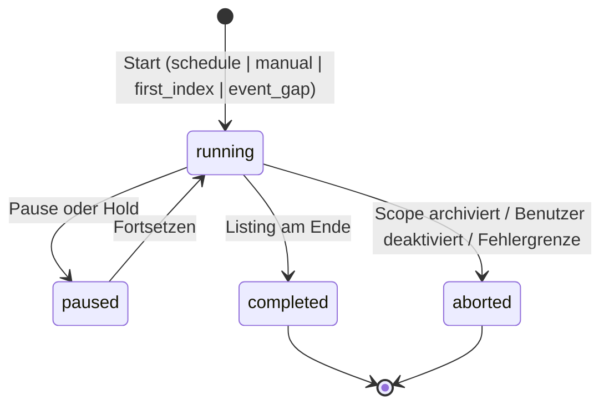
Zusätzlich die Beobachtung einer einzelnen Datei: `unseen → discovered | unchanged | changed | moved | missing_candidate`.

| Von → Nach | Auslöser | Vorbedingung | Persistiert (TX) |
|---|---|---|---|
| ∅ → running | Dispatcher/Benutzer | Scope aktiv; kein aktiver Cursor gleicher Art (Unique `active_key`); Benutzer `processing_allowed` | TX: Cursor-Zeile mit `active_key` |
| running → running (Seite) | Einheit abgeschlossen | Lease gültig | TX je Seite: `cursor_token`, `items_done`, Beobachtungsergebnisse (Instanzen/Referenzen/Jobs) |
| running → paused | Pause/Hold | – | TX: `state=paused` |
| paused → running | Pause aufgehoben | Eligibility | TX |
| running → completed | Listing erschöpft | Abschlussprüfung `missing` (s. u.) | TX: `state=completed`, `active_key=NULL` |
| running/paused → aborted | Scope deaktiviert, Hold dauerhaft | – | TX: `aborted`, `active_key=NULL`, Grund |
- **Persistiert:** Cursor, Zähler; je Datei Instanz/Referenz/Provenance nach 4.3.
- **Transaktionsgrenzen:** eine TX je Seite (Größe begrenzt); Listing selbst außerhalb TX.
- **Idempotenz:** Wiederholung einer Seite erzeugt keine Duplikate (Unique `nc_key`, `(instance_id, entry_seq)`). Reihenfolge der Seiten stabil nach Knoten-ID.
- **Fehler:** temporär (Storage nicht erreichbar) ⇒ Seite wiederholen mit Backoff (5.11); Fehlergrenze ⇒ Hold „Storage“ (5.12).
- **Missing-Abschluss:** Dateien, die bei einem **vollständigen** Listing fehlen, werden zunächst `missing_candidate`; `missing` erst nach Wiederholung (Anzahl Konfiguration, OQ-050); Löschung nur nach Bestätigung (Papierkorb/Mehrfachscan).
- **Recovery:** Cursor mit `running` und abgelaufener Job-Lease ⇒ Job zurück in die Queue, Fortsetzung bei `cursor_token`.

### 5.2 M2 – Upload-Stabilisierung
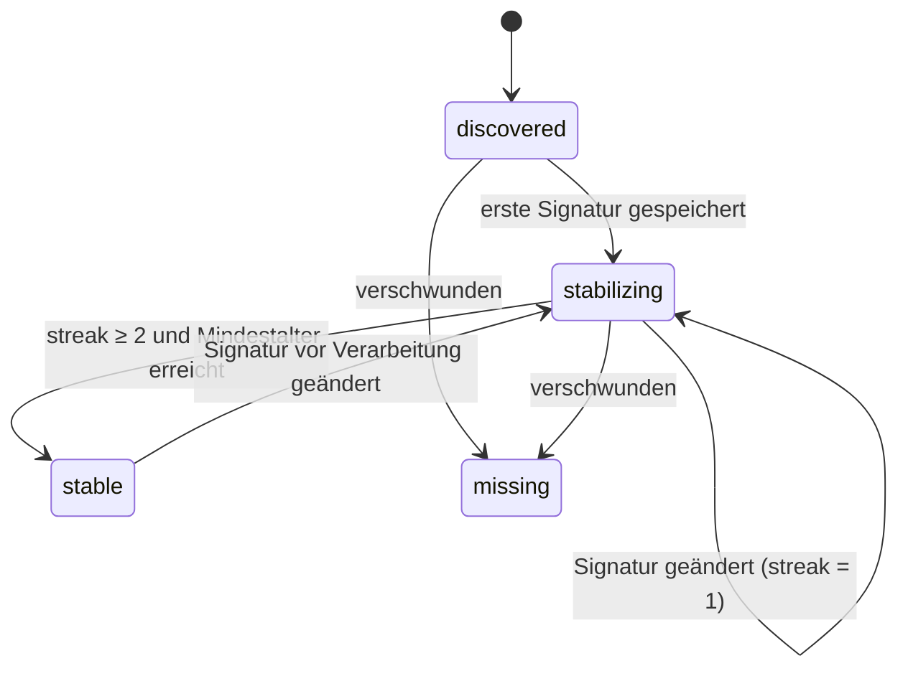
| Übergang | Auslöser | Vorbedingung | Persistiert |
|---|---|---|---|
| discovered → stabilizing | erste Beobachtung abgeschlossen | – | TX: `obs_streak=1`, Signatur (Größe, MTime, ETag), `first_seen_at` |
| stabilizing → stabilizing | Wiederbeobachtung | Signatur gleich | TX: `obs_streak+1`, `last_seen_at` |
| stabilizing → stabilizing (Reset) | Signatur anders | – | TX: `obs_streak=1`, neue Signatur; `stable_since=NULL` |
| stabilizing → stable | Wiederbeobachtung | `obs_streak ≥ 2` ∧ `now − first_seen_at ≥ Mindestalter` (`DEC-STB-001/002`, Alter nach **App-Beobachtung**, nicht MTime, `REQ-STB-06`) | TX: `stable_since`, `state=stable`; Job `hash` eingereiht (Dedup-Key) |
| stable → stabilizing | Unmittelbarprüfung (`DEC-STB-003`) zeigt Änderung | vor Hash oder Operation | TX: Reset |
- **Wiederbeobachtungsplan:** Job `observe` mit `not_before` = nächster Zeitpunkt (Mindestalter bzw. Prüfintervall); kein Warten im Prozess.
- **Idempotenz:** Beobachtung berechnet den Zielzustand aus der Signatur; doppelte Ausführung ist wirkungslos.
- **Fehler:** Knoten unlesbar ⇒ `retry_wait`; verschwunden ⇒ `missing` (M1-Regeln).
- **Recovery:** zustandslos; Jobs werden neu gestartet.
- **Gruppen:** Eine Gruppe bleibt `waiting_complete`, solange eine Komponente nicht `stable` ist (`DEC-STB-005`).

### 5.3 M3 – Dateiinhaltsanalyse und Hashing
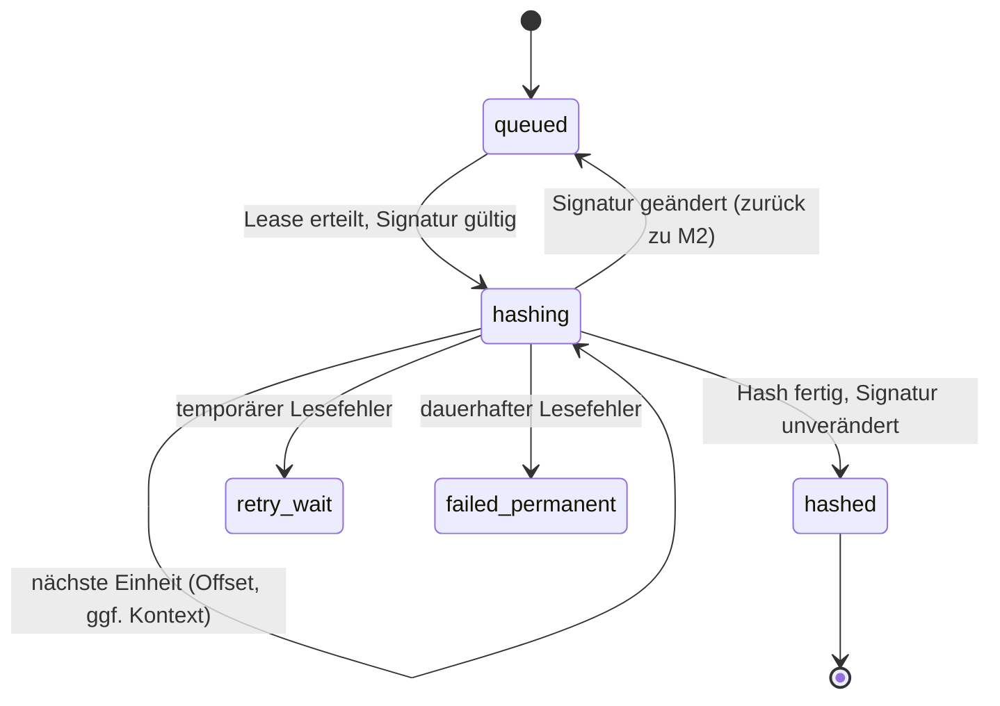
| Übergang | Auslöser | Vorbedingung | Persistiert |
|---|---|---|---|
| queued → hashing | Dispatcher | Instanz `stable`; `processing_allowed`; Signatur = gespeicherte; Hash-Cache-Test: `hashed_*` ungleich (`DEC-JOB-005`) | TX: Job `leased` |
| hashing → hashing | Einheit fertig | Lease erneuert | TX: `po_job.progress` (Offset, Signatur, ggf. Kontext) |
| hashing → hashed | letzte Einheit, Signatur-Gegenprobe ok | – | TX: `po_content` get-or-create (Unique `(user_id, sha256)`, Insert-und-Retry); `inst.content_id`, `hashed_size/mtime/etag`, `hashed_at`, `state=hashed`; Folgejobs `extract`, `group_eval`; Dedup-Prüfung (M10) |
| hashing → queued | Signatur geändert | – | TX: Reset nach M2 |
- **Bindung an Inhalt:** unveränderlich (I1). Ändert sich eine bereits gebundene Instanz, entsteht `superseded` + Nachfolgerinstanz (I2).
- **Idempotenz:** zweiter Hash derselben Signatur ändert nichts; get-or-create schützt die Inhaltszeile.
- **Fehler:** Ausnahme beim Lesen ⇒ temporär/permanent nach 5.11; **nie** ein Hash aus teilweise gelesenen Daten.
- **Große Medien:** 3.6 (drei Stufen, Umschlag mit Prüfsumme, Neuberechnung bei Mismatch; nicht hashbare Dateien `held`, nie ein Ersatzwert).
- **Recovery:** Job-Lease abgelaufen ⇒ zurück in die Queue; Fortsetzung nur bei gleicher Signatur.

### 5.4 M4 – Metadatenextraktion (Zeit, Medientyp, pHash)
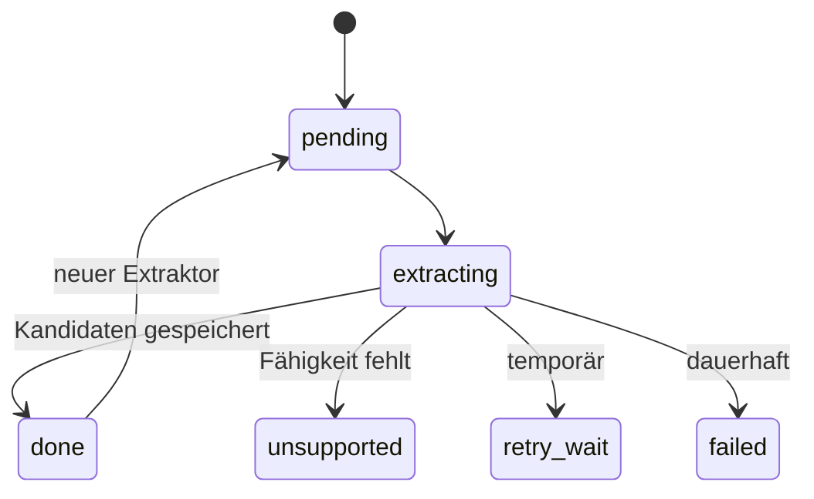
- **Zustand** je Instanz und Teilauftrag (`time`, `phash`); `po_time_candidate` (Unique `(instance_id, kind)`) und `po_phash` (Unique `(user_id, content_id, algo_row_id)`) tragen die Ergebnisse. Fehlt eine Fähigkeit (Capability Detection), ist `unsupported` ein **gültiges Endergebnis**, kein Fehler (`DEC-ARC-006`).
- **Übergänge:** `pending → extracting` (Job geleast) → `done`/`unsupported`/`failed`. Persistiert: je Kandidat eine Zeile; `plausibility` markiert, verwirft nie.
- **Transaktion:** eine TX je Instanz-Ergebnis. Extraktion (Lesen, Vorschaudecodierung) außerhalb.
- **pHash-Suche:** Nach Berechnung eine Suche gemäß Layout (`data-model.md` §19). Ergebniszustand `po_phash.search_state`: `complete` (alle Probes ausgeführt, Schwelle ≤ Garantieradius), `capped` (Kandidatenkappung erreicht), `recall_not_guaranteed` (Schwelle > Garantieradius), `pending`. **Nur `complete` darf als vollständiges Ergebnis erscheinen**; die Oberfläche kennzeichnet die anderen als „Suche unvollständig“ (`DEC-PHA-008`). Standardschwelle 8, konfigurierbar.
- **Idempotenz:** Unique-Constraints; Wiederholung überschreibt nichts.
- **Recovery:** Jobs neu.
- Der Übergang `hashed → analyzed` (5.5) setzt voraus: `time` ∈ {`done`, `unsupported`} und Gruppenauswertung durchlaufen.

### 5.5 M5 – Mediengruppenerkennung
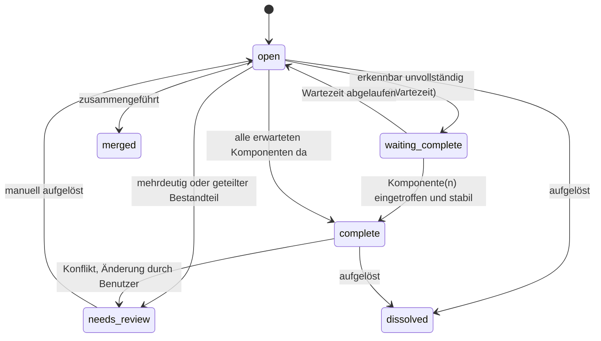
- **Auslöser:** Job `group_eval` nach Hash/Extraktion einer Komponente; Ablauf `wait_until`; manuelle Entscheidung.
- **Vorbedingungen:** alle betrachteten Instanzen mindestens `hashed`; Evidenz nach Stufen (`data-model.md` §6.2).
- **Persistiert:** `po_media_group`, `po_group_member` (Status `active/ambiguous/conflict/shared_ref/rejected/removed`), Prüfaufgaben. `version` je Gruppe (optimistische Sperre).
- **Transaktion:** eine TX je Gruppenänderung (Gruppe + Mitglieder + Prüfaufgabe).
- **Idempotenz:** Unique `(group_id, content_id)`; Konflikterkennung läuft nach jedem Einfügen.
- **Unsichere/mehrdeutige Gruppen** (OQ-048, G5): `needs_review`; **alle** Bestandteile bleiben unverändert im Eingang (`held_conflict`); weder Importplan noch Operationen. Fehlende *optionale* Komponenten blockieren nicht (`DEC-GRP-005`); eine **vorhandene aber mehrdeutige** Komponente blockiert die gesamte Konfliktmenge (`DEC-GRP-003`).
- **Fehler:** keine Hartfehler; Unklarheit ⇒ `needs_review`.
- **Recovery:** zustandslos; Neuauswertung aus Instanz-/Metadatenzustand.

### 5.6 M6 – Importplanung und Dry-Run
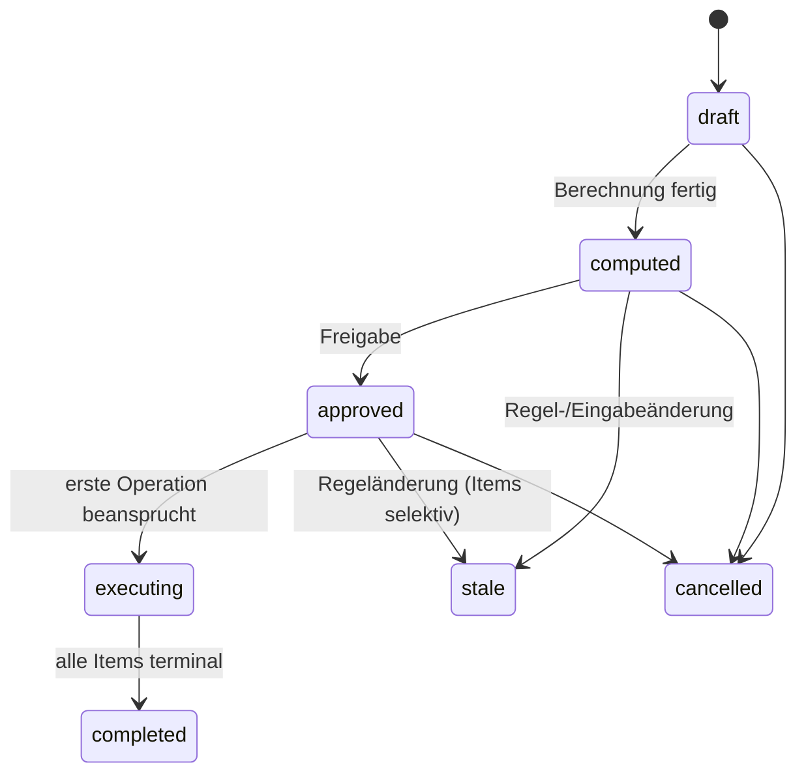
Plan-Item: `planned → approved → executing → done`, Seitenzustände `stale`, `invalidated_by_rule_change`, `failed`, `skipped`.
| Übergang | Auslöser | Vorbedingung | Persistiert |
|---|---|---|---|
| draft → computed | Berechnungsjob | alle Eingabeinstanzen `ready` (5.5 abgeschlossen), Gruppen nicht `needs_review` | TX je Item-Batch: Items mit plan-gebundenen Eingaben (`pb_*`), vorläufige Nummer, Abhängigkeiten (`po_plan_item_dep`); `computed_at`; Zähler |
| computed → approved | Benutzer | Plan nicht `stale` | `po_approval`, `approved_at` (5.7) |
| approved → executing | erster Claim | Item `approved`, Freigabe gültig | Item `executing` (mit Operation) |
| executing → completed | alle Items `done`/`skipped`/`failed` | – | `completed_at`, Zähler |
- **Dry-Run ist schreibfrei gegenüber Dateien**; er legt nur Planzeilen an. Nummern sind **vorläufig** (`prov_number`); Reservierung erst in der Ausführung (`DEC-NAM-013`).
- **Sammlungsindexierung** ist kein Plan (OQ-051): kein Dry-Run-Zwang, nur Vorschau.
- **Berechnung in Einheiten:** Planbatches von begrenzter Größe; Fortsetzung über `plan_id` + `seq`.
- **Idempotenz:** Item-Berechnung deterministisch aus Eingaben; Unique `(plan_id, seq)`; Wiederholung ersetzt nicht Freigegebenes.
- **Fehler:** Item, dessen Eingaben fehlen (Instanz nicht mehr `ready`), wird `skipped` mit Grund.
- **Recovery:** Planberechnung neu startbar; freigegebene Pläne unverändert.

### 5.7 M7 – Freigabe und Freigabeinvalidierung
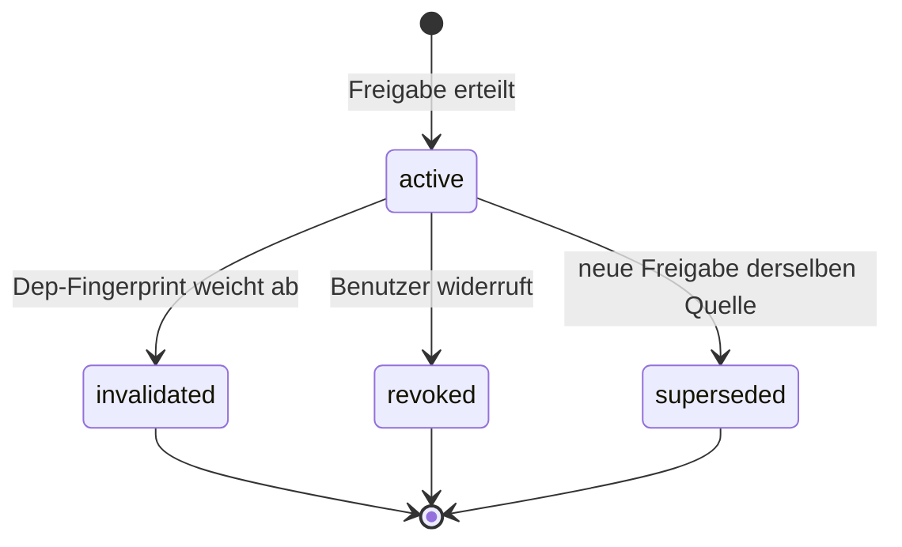
- **Arten:** `plan`, `plan_item`, `standing_source`, `reorg_plan`.
- **Auslöser der Invalidierung:** neue `po_user_rules_rev`/`po_source_rev` ⇒ neuer Snapshot ⇒ komponentenweiser Fingerprint-Vergleich (`data-model.md` §7.3/7.4). **Nicht** invalidierend: Pausen, `sched_params`, Holds (`DEC-DRY-014`).
- **Persistiert:** `po_approval`, `po_approval_dep`; Plan-Items `invalidated_by_rule_change` (nur betroffene); `po_source.effective_rev_id` (einziger Schreiber: Freigabedienst).
- **Transaktion:** Freigabe + Dep-Zeilen + `effective_rev_id` in **einer** TX.
- **Idempotenz:** `active_key` (Unique) verhindert zwei aktive Standing-Freigaben; Invalidierungsjob ist wiederholbar (vergleicht nur).
- **Wirkung auf laufende Ausführung:** Der Ausführer prüft die Gültigkeit **vor jedem Item/Kind** neu. Eine bereits beanspruchte Operation wird zu Ende geführt, nicht abgebrochen (INV-11); Folgeitems stoppen. Ausnahme Gruppe: `crash-recovery.md` §5.1.
- **Recovery:** Invalidierung ist ein Vergleich und jederzeit nachholbar.

### 5.8 M8 – Dateioperationen (Eltern/Kind) (4b konsolidiert)

**Endgültige Reihenfolge:** `intended → preverified → claimed → executing → executed → verifying → done`.
Begründung: Der Pre-Hash großer Dateien kann mehrere Dispatcher-Läufe dauern; er darf keinen Operationsanspruch und keine Lease halten. Der Claim ist kurz, trägt Frist und Fence und wird erst erteilt, wenn der Pre-Hash gültig vorliegt. Exklusivität auf der Instanz besteht schon ab `intended` (`active_key`).

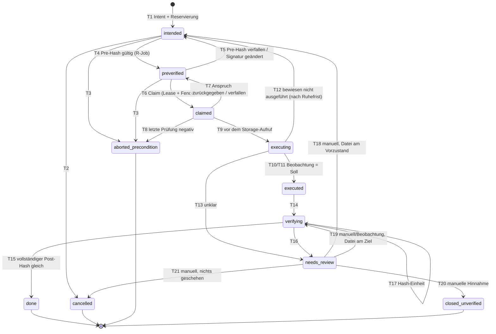
**Verboten:** jeder Übergang nach `done` außer T15 (`verifying → done`). Insbesondere `needs_review → done`, `executing → done`, `executed → done`, `closed_unverified → done`. Eine manuelle Entscheidung ersetzt **nie** die Pre-/Post-SHA-256-Verifikation (`DEC-IMM-009`).

**Fence-Wächteranweisung:** Jede Transaktion eines mutierenden Workers beginnt mit `UPDATE po_lease SET heartbeat_at=? WHERE lease_key=? AND fence=?`; 0 Zeilen ⇒ Rollback und Abbruch („Lease verloren“). Das schreibt dieselbe Zeile (Sperre) und macht Fence-Prüfung und Folgeanweisung zu einem Datenbankzugriff in einer Transaktion.

| T | Übergang | Wer | Fence / Token | Vorbedingungen | Transaktion | Lease verloren | Recovery darf wiederholen? |
|---|---|---|---|---|---|---|---|
| T1 | ∅ → intended | mutierender Worker (Lease `user:<id>:mut`) | Lease-Fence (Wächteranweisung) | Autorisierung nach Matrix 6.2 erfüllt; Eligibility; Fähigkeiten nach 6.3 verifiziert; Unique `active_key` frei | **TX-A**: Operation(en), Reservierung `reserved`, `pre_state`, Ziel | Rollback, nichts persistiert | Ja (nichts committet) |
| T2 | intended → cancelled | beliebiger Worker oder Benutzeraktion | CAS `state='intended'` | Plan ungültig, Benutzerabbruch | TX: Zustand, Reservierung `burned(aborted)` | – | Ja (idempotent) |
| T3 | intended/preverified → aborted_precondition | Worker | CAS auf Zustand | Revalidierung (P1/P3) schlägt fehl | wie T2 | – | Ja |
| T4 | intended → preverified | **R-Job** `preverify` | `lease_token` des Jobs | vollständiger SHA-256 = gespeicherter, Signatur davor = danach = `pre_state`, Ziel frei | **TX-P**: Zeile `po_integrity_check(pre)`, `pre_valid_until`, Zustand | Job-Schreibvorgang scheitert; Ergebnis verworfen | Ja (rein lesend, Wiederholung = erneuter Hash) |
| T5 | preverified → intended | R/M-Worker, Recovery | CAS `state='preverified'` | `now > pre_valid_until` oder Signatur geändert | TX | – | Ja |
| T6 | preverified → claimed | mutierender Worker | **Lease-Fence** (Unterabfrage: Fence gleich, Rest ≥ Sicherheitsabstand) | Eligibility; `pre_valid_until ≥ now + Abstand`; Autorisierung/Fähigkeiten erneut; kein anderer Claim | **TX-B**: `executor_id`, `exec_fence`, `claimed_at`, `claim_deadline`, `quiet_until`, `cap_snapshot` | 0 Zeilen: kein Claim | Ja |
| T7 | claimed → preverified | Besitzer (`exec_fence`) oder Recovery nach `claim_deadline`+Ruhefrist | CAS `WHERE exec_fence=<alt> AND state='claimed'` | der Aufruf ist **sicher nicht erfolgt** (Zustand `executing` wurde nie committet) | TX | Besitzer scheitert; Recovery übernimmt | Ja |
| T8 | claimed → aborted_precondition | Besitzer | `exec_fence` | letzte Prüfung (P7) zeigt Abweichung (Pfad, Name, ETag, Ziel belegt, Fähigkeit weg) | TX, Reservierung burn | Recovery macht T7 | Ja |
| T9 | claimed → executing | **nur Besitzer** | `exec_fence` **und** Lease-Fence | `now ≤ claim_deadline`; Lease-Rest ≥ Abstand; P7 abgeschlossen; Pause-/Hold-Prüfung | **TX-D**: Zustand, `exec_seen` (Momentaufnahme aus P7), `execute_started_at`; **committen, dann erst Storage-Aufruf** | 0 Zeilen ⇒ **kein Aufruf** | Nein (nur Besitzer) |
| T10 | executing → executed | Besitzer | `exec_fence` | Beobachtung P10 = Soll | **TX-E**: Referenzwechsel (ggf. Episode), `outcome=known_executed`, Beobachtungswerte | Schreiben scheitert; Zustand bleibt `executing`; Recovery | Ja (T11) |
| T11 | executing → executed | **Recovery** | neuer Fence, `recovery_epoch+1`, CAS auf alten `exec_fence` | nach Ruhefrist: Beobachtung = Soll | TX wie T10 | – | Ja |
| T12 | executing → intended | **Recovery** | neuer Fence, CAS | nach Ruhefrist **und** Beobachtung am Vorzustand mit unveränderter Signatur **und** Ziel frei **und** Fähigkeit „kein Überschreiben“ verifiziert (6.3) | TX: `outcome=known_not_executed`; vollständiger neuer Ablauf (nie direkt `executing`) | – | Ja |
| T13 | executing → needs_review | Besitzer oder Recovery | CAS | Beobachtung unklar (Matrix `crash-recovery.md` 3.3) | TX, Prüfaufgabe | – | – |
| T14 | executed → verifying | Besitzer, Post-Verifier-Job oder Recovery | CAS (`state='executed'`) | Referenz geschrieben | **TX-F** | – | Ja |
| T15 | verifying → done | **Post-Verifier** (R-Job) | `lease_token`; CAS `state='verifying'` | vollständiger SHA-256 des Ziels = gespeicherter = Pre-Hash; Signatur wie P10 | **TX-G**: Operation `done`, `po_integrity_check(post, match)`, Instanz `hash_verified`/`organized`, Kanon/Herkunftsentscheidung, Reservierung `consumed`, Plan-Item `done`, Zähler | Schreiben scheitert; bleibt `verifying` | Ja |
| T16 | verifying → needs_review | Post-Verifier | CAS | Mismatch (Signatur gleich), unlesbar, `drifted` | TX, Prüfaufgabe, ggf. Hold | – | – |
| T17 | verifying → verifying | Post-Verifier | `lease_token` | Hash-Einheit fertig | TX: `progress` | – | Ja |
| T18 | needs_review → intended | **Benutzer** (nach Prüfung) | CAS | Beobachtung zeigt Datei am Vorzustand; Gründe der Prüfung ausgeräumt | TX; **voller Ablauf neu** inklusive Pre-Hash | – | Nein |
| T19 | needs_review → verifying | Benutzer/Recovery nach Beobachtung | CAS | Datei am Ziel (bekannt ausgeführt) | TX; Post-Hash wird **neu** berechnet | – | Nein |
| T20 | needs_review → closed_unverified | **Benutzer** | CAS | ausdrückliche Hinnahme | TX: Instanz bleibt `failed`/`unconfirmable`, **nicht** `hash_verified`; kein Erfolgsvermerk; Reservierung `consumed` oder `burned` je Lage; Sperre für Folgeaktionen (Duplikat-Papierkorb) | – | Nein |
| T21 | needs_review → cancelled | Benutzer | CAS | Beobachtung zeigt Vorzustand; nichts geschehen | TX, Reservierung burn | – | Nein |

Mutierende Übergänge am Storage sind ausschließlich **T9 (Voraussetzung) + P9 (Aufruf)**. Alle anderen Übergänge sind reine Datenbank- oder Lesevorgänge.

Elternoperation (`is_parent`): `intended → executing → partial ⇄ executing → done` oder `needs_review`/`closed_unverified`. `partial` = mindestens ein Kind `done`, keines in `claimed…verifying`, mindestens eines nicht terminal. Eltern `done` nur, wenn **alle** Kinder `done`; Eltern wird per CAS abgeleitet, nie direkt gesetzt. Ein Kind in `closed_unverified` führt zu Eltern `needs_review`.

| Zustand | Bedeutung | In Unique `active_key`? |
|---|---|---|
| intended | Absicht, Reservierung committet, Storage unberührt | ja |
| preverified | Pre-Hash gültig bis `pre_valid_until` | ja |
| claimed | exklusiver kurzer Anspruch, Storage unberührt | ja |
| executing | **möglicherweise ausgeführt** (T4 der Grundsätze) | ja |
| executed | Ziel beobachtet, Referenz geschrieben, Verifikation offen | ja |
| verifying | Post-Hash läuft | ja |
| done | Post-Hash gleich | nein |
| cancelled / aborted_precondition | bekannt nicht ausgeführt | nein |
| closed_unverified | manuell hingenommen, **nicht verifiziert** | nein (Instanz bleibt gesperrt für Folgeaktionen über `integrity_state`) |
| needs_review | unklar, blockiert die Instanz | ja |

### 5.9 M9 – Integritätsprüfung nach Operationen
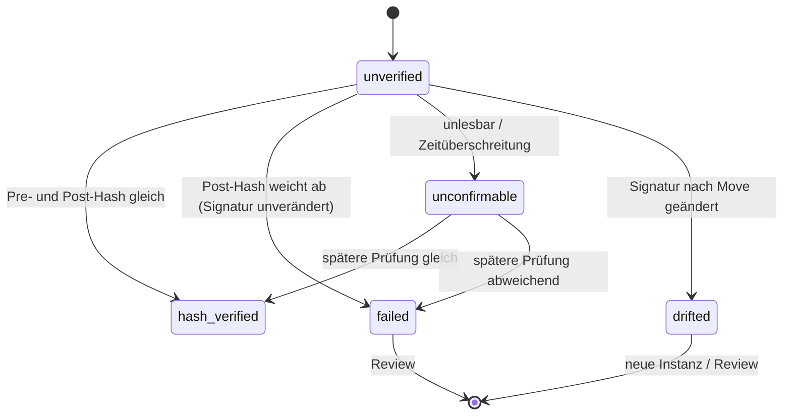
- Für **App-veranlasste Verschiebungen** gilt (`DEC-IMM-008`): vollständiger Pre-Hash und Post-Hash; **erst danach** `done` und `integrity_state=hash_verified`. `hash_verified` ist ein **Verlaufsvermerk**, keine Freigabe für spätere Löschentscheidungen (`DEC-DUP-010`). Manuelle Hinnahme (`closed_unverified`) setzt den Zustand **nie** auf `hash_verified`. `meta_continuous` bleibt ein Zwischenzustand ohne Erfolgsbedeutung.
- `po_integrity_check`-Zeilen: `pre`, `post`, `deferred`, `sample`, `pre_delete`.
- Vergleichsmatrix und Fehlerklassen: `crash-recovery.md` §4.5.
- Stichproben-/Vollscan-Neuhash (`deferred`, `sample`) bleiben für **nicht** App-verursachte Zustände und als Selbstprüfung; ihre Häufigkeit ist Konfiguration.
- **Transaktion:** Prüfzeile + Zustandsänderung in einer TX, nachdem der Hash außerhalb fertig ist.
- **Fehler:** `failed` ⇒ Hold „kritisch“ (5.12), Prüfaufgabe; keine weitere Operation auf dem Inhalt, keine Papierkorb-Aktion.

### 5.10 M10 – Quarantäne und manuelle Reviews
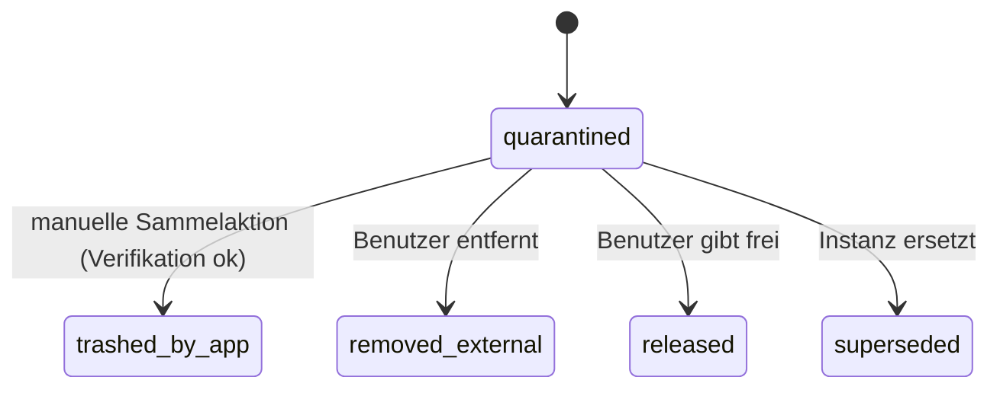
Review-Aufgabe: `open → snoozed → open`, `open → resolved | dismissed | auto_closed` (Ursache entfallen).
- **Auslöser (Quarantäne):** exaktes Duplikat (M3), Konfliktmenge (M5), `collection_duplicate` (Sammlungsindexierung), Tombstone-Treffer.
- **Vorbedingung `trashed_by_app` (4b):** Duplikat-Sammelaktion ist eine vom Benutzer bestätigte Operation `trash` (Klasse M) mit Pre-Delete-Prüfung nach 6.4: **beide** Exemplare werden unmittelbar davor vollständig neu gehasht; ein gespeicherter Status `hash_verified` genügt nie; jede Abweichung verweigert die Aktion und erzeugt den Prüffall `trash_refused`. `collection_duplicate` ist von der Sammelaktion **ausgenommen** (OQ-051).
- **Prüfaufgaben-Dedup:** `dedup_key` (Unique solange offen).
- **Papierkorb:** Ergebnis der Trash-Operation wird beobachtet (Knoten verschwunden, Papierkorbeintrag vorhanden?); unklar ⇒ `needs_review`, kein Wiederholen (`crash-recovery.md` Szenario 18).
- **Persistiert:** `po_quarantine_item`, `po_review_task`, `po_deletion_event`.
- **Recovery:** Review-Aufgaben sind zustandsbasiert; Neuauswertung durch Kontrollscan erzeugt keine Dopplungen (Dedup-Key).

### 5.11 M11 – Retry und Fehlerbehandlung
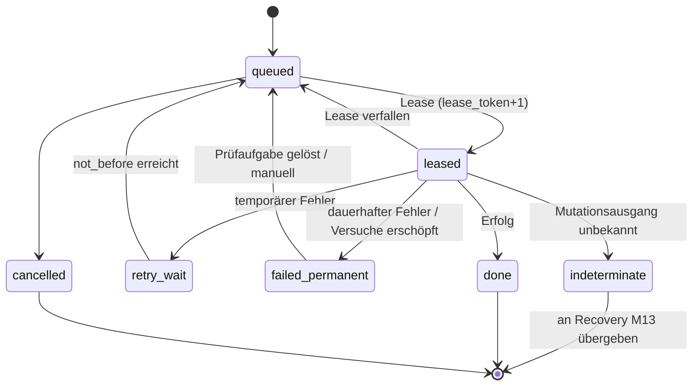
| Fehlerklasse | Beispiele | Reaktion |
|---|---|---|
| temporär | Storage kurz nicht erreichbar, Sperre belegt, Zeitüberschreitung beim Lesen | `retry_wait`, `not_before` = Backoff (exponentiell mit Zufallsanteil, Obergrenze, Zahlen Konfiguration); nach *N* Versuchen → permanent |
| permanent | nicht unterstützte Datei, beschädigte Metadaten, Berechtigungsfehler | `failed_permanent` + Prüfaufgabe (`DEC-JOB-010`); `dedup_key` bleibt gehalten bis Auflösung |
| kritisch | Integritätsabweichung, unerwartete Dateiänderung durch Dritte | Hold (5.12), Prüfaufgabe kritisch (`DEC-JOB-011`) |
| **indeterminate** (neu) | Mutation mit unbekanntem Ausgang | **kein Retry**; Übergabe an M13 |
- **Systematische Fehler** (hohe Fehlerrate je Scope/Benutzer in Zeitfenster) ⇒ größere Einheit pausieren (Hold „systematisch“, `DEC-JOB-012`) statt endlos zu wiederholen (Circuit Breaker): Auslösung und Rückkehr (nach Backoff, Test-Einheit „Probe“) Konfiguration.
- **Transaktion:** jeder Zustandswechsel mit `WHERE lease_token=?`.
- **Idempotenz:** `dedup_key` verhindert doppeltes Einreihen; Jobs sind wiederholbar, weil sie Zustand beobachten statt annehmen. **Ausnahme: Mutationen** laufen nie als anonym wiederholbarer Job, sondern als Operation (M8).
- **Recovery:** verfallene Job-Leases ⇒ `queued`, außer M-Jobs.

### 5.12 M12 – Pause, Fortsetzen, administrative Sperren (4b präzisiert)
Es gibt **keinen** gespeicherten „Verarbeitungsstatus“; die Berechtigung wird abgeleitet (`DEC-USR-007`):
`processing_allowed(u) = enabled ∧ ¬user_paused ∧ ¬Admin-Pause(u) ∧ ¬Admin-Pause(global)`
Eligibility einer Einheit = `processing_allowed(u)` ∧ Scope/Quelle aktiv ∧ `¬source_paused` ∧ ¬Hold(scope|user) ∧ (bei Plan-Items: Freigabe gültig).

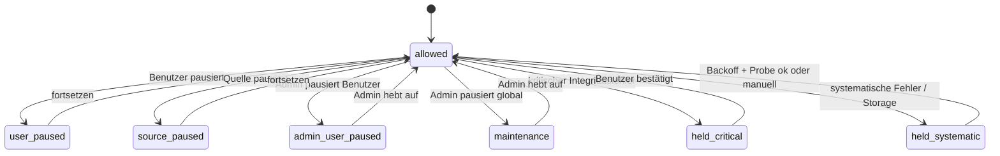
(Parallele Dimensionen; jede einzeln.)

| Sperre | Neue reguläre Arbeit (R und M) | Laufende Einheit | Rein lesende Recovery-Beobachtung | Events |
|---|---|---|---|---|
| **Benutzerpause** | ausgesetzt | wird am nächsten Sicherheitspunkt beendet (laufender Storage-Aufruf zu Ende; Hash an Blockgrenze) | **erlaubt, nur Metadaten** (Existenz, Pfad, Größe, MTime, ETag per `file_id`/Referenz) für Operationen in `executing`/`executed`/`verifying`; **kein** Inhaltslesen, kein Hash, kein Anspruch, keine Mutation | werden eingereiht |
| **Quellenpause** | ausgesetzt für den Scope der Quelle | wie oben | wie oben, nur für Operationen dieser Quelle | werden eingereiht |
| **Admin-Pause für einen Benutzer** | ausgesetzt (auch Benutzeraktionen wie Undo/Trash) | wie oben | wie Benutzerpause | werden eingereiht |
| **Globale Admin-Pause = Wartungsmodus** | **keine**; nach sicherem Abschluss der begonnenen Einheit (ein Storage-Aufruf, ein Hash-Block, eine Transaktion) **keine weiteren Storage-Lese- oder Schreibzugriffe durch die App** | wie oben, dann Stillstand | **nicht erlaubt** (auch keine Metadatenbeobachtung) | nur **minimale Erfassung ohne Storage-Zugriff** (s. u.) |
| Hold kritisch | R läuft; M des Scopes/der Quelle gestoppt | – | erlaubt | werden eingereiht |
| Hold systematisch | R und M des Scopes pausiert | – | Beobachtung mit Backoff | eingereiht |

- **Ereigniserfassung im Wartungsmodus:** Der Listener verwendet nur Informationen des Events selbst und der Datenbank (Benutzerkennung, `file_id`, Art als Code, Zeit); **kein** Laden von Knoten, keine Pfad- oder Eigentümerauflösung über Storage. Nicht entscheidbare Events werden als `unchecked` eingereiht. Läuft die Warteschlange über eine Obergrenze, werden weitere Events **verdichtet** (Zähler) oder verworfen; in jedem Fall wird `po_scan_scope.gap_since` gesetzt.
- **Nach Freigabe:** Für jeden Scope mit gesetztem `gap_since` läuft ein Kontrollscan (`incremental`, bei Überlauf `reconcile`) vor weiterer regulärer Verarbeitung; `gap_since` wird erst gelöscht, wenn ein Scan abgeschlossen ist, der **nach** `gap_since` begann. Danach laufen reguläre Jobs.
- **Pausen verändern nie** Quellenprioritäten, Regelrevisionen, Fingerprints, Herkunftsentscheidungen oder Freigaben (`DEC-DAT-013`, `DEC-DRY-014`). Prüfung: Pausenänderungen schreiben nur `po_user_state`, `po_source.source_paused`, `po_admin_pause` und ggf. `gap_since`.
- **Persistiert:** `po_user_state`, `po_source.source_paused`, `po_admin_pause`, Holds, `po_scan_scope.gap_since` (`data-model.md` §24).
- **Admin-Privacy:** Admin sieht nur Zustand und Zähler (`po_user_stats`).
- **Pause und Operationen im Zustand `executing`:** Die Operation bleibt `executing` bzw. `executed`/`verifying`; sie wird weder abgebrochen noch fortgesetzt; nach Aufhebung greift die Recovery (`crash-recovery.md` §3).

### 5.13 M13 – Recovery nach Prozessabbruch
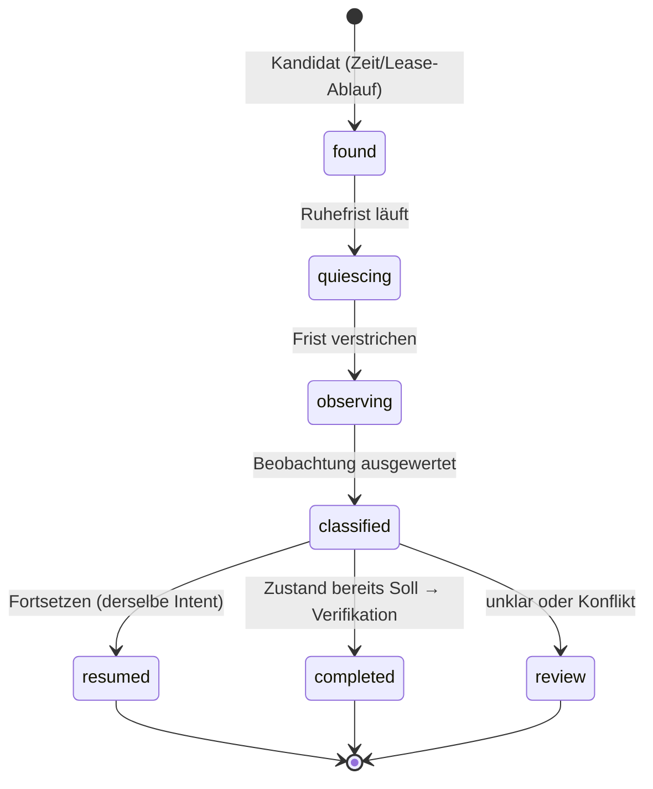
Ausführlich: `crash-recovery.md` §3. Grundregeln: Beobachten vor Handeln (T5/T6); Ruhefrist (`claim_deadline` + Sicherheitsabstand + Lease-Ablauf); neuer Anspruch mit höherem Fence und `recovery_epoch+1`; **derselbe Intent**; kein Wechsel von Ziel oder Absicht; kein blindes Wiederholen; kein Rollback.

## 6. Verarbeitung einer Dateioperation (4b überarbeitet)

### 6.1 Gemeinsamer Mutationskern
Der Kern ist für alle Operationstypen identisch; die Typen unterscheiden sich **nur** in den Vorbedingungen (P1), den Folgewirkungen in P14 und den Zusatzprüfungen (6.2). Schritt-Nummern gelten für `crash-recovery.md`.

| Schritt | Aktion | Art | Übergang / Persistiert |
|---|---|---|---|
| **P0** | Auswahl durch Dispatcher; Eligibility (5.12) | lesend | – |
| **P1** | **Typspezifische Revalidierung** (Matrix 6.2): Autorisierung gültig, Fähigkeiten verifiziert (6.3), Instanz-/Gruppenzustand, Overrides, Tombstone, Fingerprints | lesend | bei Abweichung Item `invalidated…`/`skipped`, keine Operation |
| **P2** | **TX-A (T1):** Operation(en) `intended` (bei Gruppen: Elternoperation + alle Kinder + **eine** Gruppenreservierung in derselben TX); `pre_state` mit `observed_at`; Sollname/-ziel; `idem_key`; `active_key`; `auth_kind/auth_id`; Reservierung `reserved` (Insert-und-Retry bei Unique-Verletzung, ganze TX wiederholen); Wächteranweisung auf die Lease | TX | Intent committet (T3 der Grundsätze) |
| **P3** | **Pre-Verifikation (R-Job `preverify`):** Knoten laden; Eigentümer/Mount/Storage; Signatur gegen `pre_state`; Ziel frei; **vollständiger SHA-256** (3.6) gleich gespeichertem; Signatur nach dem Hash gleich | SC lesend + HC | **T4** → `preverified`; `po_integrity_check(pre)`; `pre_valid_until` |
| **P4** | **Claim (T6, TX-B):** nur wenn `pre_valid_until ≥ now + Abstand`, Lease-Rest ≥ Abstand, Eligibility, Autorisierung | TX | `claimed`; `exec_fence`, `claim_deadline`, `quiet_until`, `cap_snapshot` |
| **P5** | **Sperren** (6.3.4): Quellknoten und Zielpfad, soweit verifiziert nutzbar | SC | Ereignis `lock_acquired`/`lock_unavailable` |
| **P6** | – (vormals „letzte Prüfung“, jetzt Teil von P7) | – | – |
| **P7** | **Letzte Prüfung** (ohne Hash): Quelle **über erwarteten Pfad** (6.5) laden; Name/Pfad/Größe/MTime/ETag/`file_id` = Pre-Verifikation; Ziel frei; Frist; Fähigkeiten | SC lesend | Abweichung ⇒ **T8**; sonst `exec_seen` bereit |
| **P8** | **TX-D (T9):** `claimed → executing`, `exec_seen`, Frist- und Fence-Prüfung; **committen** | TX | „möglicherweise ausgeführt“ |
| **P9** | **Storage-Aufruf** über `FileGateway` (6.3) | SC | – |
| **P10** | **Beobachten** (auch bei Ausnahme): Knoten neu laden; Pfad, Name, Größe, MTime, ETag, `file_id`; Zielreferenz bestimmen | SC | – |
| **P11** | **TX-E (T10):** `executing → executed`; Referenz schließen/öffnen (`op_id`, Episodenregel); `outcome=known_executed` | TX | Referenz + Zustand |
| **P12** | Sperren lösen; **TX-F (T14)** `verifying` | SC + TX | – |
| **P13** | **Post-Verifikation (R-Job):** vollständiger SHA-256 des Zielknotens (3.6), Signaturvergleich | SC + HC | T17 je Einheit |
| **P14** | **TX-G (T15)**: Abschluss, **eine** Transaktion, typspezifische Wirkungen (Kanon, Herkunftsentscheidung, Override, Quarantäne usw.) | TX | **Endgültiger Erfolg** |
Abbruchpfade: vor P8 bekannt nichts geschehen (T7/T8). Nach P8 nur Beobachtung (P10, Recovery). Das Wegfallen von P6 ändert die Nummerierung nicht (Verweise in `crash-recovery.md` bleiben gültig).

**Grenze (ausdrücklich):** P8 und P11 sind Datenbanktransaktionen; P9 ist es nicht. Zwischen P8 und P11 gibt es keinen atomaren Zusammenhang. Alles Wissen über den Ausgang in diesem Zeitraum stammt aus P10 bzw. der Recovery-Beobachtung.

**Gruppen:** Kinder nacheinander (ein mutierender Worker pro Benutzer), jedes durchläuft P3–P14 einzeln; zwischen den Kindern erneut Revalidierung (P1-Teil). Details `crash-recovery.md` §5.

### 6.2 Operationstypen und Autorisierungsmatrix
`po_operation.op_type` ∈ {`import`, `reassign`, `group_follow`, `reorganize`, `undo`, `trash`}; Gruppenoperationen sind Eltern/Kind-Strukturen eines dieser Typen (`is_parent`). `auth_kind`/`auth_id` benennen die Autorisierung; ohne gültige Autorisierung entsteht keine Operation.

| Kriterium | **import** | **reassign** | **group_follow** | **reorganize** | **undo** | **trash** |
|---|---|---|---|---|---|---|
| Zweck | Instanz aus Eingang in die Sammlung | kanonische Datei an neuen bevorzugten Ort | Gruppenkomponente nach manueller Verschiebung einer anderen nachziehen | Sammlungsdatei gemäß ausdrücklich freigegebenem Neuordnungsplan umsortieren | früherer Operation zurücknehmen | zusätzliche Duplikatkopie in den Papierkorb |
| Autorisierung | dauerhafte Quellenfreigabe (gültige Dep-Fingerprints) **oder** einmalige Plan-Item-Freigabe | dauerhafte Freigabe der **gewinnenden** Quelle (`DEC-DRY-012`) + `po_origin_decision` `challenger_won` | Benutzeraktion (manuelle Verschiebung, `DEC-GRP-010`) → `location`-Override | Freigegebener `reorg_plan`-Eintrag je Datei (`DEC-DRY-008`) | Benutzeraktion; Original-Operation `done` | **Ausdrückliche Benutzerbestätigung** einer Sammelaktion (`DEC-DUP-005`) |
| Subjekt | Instanz im Eingangs-Scope, `management_mode=none`, `ready` | kanonische Instanz im Sammlungs-Scope, `management_mode=organized` | weitere Komponenten derselben aktiven Gruppe im Sammlungs-Scope | Instanz im Sammlungs-Scope (`organized` oder `adopted`) | Instanz am Nachzustand der Original-Operation | Instanz `exact_duplicate`-Quarantäne, `quarantined` |
| **adoptierte Datei** | **verboten** (adoptierte Datei liegt nicht im Eingang; ein Eingangsimport darf sie nie anfassen) | **verboten** (`DEC-IDX-001`) | nur wenn Gruppenmitglied `active` mit Evidenz Stufe 1 oder 3; sonst Prüffall (offen, `OQ-067`) | **erlaubt, nur wenn im freigegebenen Plan ausdrücklich enthalten** | nur als Rücknahme einer vorherigen Reorganisation | **verboten** (`collection_duplicate` ist ausgenommen) |
| Standort-Override | – (Neuimport hat keines; existiert eins, kein Import) | **verboten** (`suppressed`) | setzt/bestätigt das Override | geschützt, nur wenn der Plan es ausdrücklich einbezieht (`DEC-DRY-009`) | Override-Wirkung ggf. mit zurücksetzen (Benutzerentscheid) | – |
| Mediengruppe | Gruppe `complete`/`open`, kein Mitglied `conflict`/`ambiguous` (G5) | ganze Gruppe als Elternoperation | Gruppe unverändert (`pb_group_rev`), Zielkomponente unverändert | wie reassign | wie Original | Gruppenschutz (`DEC-DUP-007`) |
| Tombstone | aktiver Tombstone für den Inhalt ⇒ kein Import (`DEC-DUP-009`) | – | – | – | – | Tombstone/Benutzerentscheidungen respektiert |
| Pausen/Holds | blockiert | blockiert | blockiert | blockiert | blockiert | blockiert |
| Fähigkeiten (6.3) | `move_no_overwrite` | `move_no_overwrite` | `move_no_overwrite` | `move_no_overwrite` | `move_no_overwrite` | `trash_verified` |
| Pre/Post-Verifikation | Pre-Hash + Post-Hash | Pre + Post | Pre + Post | Pre + Post | Pre + Post | **Pre-Delete** (6.4) + Post-Beobachtung |
| Wirkung bei Abschluss (P14) | Kanon, `organized`, Herkunftsentscheidung `initial`, Reservierung `consumed` | Kanon bleibt, Entscheidung `challenger_won` wirksam | Reservierung der Gruppe weiterverwendet | `batch_plan`-Entscheidung, Overrides gemäß Plan | Gegenoperation, Reservierung bleibt `consumed`/`burned` (nie wiederverwendet) | `trashed_by_app`, Löschereignis `duplicate_copy`, **kein** Tombstone |

Querschnittsregeln:
- Jede Operation prüft in P1 und erneut in P4 (Claim): Typ-Autorisierung gültig, Eligibility, Fähigkeiten, Instanz nicht `held`, Gruppe nicht `needs_review`.
- **Manuelle Benutzeraktionen** (Verschieben/Umbenennen im Web) sind keine Operationen der App; sie erzeugen Overrides, Prüffälle oder `group_follow`.
- **Keine Operation ist anonym:** Jede hat Autorisierung, Journal und Idempotenzschlüssel.
- Benutzerauslösung (Undo, Trash, Gruppen-Auflösung) wird bei Pause nicht ausgeführt, sondern vorgemerkt oder abgelehnt (der Benutzer muss fortsetzen); Admin-Pause gilt für alles (`DEC-USR-006/007`) [Z, OQ-068].

### 6.3 Überschreibsicherheit und FileGateway (fail-closed)

**Anforderung (Auftrag 4b, als `DEC-ARC-010` aufgenommen):** Die automatische Organisation überschreibt niemals einen bestehenden Zielknoten. Es gibt keine mutierende Operation ohne verifiziertes Verhalten bezüglich Zielkollisionen. Eine Konfiguration ohne ausreichend sicheres Move-Verhalten darf indexieren und analysieren, aber nicht automatisch organisieren.

**6.3.1 Fähigkeitsmodell.** Globale Konfiguration (keine Benutzerdaten), geführt je Tupel (Nextcloud-Hauptversion, Storage-Klasse):
| Flag | Bedeutung | Quelle der Wahrheit |
|---|---|---|
| `move_no_overwrite` | der verwendete Verschiebeaufruf schlägt bei vorhandenem Ziel **atomar** mit Fehler fehl und verändert Ziel und Quelle nicht (auch bei gleichzeitiger Neuanlage des Ziels) | Spikes SP-A1…A6 (6.3.5); als **Allowlist** der getesteten Tupel ausgeliefert |
| `move_source_by_path` | der Aufruf scheitert, wenn unter dem erwarteten Quellpfad nicht mehr dieselbe Datei liegt (6.5) | SP-I |
| `trash_verified` | Löschen verschiebt in den Papierkorb, nie endgültig; Papierkorbeintrag prüfbar | SP-J |
| `lock_target` | Sperre auf noch nicht existierenden Zielpfad möglich und von Move respektiert | SP-E |
| `hash_resume` | fortsetzbarer Hash-Kontext (3.6 H2) | SP-H + Laufzeittest |
Ohne Eintrag oder ohne `move_no_overwrite` für das erkannte Tupel (**unbekannte Version/Storage = nicht verifiziert**) gilt: **Modus „Nur Indexierung und Analyse“**. Erlaubt: M1–M5, M6 (Dry-Run als Vorschau), M7, M9 (Prüfung vorhandener Zustände), M10 ohne Papierkorb. Nicht erlaubt: jede Operation der Typen import, reassign, group_follow, reorganize, undo (Move) und, ohne `trash_verified`, trash. Die Oberfläche zeigt den Grund („Sicheres Verschieben für diese Nextcloud-Version/Speicherart nicht verifiziert“). Es gibt keine Benutzer-„Trotzdem“-Option [Z, OQ-069].

**6.3.2 Mögliche öffentliche Verfahren (zu prüfen, keines vorausgesetzt):**
| Verfahren | Bewertung |
|---|---|
| `Node::move()` nach Existenzprüfung (`nodeExists`) | **Allein unzureichend:** Prüfung und Aufruf sind nicht atomar (parallele Clients, verspätete Worker). Erst die Spikes können zeigen, ob `Node::move()` selbst ein vorhandenes Ziel ablehnt. Auf POSIX überschreibt ein nacktes Dateisystem-`rename` vorhandene Dateien; ob Nextcloud davor schützt, ist unverifiziert. |
| Datei-API-Aufrufe mit dokumentierter Nichtüberschreibung (Suchauftrag für SP-A: Ordner-API, `newFile`-ähnliche Methoden, View-Ebene) | Nur zulässig, wenn öffentlich dokumentiert **und** getestet |
| WebDAV `MOVE` mit `Overwrite: F` (RFC 4918: Ziel existiert ⇒ 412) | **Vergleichspunkt** für das Soll-Verhalten. Intern per HTTP aufrufen ist **nicht** Architekturstandard (Authentifizierung, Latenz, Kontext, Ausfallpfade). Falls es die einzige Garantie liefert, ist die Entscheidung dem Product Owner vorzulegen (OQ-069) |
| Platzhalter-Datei am Ziel anlegen und darüber verschieben | **Verworfen:** setzt Überschreiben voraus |
| Nichts davon verifiziert | Modus „Nur Indexierung“ |

**6.3.3 FileGateway-Regeln:** (1) einzige Stelle mit Zugriff auf Move/Delete/Sperre; (2) bietet **keine** Methode, die ein vorhandenes Ziel überschreibt; (3) Methode `moveNoOverwrite(source: erwarteter Pfad + file_id, target)` liefert nur die Ergebnisse `moved`, `target_exists`, `source_changed`, `error(unknown)`; `error(unknown)` wird **nicht** als „nicht ausgeführt“ gedeutet (T4/T5 der Grundsätze); (4) prüft vor jedem Aufruf die Fähigkeit des Tupels; fehlt sie, wirft sie ohne Storage-Zugriff; (5) hat keinen Schreibzugriff auf Inhalte.

**6.3.4 Sperren.** Eine Sperre auf einen noch nicht existierenden Zielknoten setzt voraus, dass die Sperre pfadbasiert ist und für nicht existierende Pfade gilt (`lock_target`, SP-E). Unverifiziert sind außerdem: ob `Node::move()` die eigene Sperre erkennt (Wiedereintritt) oder blockiert, ob Sperren gegen andere Clients wirken, und Ablaufzeit hängengebliebener Sperren. Die Sicherheitsargumentation darf **nicht** auf Sperren beruhen; sie sind zusätzlich. Stale Sperre eines toten Workers ⇒ temporärer Fehler (Backoff).

**6.3.5 Spikes (gegen jede unterstützte Version, 34 und 35, sowie jede Storage-Klasse):**
| Spike | Frage / Fälle |
|---|---|
| SP-A1 | Ziel existiert als Datei: Ergebnis (Ausnahme, Überschreiben, Umbenennen); Inhalt, `file_id` und ETag des Ziels danach |
| SP-A2 | Ziel existiert als Ordner |
| SP-A3 | Ziel wird **nebenläufig** angelegt (Test-Harness mit vielen Wiederholungen, zwei Prozesse): jemals Überschreiben? |
| SP-A4 | Quelle = Ziel, Groß-/Kleinschreibungsänderung, Unicode-Normalisierung |
| SP-A5 | verspäteter zweiter Aufruf nach erfolgreichem ersten (Quelle fehlt) |
| SP-A6 | Zielverzeichnis fehlt / Rechte fehlen |
| SP-I | Move eines zuvor geladenen Knotens, der inzwischen umbenannt wurde: scheitert er oder folgt er der `file_id`? |
| SP-J | `Node::delete()`: Papierkorb aktiv/inaktiv, Retention, Papierkorbeintrag auffindbar; endgültiges Löschen? |
| SP-E (erweitert) | Sperre auf nicht existierenden Pfad; Wirkung auf Move und auf WebDAV-Clients; Wiedereintritt |
Akzeptanz: für jedes Tupel in jedem Fall Ziel unverändert und Fehlerergebnis. Die Anzahl der Wiederholungen der Race-Harness legt der Product Owner fest (OQ-069).

**6.3.6 Verzögerte alte Worker und parallele Clients.** Mit verifiziertem `move_no_overwrite` und `move_source_by_path` gilt: Ein verspäteter zweiter Aufruf scheitert (Quelle weg oder Ziel vorhanden); ein paralleler Client, der das Ziel anlegt, führt zu `target_exists` statt Überschreiben. Ohne diese Verifikation gibt es keine Automatik; es bleibt kein Überschreibrisiko durch die App, nur der Funktionsverlust.

### 6.4 Löschsicherheit (Papierkorb für Duplikate)
**Anforderung (Auftrag 4b, `DEC-DUP-010`):** Keine automatische Löschung. Vor jeder vom Benutzer bestätigten Duplikat-Papierkorbaktion werden **beide** Exemplare vollständig neu gehasht; ein älterer Datenbankstatus `hash_verified` genügt nie.

Pre-Delete-Prüfung (Phase `pre_delete`, Teil von P3/P7 für `trash`), pro Element der bestätigten Auswahl:
1. Vollständiger SHA-256 des **zusätzlichen Exemplars** (jetzt), gleich dem Inhalt seiner Instanz.
2. Vollständiger SHA-256 der **kanonischen Instanz** (jetzt), gleich demselben Inhalt.
3. Beide Instanzen gehören zum selben `po_content`; kanonische Instanz ist aktiv (`po_canonical.active`) und liegt im Sammlungs-Scope.
4. Gruppenschutz (`DEC-DUP-007`): Das Duplikat ist keine Komponente, deren Gruppe sonst Bestandteile verlöre; Gruppen nicht `needs_review`.
5. Kein aktiver Tombstone und keine entgegenstehende Benutzerentscheidung (kein Override auf der kanonischen Instanz, keine laufende Operation auf einer der beiden, nicht `held_conflict`, nicht `collection_duplicate`).
6. Signaturen vor und nach den Hashes gleich; Gültigkeit des Ergebnisses sehr kurz (`pre_delete_ttl`).
7. `trash_verified` für das Tupel (6.3.1).
**Bei jeder Abweichung:** Aktion verweigern, Element `refused`, Prüfaufgabe `trash_refused` mit Grund; **keine** Teilausführung außer für andere, vollständig geprüfte Elemente. Nach der Mutation: Duplikat nicht mehr am Ort, Papierkorbeintrag wenn prüfbar, kanonische Instanz weiterhin vorhanden mit unveränderter Signatur. Unklares Ergebnis ⇒ `needs_review`, nie Wiederholung (`crash-recovery.md` S19).

### 6.5 Konfliktbehandlung bei manueller Änderung während einer Operation
Wissensklassen (`crash-recovery.md` §5.2 für Details):
| Klasse | Definition | Beispiel | Behandlung |
|---|---|---|---|
| **Nachweislich beobachtet** | Die App hat den abweichenden Zustand gelesen, bevor sie mutierte | Name ≠ `pre_state` in P7 | Operation abbrechen (T8), Änderung als manuell übernehmen (Override/Prüffall), nichts überschreiben |
| **Nur vermutet** | Indiz ohne Wert: Events mit Zähleranstieg im Fenster P4–P10, `hint=rename`, Signatur/ETag-Drift nach der Mutation, Fehlerergebnis `source_changed` | `event_gen` stieg während `executing` | Prüfaufgabe `possible_change_overwritten` (Warnung); Journal vermerkt „unbekannter Vorwert“; **kein** Undo-Versprechen für Namen |
| **Nicht rekonstruierbar** | Eine Änderung zwischen letzter Prüfung (P7) und Aufruf, die den Quellnamen betraf und deren Wert überschrieben wurde | Benutzer benennt A→B nach P7, Move schreibt Zielnamen C | Wert unbekannt; nur P7-Zustand ist belegt. Undo stellt ausschließlich den **zuletzt belegten** Zustand wieder her und sagt das (mit Zeitstempel `observed_at`) |
Konservative Regel: Die Quelle wird **über den erwarteten Pfad** angesprochen (`move_source_by_path`); scheitert der Aufruf mit `source_changed`, ist das ein Beleg für eine Änderung seit P7 ⇒ nichts verloren, Prüfaufgabe. Fehlt diese Eigenschaft (Spike SP-I negativ), bleibt das Restfenster bestehen und wird als „nicht rekonstruierbar möglich“ dokumentiert; dann werden `group_follow`-Operationen und Moves in Quellen mit hohem Benutzerkontakt (Sammlung) zusätzlich nur nach einer **Ruhezeit** (keine Änderungsereignisse an der Datei seit *T*) ausgeführt (Konfiguration).

## 7. Mediengruppen-Operationen
Ausarbeitung des Falls RAW+JPEG+XMP mit Absturz, Entscheidungsmatrix und Live-Photo-Konflikt: `crash-recovery.md` §5.

## 8. Performance und Portabilität

| Anforderung | Umsetzung |
|---|---|
| Keine absoluten Linux-Pfade | Pfade relativ zum Benutzerordner; Knoten per `file_id`; externe Werkzeuge erhalten Stream/temporäre Datei von Nextcloud (`DEC-ARC-003`) |
| Keine MySQL-spezifischen Transaktionskonstrukte | nur kurze Standardtransaktionen, bedingte Updates, Insert-und-Retry; nichts hängt an `SKIP LOCKED`, `RETURNING`, Sperren auf Zeilenebene oder Isolationsstufe über `READ COMMITTED` hinaus; Unterabfrage-Updates nur auf andere Tabellen (zu testen) |
| Kein eigener System-Cron | `TimedJob` als Dispatcher; `occ`-Worker nur optionales Betriebswerkzeug (`DEC-ARC-008`) |
| PHP-Limits | Zeitbudget aus `max_execution_time`, Speicher aus `memory_limit` zur Laufzeit; Chunkgrößen entsprechend; kein Laden ganzer Mediendateien in den Speicher |
| Medienwerkzeuge | Capability Detection; `unsupported` ist gültiger Endzustand (5.4) |
| Lange Jobs | Hash/Scan/Plan in Einheiten mit Fortschritt (3.6, 5.1, 5.6) |
| Große Medien | Pre-/Post-Hash vollständig (DEC-IMM-008); Kosten pro Operation ≈ 2× Lesen der Datei; über Kostenbudget fair verteilt |
| Keine unnötigen Vollscans | Events + täglicher Abgleich (Listing); Hash-Cache über Signatur (`DEC-JOB-005`) |
| Datenbankbelastung | Queue-Zeilen leicht (nur IDs); Fortschrittsschreiben pro Einheit, nicht pro Datei in großen Hashes; Kontrollindizes in `data-model.md` |

**Bewertung des Datenmodells:** Es sind Ergänzungen nötig (Zustandsvokabulare, Episodenzähler, Holds, Job-Klasse/Fortschritt, Operationsfelder, `search_state`); sie stehen in `data-model.md` §23. Keine neue Tabelle.

## 9. Idempotenz-Übersicht (nach Einheit)
| Einheit | Schlüssel/Garantie |
|---|---|
| Event-Job | `dedup_key=ev:<user>:<file_id>` |
| Instanz-Anlage | Unique `nc_key` |
| Inhalts-Anlage | Unique `(user_id, sha256)` |
| Provenance | Unique `(instance_id, entry_seq)` (K1) |
| Zeitkandidat/pHash | Unique je Instanz/Art bzw. `(user_id, content_id, algo_row_id)` |
| Gruppenmitglied | Unique `(group_id, content_id)` |
| Operation | Unique `(user_id, idem_key)` und `active_key` |
| Reservierung | Unique `(user_id, ns_key, seq)` |
| Prüfaufgabe | Unique `(user_id, dedup_key)` solange offen |
| Scan | Unique `active_key` |

## 10. Offene Auswahl für das Review (Zusammenfassung)
Siehe §13 und `open-questions.md` Abschnitt „Runde 4“.

## 11. Nicht Teil dieses Dokuments
Konkrete Klassen, SQL, Migrationen, UI-Abläufe, Testfälle (`testing.md`), Messwerte (`performance.md`).

## 12. Verweise
`crash-recovery.md`, `data-model.md` §17, §18, §20, §23, `architecture-overview.md` §6, §20, `nextcloud-integration.md`.

## 13. Vom Product Owner zu bestätigende Punkte (aus diesem Entwurf)
1. Pausensemantik (4b, Vorgabe des Auftrags): Benutzer-, Quellen- und Benutzer-Admin-Pause erlauben nur Metadaten-Beobachtung zur Recovery; globaler Wartungsmodus nicht (OQ-058 beantwortet in dieser Form, Detailfragen OQ-068).
2. Episodenzähler `entry_seq` als Korrektur der Provenance-Eindeutigkeit (K1).
3. Reihenfolge der Kinder einer Gruppenoperation.
4. Gültigkeitsdauer des Pre-Hash und Kostenmodell (zweifaches Lesen je Operation).
5. Live-Photo-Konfliktstrategie (`crash-recovery.md` §5.2).
6. Hold-Regeln: was hebt einen „kritischen“ Hold auf, und wer?
